# P-2025-2S — Parcial II (2025-2S), resuelto paso a paso

> Solo lo **en alcance**: #1, #2, #3 y #4(a). **Fuera de alcance (bandas, `extra.1`):** #4(b)-(f) — no resueltos. Constantes: $\hbar=1.0546\times10^{-34}$, $m=9.109\times10^{-31}$ kg, $k_B=1.381\times10^{-23}$ J/K, $m_p=1.6726\times10^{-27}$ kg. Este examen traía solución manuscrita (3.3/5): se señalan los errores. Cifras verificadas con Python.
>
> **Formato:** primero los enunciados; después cada solución va plegada: abre «Solución paso a paso». Cada solución cita la diapositiva (`Metales 2021.pdf`) y, cuando aplica, Pavlov (mapa en `notas/08_mapa_pavlov.md`).

---

# Parte 1 · Ejercicios

**#1.** Cu fcc con $a=3.61$ Å y $\tau=10^{-9}$ s: halla el camino libre medio.

**#2.** El Sol ($M=2\times10^{30}$ kg) colapsa a $R=7\times10^8$ m con $N=M/m_p$ e⁻: calcula $E_F$, $T_F$ y la velocidad promedio de los e⁻.

**#3.** Estima la fracción de e⁻ excitados por encima del nivel de Fermi a temperatura ambiente para Cu y Na.

**#4(a).** Un gas familiar es el aire: explica analogías y diferencias con el gas de e⁻.

---

# Parte 2 · Soluciones paso a paso

<b>▶ Solución paso a paso — #1 Camino libre medio del Cu (numérico)</b>

**Solución.**

1. fcc: 4 átomos/celda, 1 e⁻/átomo ⇒ $n=4/a^3=4/(3.61\times10^{-10})^3=8.50\times10^{28}$ m⁻³.
2. $k_F=(3\pi^2n)^{1/3}=1.36\times10^{10}$ m⁻¹ ⇒ $v_F=\hbar k_F/m=1.575\times10^6$ m/s.
3. $\ell=v_F\tau=1.575\times10^6\times10^{-9}=1.6\times10^{-3}$ m $=1.6$ mm (diap. 34, $\ell=v\tau$).
4. **Error de la solución manuscrita:** usar la velocidad térmica clásica $v=\sqrt{3k_BT/m}=1.17\times10^5$ m/s (300 K) daría 0.12 mm (13 veces menos). En un metal degenerado la velocidad de los e⁻ que conducen es $v_F$ (diap. 35-36: $v_r\approx v_F$).

**Resultado.** $\ell=1.6$ mm ($\approx4\times10^6$ parámetros de red; $\tau=10^{-9}$ s es un valor de muestra pura a baja $T$, no el de 300 K).

📷 Diapositivas y páginas de Pavlov citadas (4 diap., 2 Pavlov)

<b>Diap. 34</b> (Metales 2021) 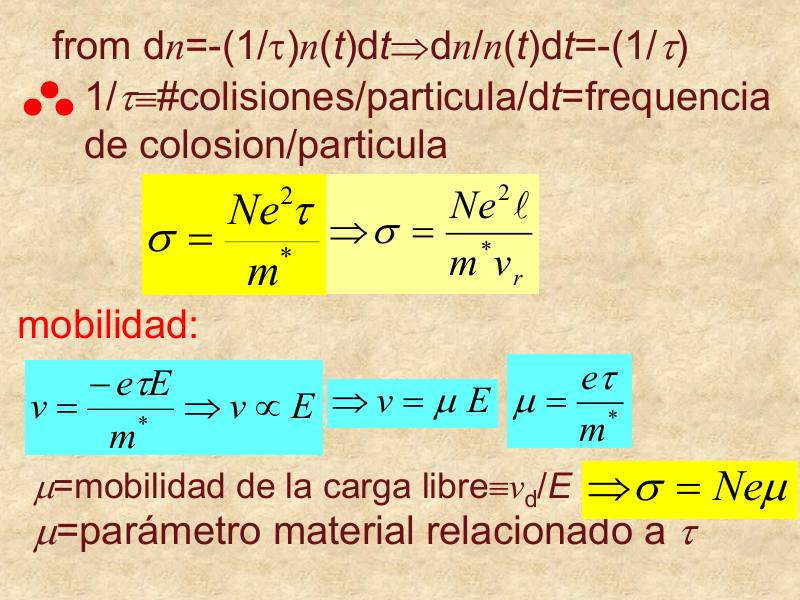 
<b>Diap. 35</b> (Metales 2021) 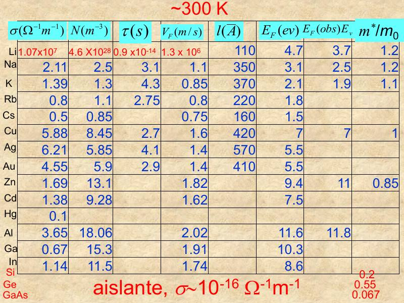 
<b>Diap. 36</b> (Metales 2021) 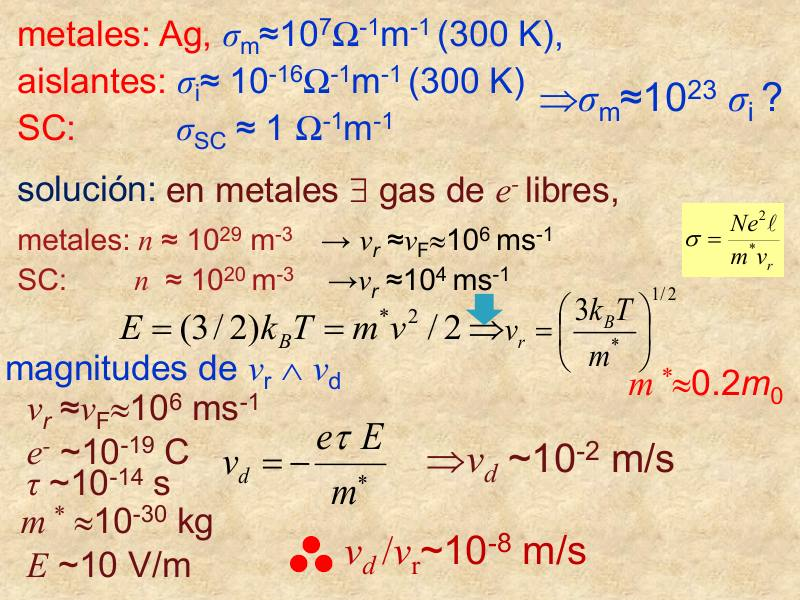 
<b>Diap. 66</b> (Metales 2021) 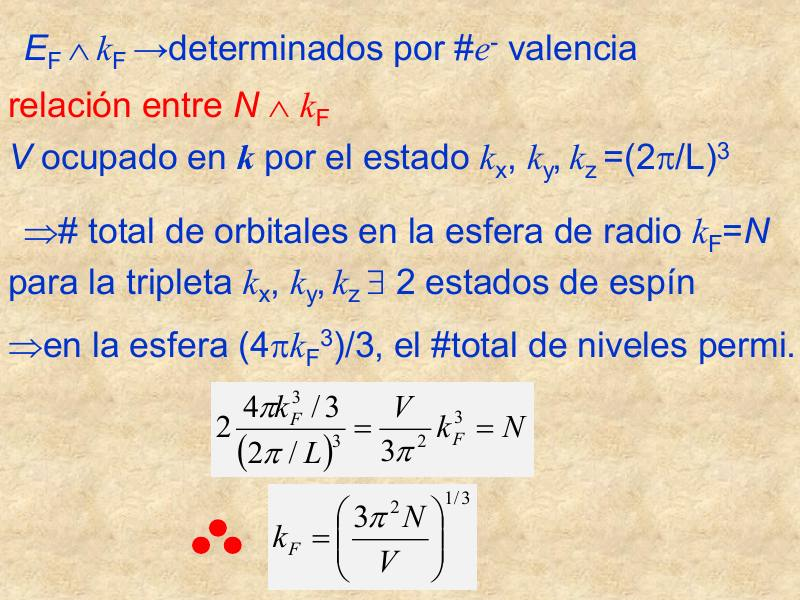 
<b>Pavlov, p. 218</b> (página del libro) 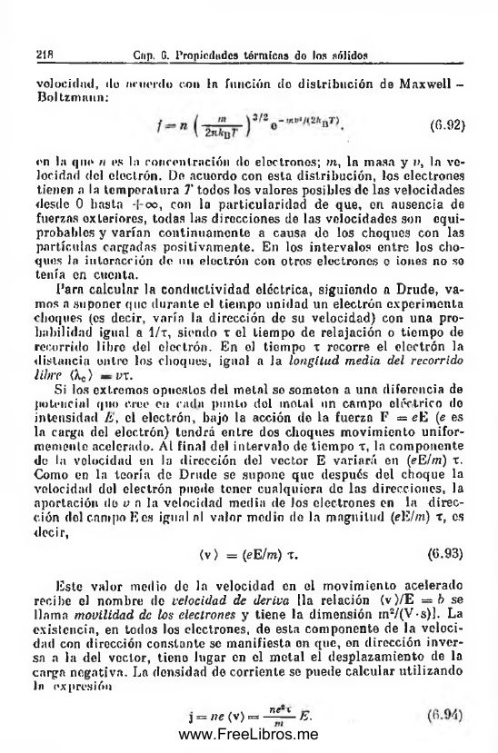 
<b>Pavlov, p. 219</b> (página del libro) 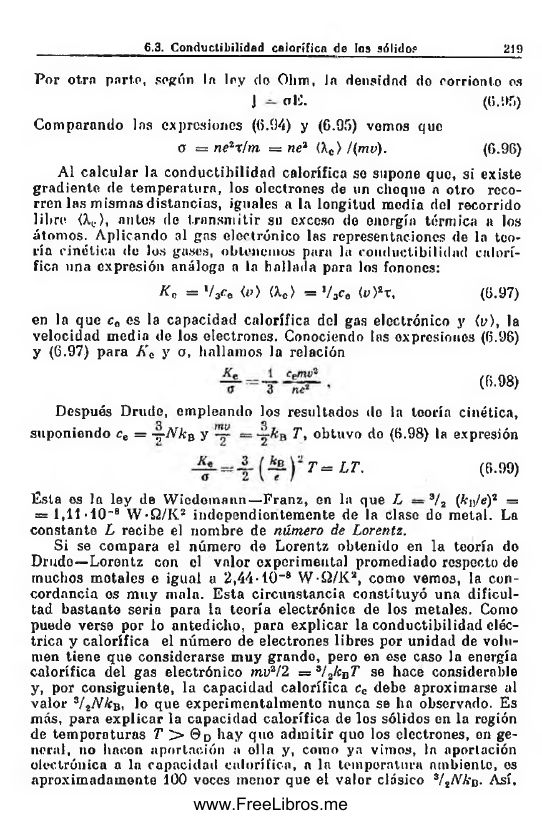 

<b>▶ Solución paso a paso — #2 Sol colapsado (numérico)</b>

**Solución.**

1. $N=2\times10^{30}/1.6726\times10^{-27}=1.196\times10^{57}$.
2. $V=\tfrac43\pi R^3=1.437\times10^{27}$ m³ ⇒ $n=8.32\times10^{29}$ m⁻³.
3. $k_F=(3\pi^2n)^{1/3}=2.91\times10^{10}$ m⁻¹ ⇒ $E_F=\dfrac{\hbar^2k_F^2}{2m}=5.17\times10^{-18}$ J $=32.3$ eV.
4. $T_F=E_F/k_B=3.74\times10^5$ K.
5. $v_F=\hbar k_F/m=3.37\times10^6$ m/s ⇒ $\langle v\rangle=\tfrac34v_F=2.53\times10^6$ m/s (dato que da el enunciado: promedio sobre la esfera de Fermi).
6. Chequeo de régimen: $E_F=32$ eV $\ll mc^2=0.511$ MeV ⇒ no relativista ✔.
7. Si fuese $N=M/2m_p$ (neutrones): $n\to n/2$ ⇒ $E_F\to2^{-2/3}E_F=20.3$ eV.

**Resultado.** $E_F=32.3$ eV, $T_F=3.7\times10^5$ K, $\langle v\rangle=2.5\times10^6$ m/s.

📷 Diapositivas y páginas de Pavlov citadas (2 diap., 1 Pavlov)

<b>Diap. 66</b> (Metales 2021)  
<b>Diap. 67</b> (Metales 2021) 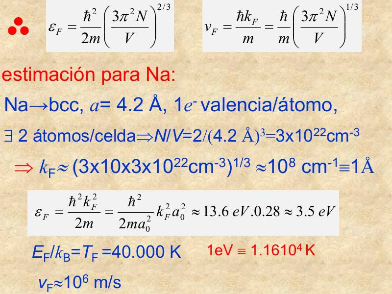 
<b>Pavlov, p. 204</b> (página del libro)  

<b>▶ Solución paso a paso — #3 Fracción de e⁻ excitados en Cu y Na (numérico)</b>

**Solución.** Fracción térmicamente activa $\sim T/T_F$ (diap. 57):

1. Cu ($E_F=7.05$ eV del enunciado; con las constantes de aquí 7.02 eV): $T_F=7.05\times1.602\times10^{-19}/1.381\times10^{-23}=8.18\times10^4$ K ⇒ $T/T_F=300/8.18\times10^4=0.0037$.
2. Na ($E_F=3.2$ eV): $T_F=3.71\times10^4$ K ⇒ $T/T_F=0.0081$.
3. Interpretación: solo 0.4 % (Cu) y 0.8 % (Na) de los e⁻ pueden absorber $\sim k_BT$; el resto está bloqueado por Pauli.

**Resultado.** Cu: 0.0037, Na: 0.008 (≈ 0.4 % y 0.8 %).

📷 Diapositivas y páginas de Pavlov citadas (2 diap., 1 Pavlov)

<b>Diap. 57</b> (Metales 2021) 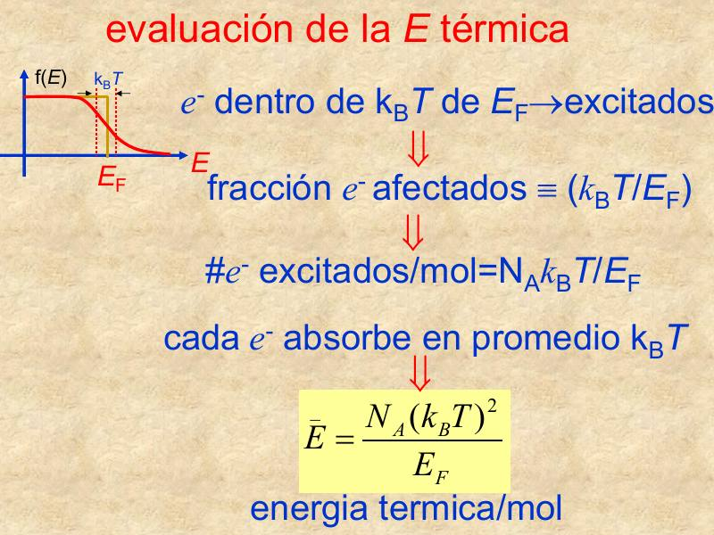 
<b>Diap. 58</b> (Metales 2021) 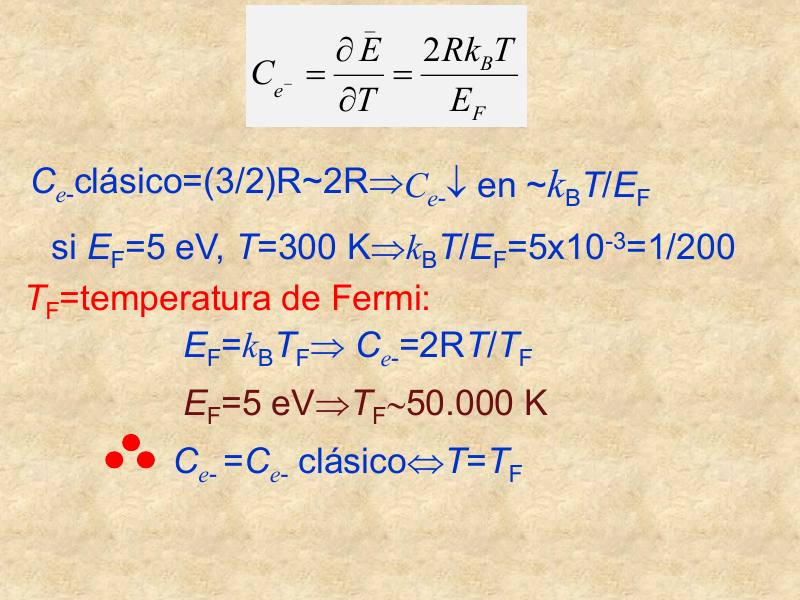 
<b>Pavlov, p. 205</b> (página del libro) 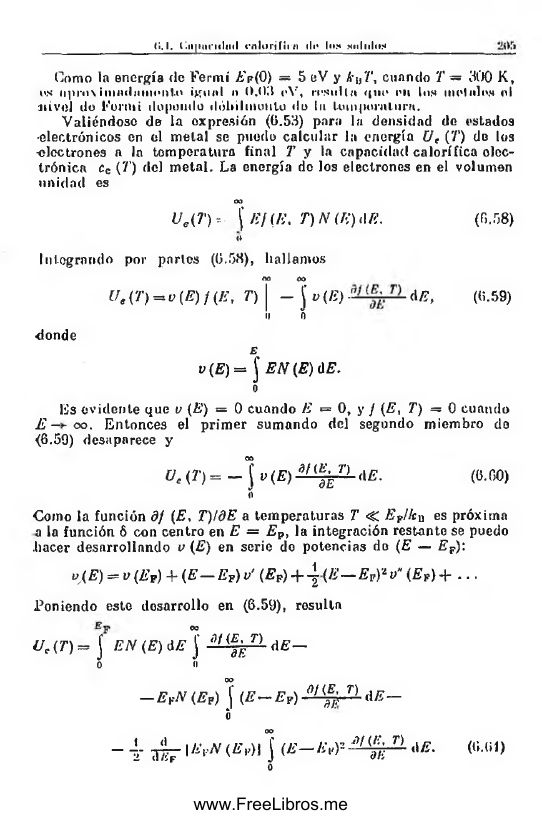 

<b>▶ Solución paso a paso — #4(a) Gas de Fermi vs. aire (conceptual)</b>

Ver la tabla de `examenes_resueltos/P-2025-01.md` (#4c): misma pregunta. Puntos clave: FD vs. MB; $E(T{=}0)=\tfrac35E_F\neq0$ vs. 0; densidad $10^{29}$ vs. $10^{25}$ m⁻³; plasma vs. gas neutro; analogía: ambos casi libres. (Diap. 19-23.)

📷 Diapositivas y páginas de Pavlov citadas (5 diap., 2 Pavlov)

<b>Diap. 19</b> (Metales 2021) 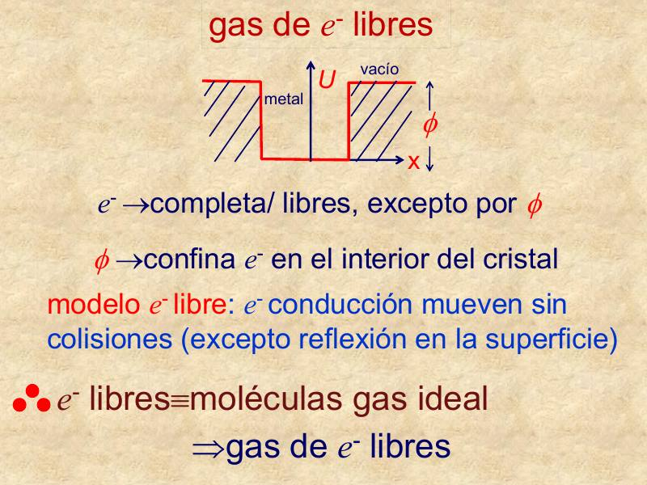 
<b>Diap. 20</b> (Metales 2021) 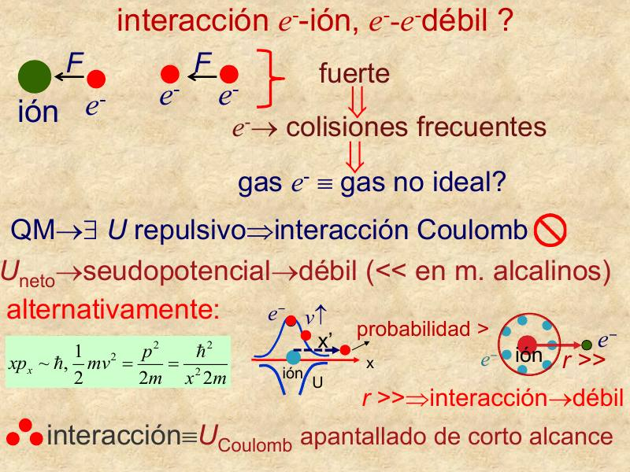 
<b>Diap. 21</b> (Metales 2021) 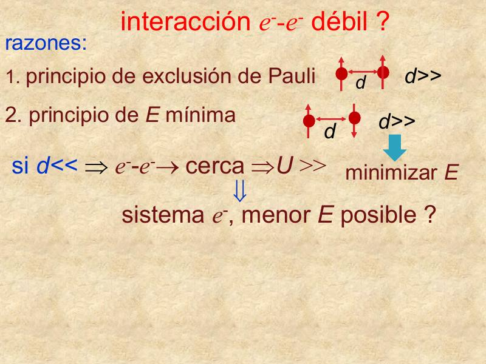 
<b>Diap. 22</b> (Metales 2021) 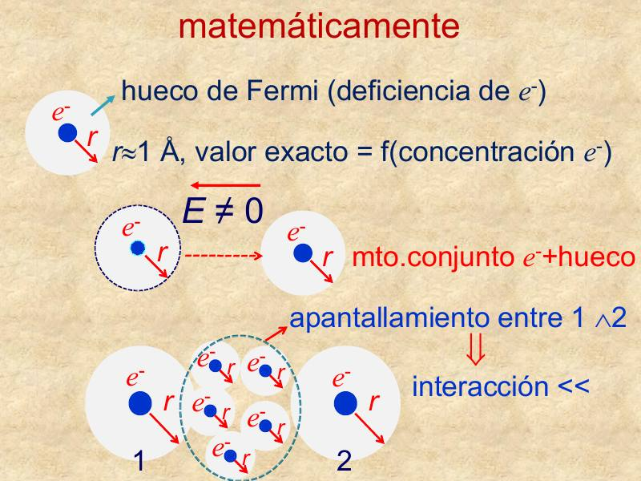 
<b>Diap. 23</b> (Metales 2021) 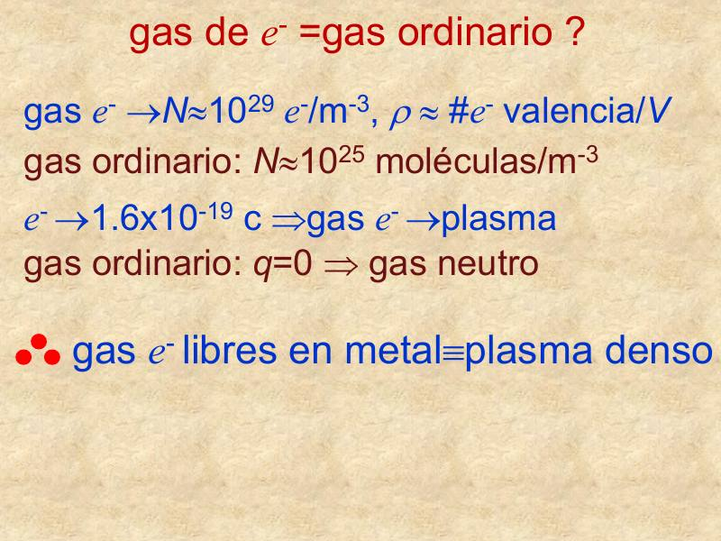 
<b>Pavlov, p. 235</b> (página del libro) 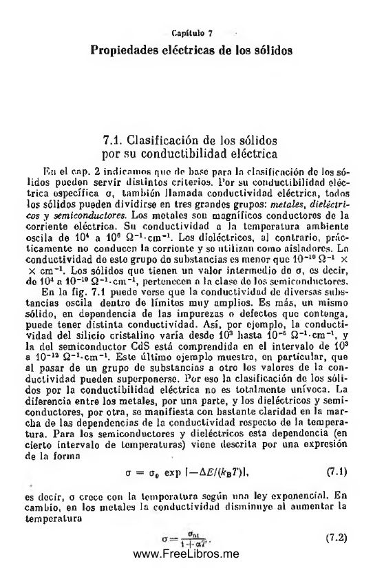 
<b>Pavlov, p. 236</b> (página del libro) 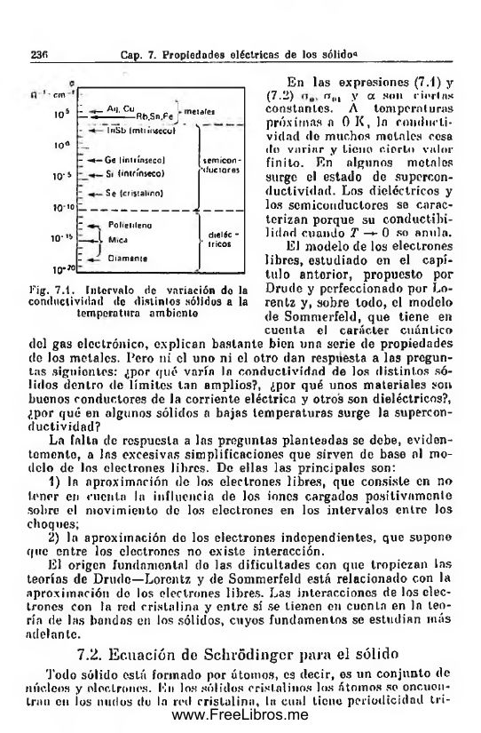 

---

## Checklist de este examen

- [ ] V.P252S.1 #1 — Camino libre medio del Cu con $v_F$
- [ ] V.P252S.2 #2 — Sol colapsado: $E_F$, $T_F$, $\langle v\rangle$
- [ ] V.P252S.3 #3 — Fracción excitada $T/T_F$ en Cu y Na
- [ ] V.P252S.4a #4(a) — Gas de Fermi vs. aire
