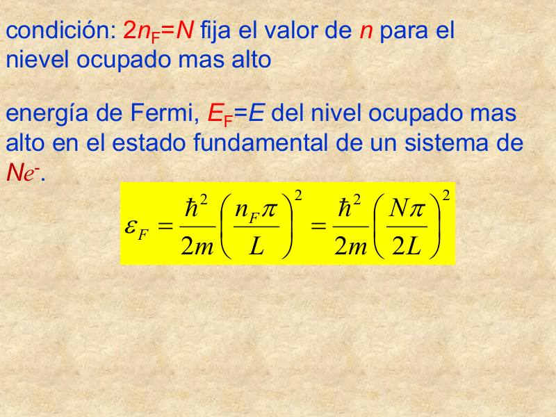
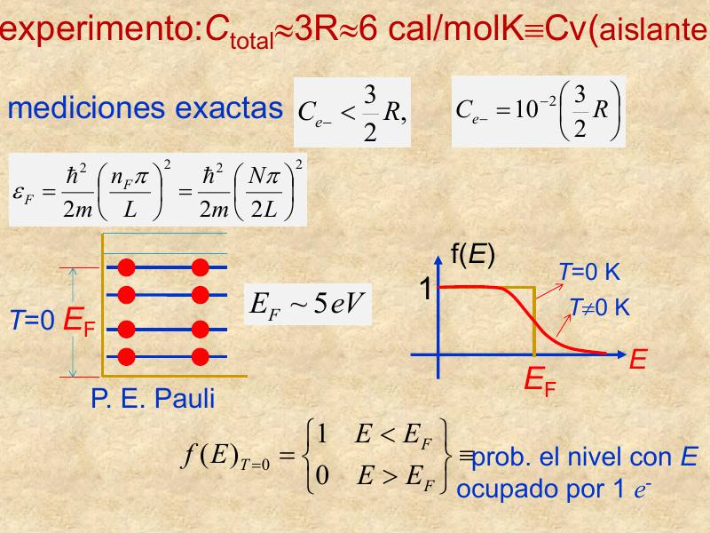
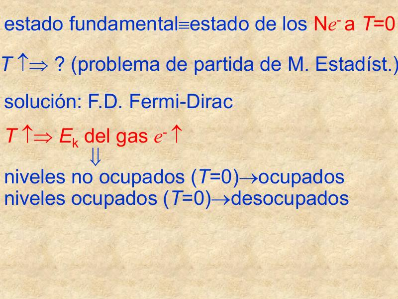
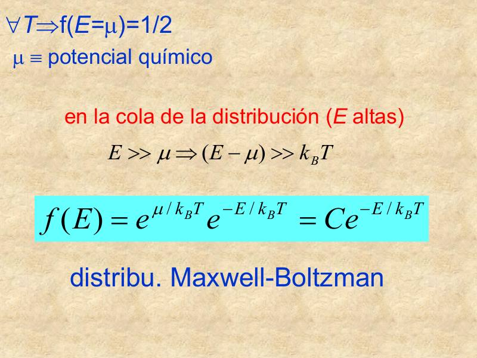
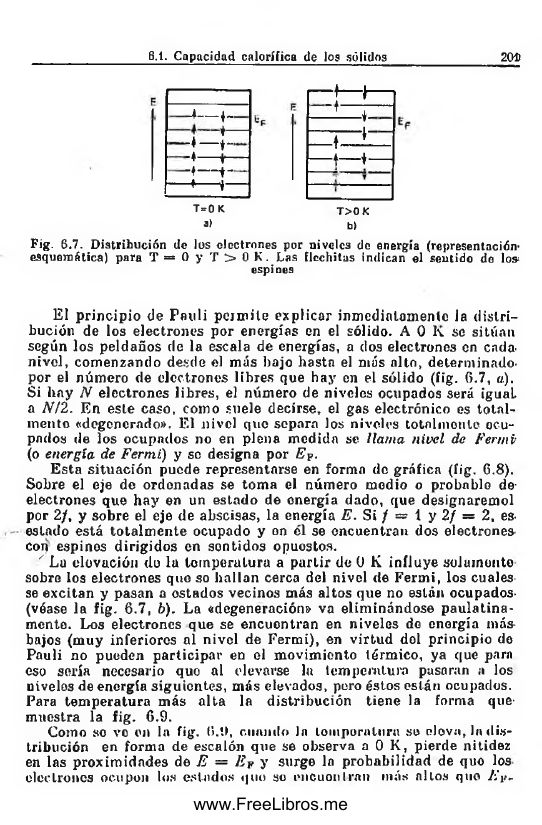

# P-2026-1S — Parcial II (2026-1S, 20 selección múltiple), resuelto paso a paso

> **En alcance: solo #11 (metales).** Las otras 19 preguntas son de vibraciones de red (`vib.1-vib.5`, bloque de `Parcial_1/`) y están **fuera del alcance** de este parcial (diap. 1-70): no se resuelven aquí; su clave y justificación están en `examenes/guia_teoria_por_examen.md`. Las 4 fotos originales ya no están en el repo; el enunciado se conserva transcrito en esa guía. La clave de #11 se dedujo por física (la hoja solo traía la respuesta marcada del estudiante).
>
> **Formato:** primero los enunciados; después cada solución va plegada: abre «Solución paso a paso». Cada solución cita la diapositiva (`Metales 2021.pdf`) y, cuando aplica, Pavlov (mapa en `notas/08_mapa_pavlov.md`).

---

# Parte 1 · Ejercicios

**#11.** Para un metal a $T=0$ K, ¿cómo se define la energía de Fermi $E_F$ en términos de la ocupación de los estados electrónicos?  
a. energía promedio de todos los e⁻ de conducción;  
b. energía del estado cuántico ocupado más alto en el estado fundamental del gas de e⁻;  
c. energía del estado cuántico ocupado más bajo en el estado fundamental;  
d. nivel de energía donde la probabilidad de encontrar un e⁻ es exactamente 0.5;  
e. energía mínima requerida para remover el e⁻ completamente del metal.

---

# Parte 2 · Soluciones paso a paso

<b>▶ Solución paso a paso — #11 Definición de $E_F$ a $T=0$ (conceptual)</b>

**Solución (descartando).**

1. **a ✘:** la energía promedio a $T=0$ es $\tfrac35E_F$ (dato de clase), no $E_F$.
2. **c ✘:** el estado ocupado más bajo es $k=0$, $\varepsilon=0$ (energía cinética nula), no $E_F$.
3. **d ✘:** $f(\mu)=\tfrac12$ define el potencial químico $\mu(T)$ para $T>0$ (diap. 61). A $T=0$, $f$ es un escalón (1 → 0 en $E_F$) y $\mu(0)=E_F$, pero la *definición* de $E_F$ es el borde de la ocupación, no "probabilidad 0.5".
4. **e ✘:** es la función trabajo $\phi=E_{vac}-E_F$ (medida **desde** $E_F$ hasta el vacío).
5. **b ✔:** a $T=0$, $f(E)=1$ para $E<E_F$ y $0$ para $E>E_F$ (diap. 53, 56) ⇒ $E_F$ es la energía del nivel ocupado más alto (diap. 18; Pavlov p. 201: "el nivel que separa los ocupados de los no ocupados se llama nivel de Fermi").

**Resultado.** Respuesta **b**. Para el Cu: $E_F=7.02$ eV, $\langle E\rangle=4.2$ eV, $\phi\approx4.7$ eV (dato externo): tres números distintos (`practica/P05`).

📷 Diapositivas y páginas de Pavlov citadas (4 diap., 1 Pavlov)

<b>Diap. 18</b> (Metales 2021)  
<b>Diap. 53</b> (Metales 2021)  
<b>Diap. 56</b> (Metales 2021)  
<b>Diap. 61</b> (Metales 2021)  
<b>Pavlov, p. 201</b> (página del libro)  

---

## Checklist de este examen

- [ ] V.P261S.11 #11 — Definición de $E_F$ a $T=0$
