# T-2026-II — Taller II (S 02 2026), resuelto paso a paso

> Fuente: `Talleres_Parciales/Taller electron libre(S 2 2026).doc` (12 problemas, O. Morán). Aquí van **primero los 12 enunciados** y después, **plegadas**, las soluciones paso a paso: abre cada una con el botón «Solución paso a paso». En cada solución se citan la **diapositiva** (`Metales 2021.pdf`) y la **página del libro de Pavlov** (página impresa; mapa en `notas/08_mapa_pavlov.md`). Lo que **no está en las diapositivas 1-70** se marca con **⚠ fuera de las diap. 1-70** y se resuelve igual.
>
> Constantes: $\hbar=1.0546\times10^{-34}$ J·s, $m=9.109\times10^{-31}$ kg, $k_B=1.381\times10^{-23}$ J/K, $e=1.602\times10^{-19}$ C, $m_p=1.6726\times10^{-27}$ kg, $c=2.998\times10^8$ m/s, $R=8.314$ J/mol·K, $N_A=6.022\times10^{23}$, $a_0=0.5292$ Å, 1 u $=1.6605\times10^{-27}$ kg. Cifras verificadas con Python.

---

# Parte 1 · Los 12 ejercicios

**1.** Estimar la relación de la velocidad de deriva a la velocidad de Fermi para un alambre de Cu de 2 mm² que transporta una corriente de 20 A.

**2.** He³ líquido. El átomo de He³ tiene un espín de 1/2 y es un fermión. La densidad del He³ es 0.081 g/cm³ cerca de $T=0$. Calcular la energía de Fermi y la temperatura de Fermi cerca de $T=0$.

**3.** Calcular la temperatura de Fermi para Cu, Na y Ag. También calcular la relación $T/T_F$ en cada caso para $T=300$ K. La masa efectiva del Cu y del Na es 1 y 1.2 veces $m_0$, respectivamente.

**4.** Estimar la fracción de electrones excitados por encima del nivel de Fermi a temperatura ambiente para Cu y Na.

**5.** Considerar un gas de electrones bidimensional (2D) con una densidad de $1.5\times10^{11}$ cm⁻². Expresar esta densidad en unidades atómicas. ¿Cuál es la energía de Fermi para este gas de electrones 2D?

**6.** Para un sistema de electrones no interactuantes, mostrar que la probabilidad $f(\varepsilon)$ de encontrar un electrón en un estado con energía $\Delta$ por encima del potencial químico $\mu$ es igual a la probabilidad de tener un electrón ausente en un estado con energía $\Delta$ por debajo de $\mu$, a una temperatura dada $T$.

**7.** A temperaturas bajas, el calor específico electrónico de un metal es aproximadamente $C_e=AT$, donde $A$ puede determinarse experimentalmente. Para el oro, la constante $A$ es 0.73 (unidades del enunciado: «J kg/mol K», ilegible en el original; ver la nota en la solución). Comparar este valor con el que se obtendría de la teoría (peso molecular del oro 197; densidad $18.9\times10^3$ kg/m³).

**8.** Calcular la contribución electrónica al calor específico del aluminio a temperatura ambiente y compararla con el valor $3R$.

**9.** El sodio tiene aproximadamente $2.6\times10^{26}$ electrones de conducción por metro cúbico (el enunciado dice $\times10^{26}$ por m³; el valor del Na es $2.6\times10^{28}$ m⁻³, ver la solución). Estos electrones se comportan como un gas libre. Estimar el calor específico electrónico del sodio a temperatura ambiente (peso atómico del sodio 23).

**10.** Considerar el colapso del Sol en una enana blanca. La masa del Sol es $2\times10^{30}$ kg, el radio $7\times10^8$ m y su volumen $1.4\times10^{27}$ m³. a) Calcular la energía de Fermi de los electrones. b) Calcular la temperatura de Fermi. c) Estimar la velocidad promedio de los electrones en el gas de fermiones y comparar el resultado con la velocidad de la luz.

**11.** Considerar que la velocidad de los electrones se debe al movimiento térmico de un gas de electrones clásico. Mostrar que en este caso la resistividad eléctrica aumentaría con la temperatura según $T^{3/2}$.

**12.** Suponer que el sodio tiene un coeficiente de expansión térmica lineal $\alpha=1.5\times10^{-6}$ K⁻¹ para temperaturas entre 0 y 300 K. Calcular el cambio porcentual de la energía de Fermi en ese rango. Recordar que $\alpha=(1/\ell)(d\ell/dT)$, donde $\ell$ es la longitud de la muestra.

---

# Parte 2 · Soluciones paso a paso

<b>▶ Solución paso a paso — #1 Deriva frente a velocidad de Fermi (Cu, 20 A)</b>

**Dónde está la teoría.** Densidad de corriente $J=-Nev_d$: diap. 30 (`drude.1`); $v_d\sim10^{-2}$ m/s frente a $v_r\sim10^6$ m/s: diap. 36-37; $v_F=\hbar k_F/m$ y $k_F=(3\pi^2N/V)^{1/3}$: diap. 66-67. Pavlov: $j=ne^2\tau E/m$ (6.94) y $\langle v\rangle=(eE/m)\tau$ (6.93), §6.3, pp. 218-219; $E_F$ y $k_F$: (6.56), §6.1, p. 204.

1. $J=I/A=ne\,v_d\ \Rightarrow\ v_d=\dfrac{I}{neA}$.
2. Cu: 1 e⁻/átomo, $n=8.45\times10^{28}$ m⁻³ (fcc con $a=3.61$ Å: $n=4/a^3=8.5\times10^{28}$ m⁻³; diap. 10 y 67).
3. $A=2\ \text{mm}^2=2\times10^{-6}$ m²:
   $v_d=\dfrac{20}{(8.45\times10^{28})(1.602\times10^{-19})(2\times10^{-6})}=7.39\times10^{-4}$ m/s $=0.74$ mm/s.
4. $k_F=(3\pi^2n)^{1/3}=1.358\times10^{10}$ m⁻¹ y $v_F=\hbar k_F/m=1.57\times10^6$ m/s.
5. $\dfrac{v_d}{v_F}=\dfrac{7.39\times10^{-4}}{1.57\times10^6}=4.7\times10^{-10}$.

**Resultado.** $v_d\approx0.74$ mm/s y $v_d/v_F\approx5\times10^{-10}$: la corriente es una deriva diminuta superpuesta al movimiento de ~$10^6$ m/s de los electrones.

📷 Diapositivas y páginas de Pavlov citadas (5 diap., 3 Pavlov)

<b>Diap. 30</b> (Metales 2021) 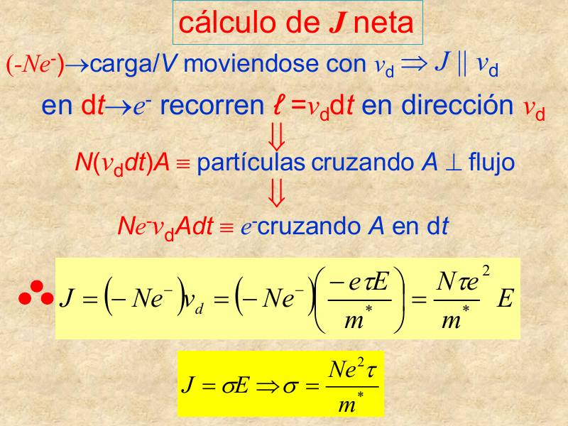 
<b>Diap. 36</b> (Metales 2021) 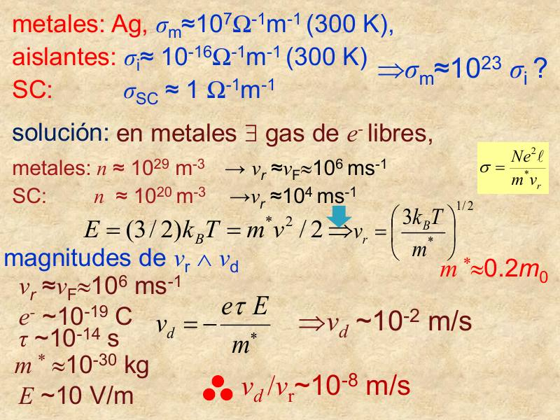 
<b>Diap. 37</b> (Metales 2021) 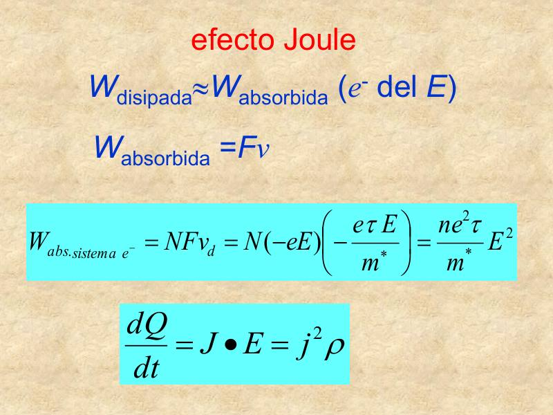 
<b>Diap. 66</b> (Metales 2021) 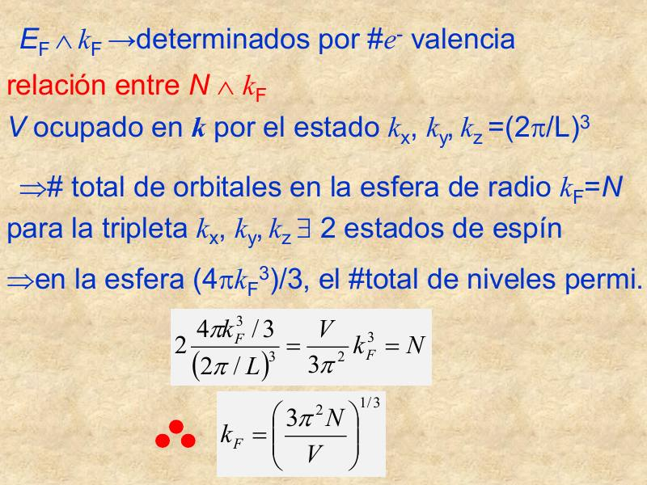 
<b>Diap. 67</b> (Metales 2021) 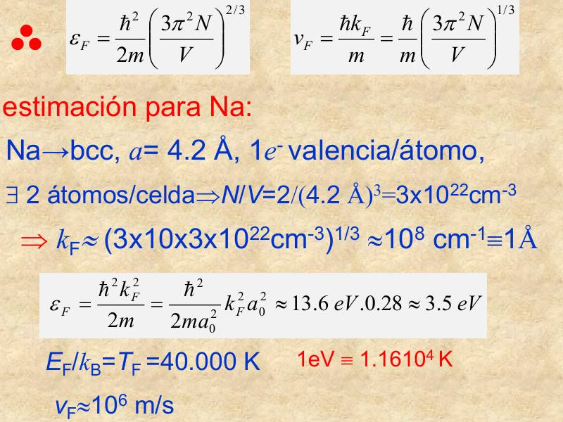 
<b>Pavlov, p. 218</b> (página del libro) 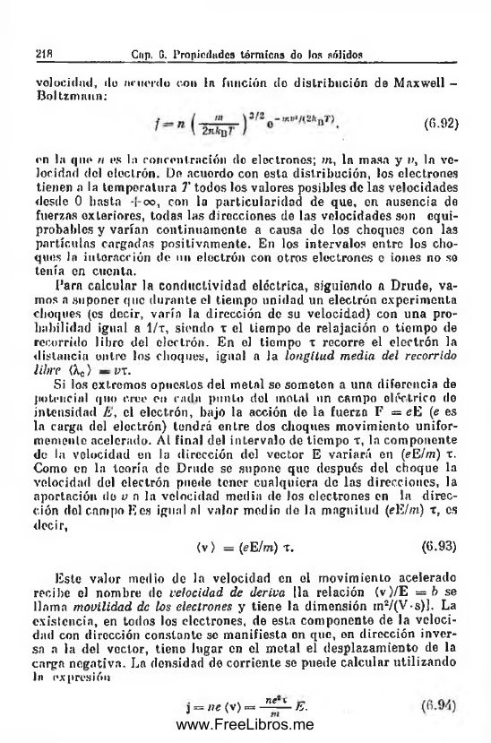 
<b>Pavlov, p. 219</b> (página del libro) 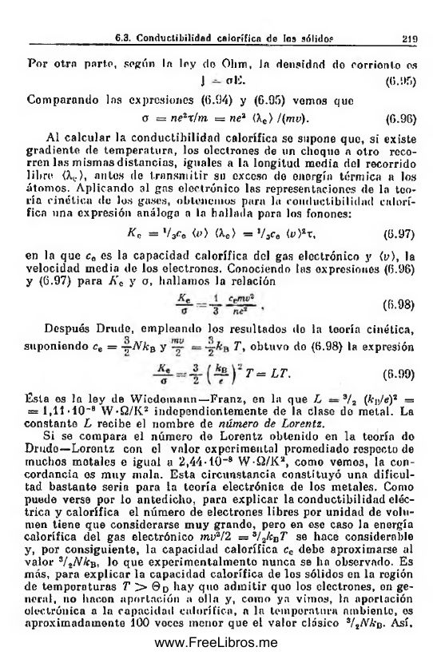 
<b>Pavlov, p. 204</b> (página del libro) 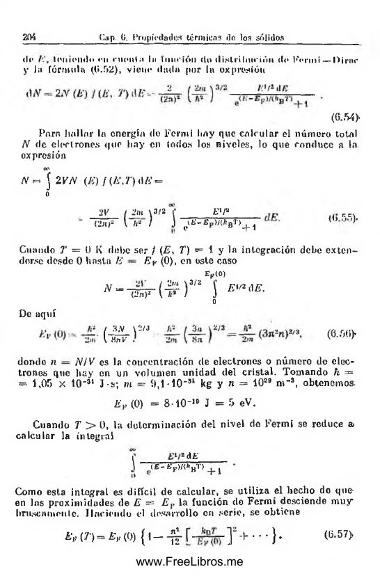 

<b>▶ Solución paso a paso — #2 He³ líquido: E_F y T_F</b>

**Dónde está la teoría.** $n$, $k_F$ y $E_F$ de un gas de fermiones de espín ½: diap. 66-67 (`fermi3d.1`); $T_F=E_F/k_B$: diap. 58-59. Pavlov: (6.55)-(6.56), §6.1, pp. 203-204. La partícula es el **átomo** (masa $M$), no el electrón: se cambia $m\to M$.

1. $M=3.016$ u $=5.008\times10^{-27}$ kg.
2. $n=\rho/M=\dfrac{81\ \text{kg/m}^3}{5.008\times10^{-27}\ \text{kg}}=1.617\times10^{28}$ m⁻³ (0.081 g/cm³ = 81 kg/m³).
3. $k_F=(3\pi^2n)^{1/3}=7.82\times10^{9}$ m⁻¹.
4. $E_F=\dfrac{\hbar^2k_F^2}{2M}=6.80\times10^{-23}$ J $=4.24\times10^{-4}$ eV.
5. $T_F=E_F/k_B=4.9$ K. (Además $v_F=\hbar k_F/M=165$ m/s.)

**Resultado.** $E_F\approx4.2\times10^{-4}$ eV y $T_F\approx4.9$ K: el He³ líquido solo está degenerado por debajo de unos pocos kelvin (masa ~$10^4$ veces la del electrón ⇒ $E_F$ ~$10^4$ veces menor que en un metal).

📷 Diapositivas y páginas de Pavlov citadas (4 diap., 2 Pavlov)

<b>Diap. 66</b> (Metales 2021)  
<b>Diap. 67</b> (Metales 2021)  
<b>Diap. 58</b> (Metales 2021) 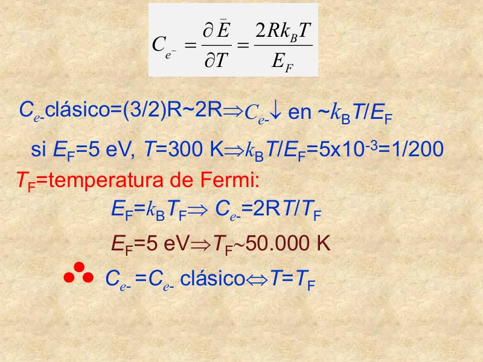 
<b>Diap. 59</b> (Metales 2021) 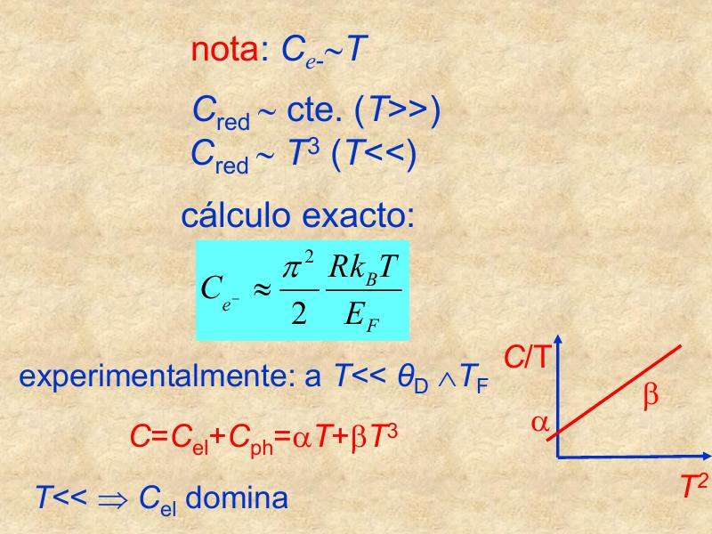 
<b>Pavlov, p. 203</b> (página del libro) 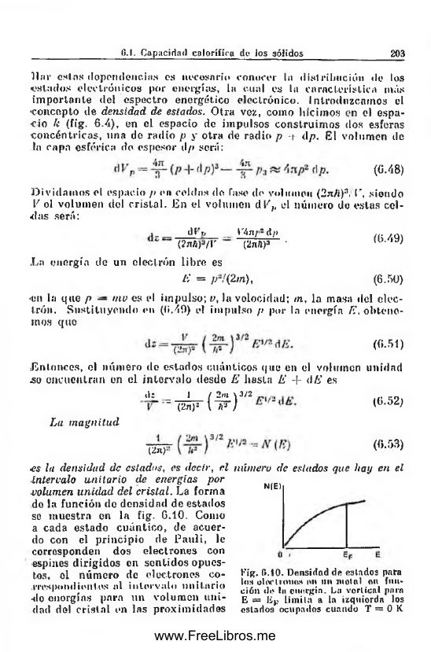 
<b>Pavlov, p. 204</b> (página del libro)  

<b>▶ Solución paso a paso — #3 T_F de Cu, Na y Ag, y T/T_F a 300 K</b>

**Dónde está la teoría.** $n=N/V$ desde la estructura y el parámetro de red: diap. 9-10 y 67 (Na bcc, $a=4.2$ Å, 2 átomos/celda); $E_F=\frac{\hbar^2}{2m^*}(3\pi^2n)^{2/3}$ y $T_F=E_F/k_B$: diap. 66-67 y 58-59 (con $m\to m^*$, diap. 27). Pavlov: (6.56), §6.1, p. 204, y $T_F\approx5\times10^4$ K, p. 205.

Cada uno tiene 1 e⁻ de valencia por átomo. Parámetros de red (dato estándar, no vienen en el enunciado): Cu fcc $a=3.61$ Å, Na bcc $a=4.23$ Å, Ag fcc $a=4.09$ Å. Para la Ag no se da masa efectiva: se toma $m^*=m_0$.

1. $n_{Cu}=4/a^3=8.50\times10^{28}$ m⁻³; $n_{Na}=2/a^3=2.64\times10^{28}$ m⁻³; $n_{Ag}=4/a^3=5.85\times10^{28}$ m⁻³.
2. $E_F=\dfrac{\hbar^2}{2m^*}(3\pi^2n)^{2/3}$:

| Metal | $m^*/m_0$ | $E_F$ (eV) | $T_F=E_F/k_B$ (K) | $T/T_F$ (300 K) |
|---|---|---|---|---|
| Cu | 1.0 | 7.05 | $8.2\times10^{4}$ | $3.7\times10^{-3}$ |
| Na | 1.2 | 2.70 | $3.1\times10^{4}$ | $9.6\times10^{-3}$ |
| Ag | 1.0 (supuesta) | 5.49 | $6.4\times10^{4}$ | $4.7\times10^{-3}$ |

3. Sin masa efectiva el Na daría $E_F=3.24$ eV, $T_F=3.75\times10^4$ K y $T/T_F=8.0\times10^{-3}$.

**Resultado.** $T_F\sim3\text{-}8\times10^4$ K ≫ 300 K en los tres metales: $T/T_F\sim10^{-2}$ o menos ⇒ gas fuertemente degenerado a temperatura ambiente.

📷 Diapositivas y páginas de Pavlov citadas (4 diap., 2 Pavlov)

<b>Diap. 10</b> (Metales 2021) 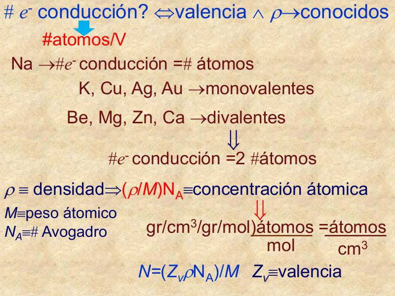 
<b>Diap. 67</b> (Metales 2021)  
<b>Diap. 58</b> (Metales 2021)  
<b>Diap. 59</b> (Metales 2021)  
<b>Pavlov, p. 204</b> (página del libro)  
<b>Pavlov, p. 205</b> (página del libro) 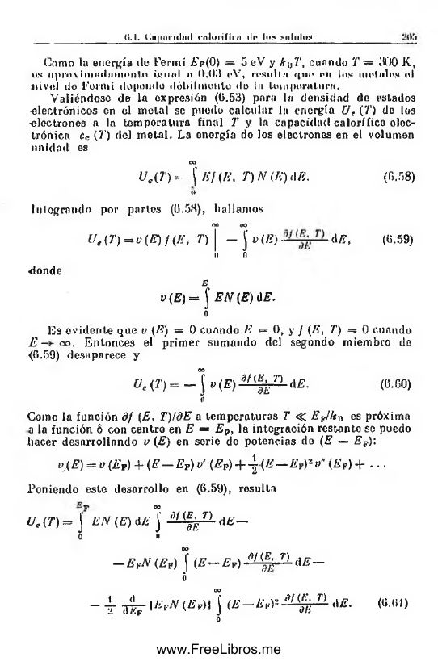 

<b>▶ Solución paso a paso — #4 Fracción de electrones excitados (Cu y Na, 300 K)</b>

**Dónde está la teoría.** Solo los e⁻ a ~$k_BT$ de $E_F$ pueden absorber energía: fracción $\sim k_BT/E_F=T/T_F$: diap. 57-58 (`cal.2`). Distribución $f(E)$ de Fermi-Dirac: diap. 55-56. Pavlov: $f(E)$, §6.1, p. 202 (6.46); solo los e⁻ de una franja $\sim k_BT$ cuentan, pp. 202-205.

1. Fracción excitada $\approx\dfrac{k_BT}{E_F}=\dfrac T{T_F}$ (cada e⁻ de la franja $k_BT$ bajo $E_F$ sube ~$k_BT$).
2. Con los $T_F$ del ejercicio 3: Cu: $300/8.18\times10^4=3.7\times10^{-3}$. Na ($m^*=1.2m_0$): $300/3.13\times10^4=9.6\times10^{-3}$.
3. (Con $m^*=m_0$ para el Na: $8.0\times10^{-3}$.) Si se cuenta con la densidad de estados, $D(E_F)k_BT/N=\tfrac32T/T_F$: ≈ 0.55 % y 1.4 %; es el mismo orden.

**Resultado.** Solo ~0.4 % de los e⁻ del Cu y ~1 % de los del Na están excitados sobre $E_F$ a 300 K; el resto está «congelado» por Pauli. Esa es la razón de que $C_e$ sea ~$10^{-2}$ del valor clásico (diap. 58-59).

📷 Diapositivas y páginas de Pavlov citadas (4 diap., 2 Pavlov)

<b>Diap. 55</b> (Metales 2021) 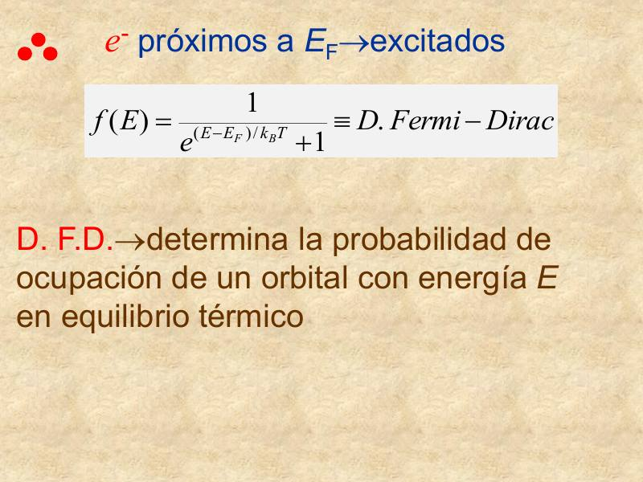 
<b>Diap. 56</b> (Metales 2021) 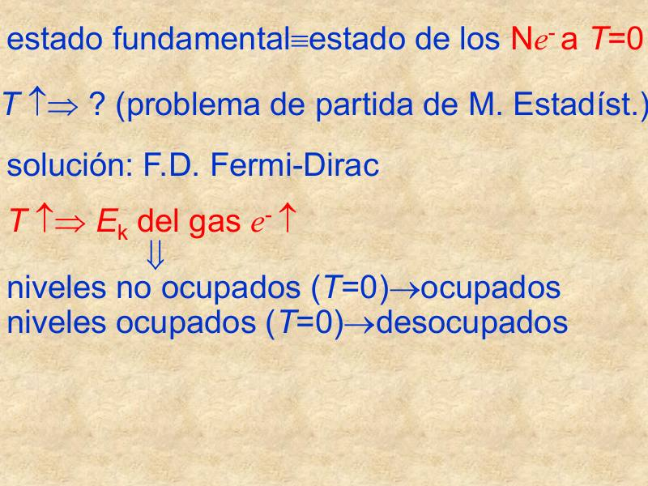 
<b>Diap. 57</b> (Metales 2021) 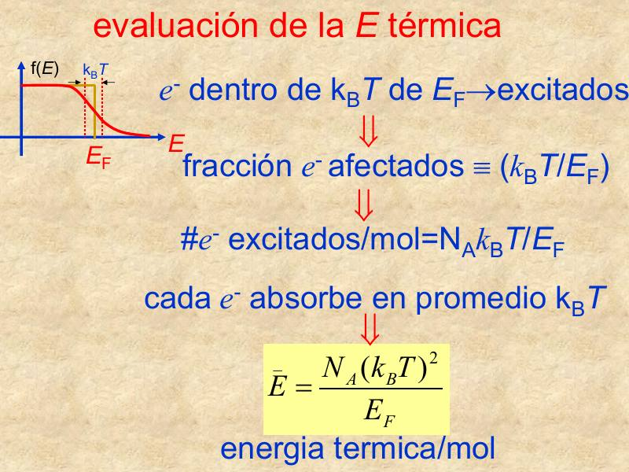 
<b>Diap. 58</b> (Metales 2021)  
<b>Pavlov, p. 202</b> (página del libro) 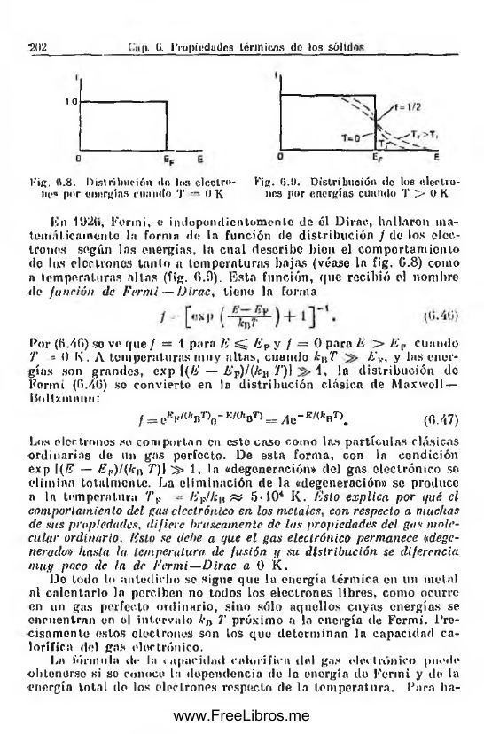 
<b>Pavlov, p. 205</b> (página del libro)  

<b>▶ Solución paso a paso — #5 Gas de electrones 2D: unidades atómicas y E_F</b>

**Dónde está la teoría.** ⚠ **Fuera de las diap. 1-70**: las diapositivas hacen el gas 1D (pp. 13-18, `gas1d.1`) y el 3D (pp. 62-67). Aquí se repite el método del 3D (contar estados en el espacio $\mathbf k$ con 2 espines, diap. 66) en 2 dimensiones. Pavlov: conteo de celdas del espacio de impulsos, (6.48)-(6.49), §6.1, pp. 203-204 (el libro lo hace en 3D).

**Unidades atómicas** ($\hbar=m=e=1$; longitud $a_0=0.5292$ Å, energía Hartree $=27.21$ eV).

1. $n=1.5\times10^{11}\ \text{cm}^{-2}$ y $a_0=5.292\times10^{-9}$ cm ⇒ $a_0^2=2.800\times10^{-17}$ cm².
2. $n=1.5\times10^{11}\times2.800\times10^{-17}=4.2\times10^{-6}\ a_0^{-2}$.

**Energía de Fermi 2D.**

3. Área ocupada por un estado: $(2\pi/L)^2$; con 2 espines: $N=2\cdot\dfrac{\pi k_F^2}{(2\pi/L)^2}=\dfrac{k_F^2L^2}{2\pi}$ ⇒ $n=\dfrac{k_F^2}{2\pi}$, es decir $k_F=\sqrt{2\pi n}$.
4. $E_F=\dfrac{\hbar^2k_F^2}{2m}=\dfrac{\pi\hbar^2n}{m}$.
5. En unidades atómicas: $E_F=\pi n=\pi(4.2\times10^{-6})=1.32\times10^{-5}$ Hartree $=3.6\times10^{-4}$ eV $=0.36$ meV.
6. $T_F=E_F/k_B=4.2$ K y $k_F=\sqrt{2\pi n}=5.1\times10^{-3}\,a_0^{-1}=9.7\times10^{7}$ m⁻¹.

**Resultado.** $n=4.2\times10^{-6}\,a_0^{-2}$ y $E_F=\pi n\approx1.3\times10^{-5}$ Ha $\approx0.36$ meV ($T_F\approx4$ K). Nota: en 2D $E_F$ es **lineal** en $n$ (en 3D va como $n^{2/3}$). Si se usara la masa efectiva de un pozo de GaAs ($m^*\approx0.067m_0$), $E_F$ sería ≈ 5.4 meV; el enunciado pide $m=m_0$.

📷 Diapositivas y páginas de Pavlov citadas (2 diap., 1 Pavlov)

<b>Diap. 18</b> (Metales 2021) 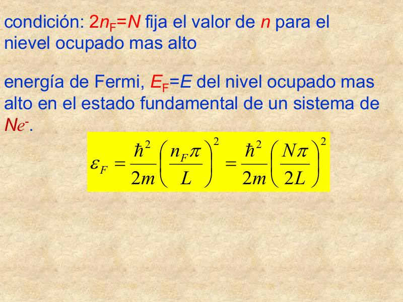 
<b>Diap. 66</b> (Metales 2021)  
<b>Pavlov, p. 203</b> (página del libro)  

<b>▶ Solución paso a paso — #6 Simetría partícula-hueco de Fermi-Dirac</b>

**Dónde está la teoría.** $f(E)=\dfrac{1}{e^{(E-\mu)/k_BT}+1}$: diap. 55-56 (`cal.2`); el potencial químico $\mu$ como generalización de $E_F$ y el factor $[1-f]$ = orbital vacío: diap. 60-61 y 109. Pavlov: $f(E)$ (6.46), §6.1, p. 202.

1. Un estado con energía $\mu+\Delta$ está ocupado con probabilidad
   $$f(\mu+\Delta)=\frac1{e^{\Delta/k_BT}+1}.$$
2. Un estado con energía $\mu-\Delta$ está **vacío** con probabilidad $1-f(\mu-\Delta)$:
   $$f(\mu-\Delta)=\frac1{e^{-\Delta/k_BT}+1}\ \Rightarrow\ 1-f(\mu-\Delta)=\frac{e^{-\Delta/k_BT}}{e^{-\Delta/k_BT}+1}.$$
3. Multiplicando numerador y denominador por $e^{\Delta/k_BT}$:
   $$1-f(\mu-\Delta)=\frac1{1+e^{\Delta/k_BT}}=f(\mu+\Delta).\qquad\blacksquare$$

**Resultado.** $f(\mu+\Delta)=1-f(\mu-\Delta)$: la curva $f(E)$ es simétrica respecto a $(\mu,\tfrac12)$ (la zona difusa de ancho $\sim k_BT$ es antisimétrica alrededor de $\mu$). La probabilidad de un e⁻ excitado a $\Delta$ sobre $\mu$ es la de un hueco a $\Delta$ bajo $\mu$ (base de la energía de e⁻ excitados y huecos, diap. 106-109).

📷 Diapositivas y páginas de Pavlov citadas (6 diap., 1 Pavlov)

<b>Diap. 55</b> (Metales 2021)  
<b>Diap. 56</b> (Metales 2021)  
<b>Diap. 60</b> (Metales 2021) 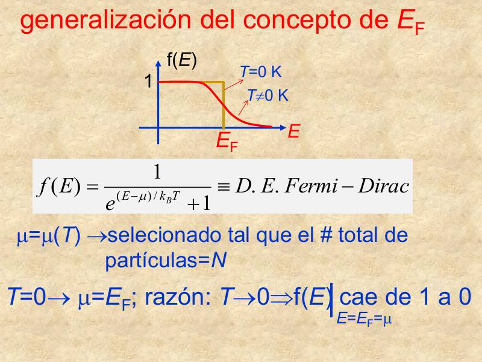 
<b>Diap. 61</b> (Metales 2021) 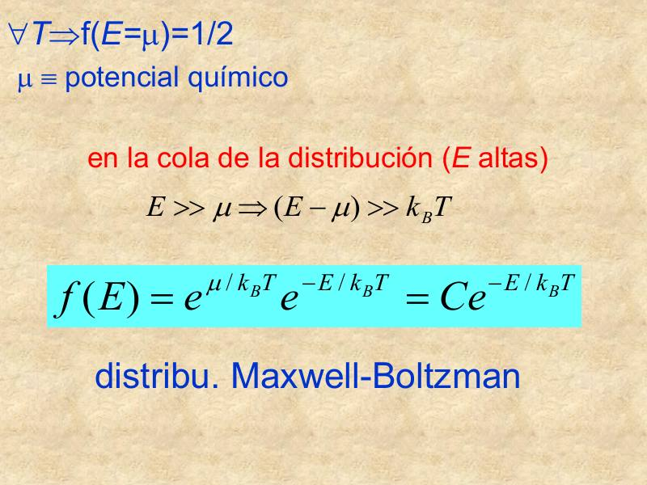 
<b>Diap. 106</b> (Metales 2021) 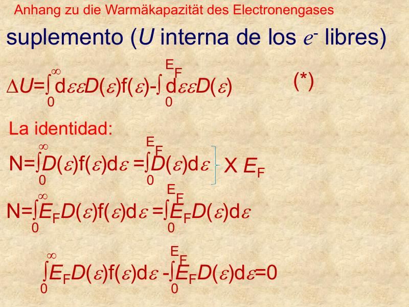 
<b>Diap. 109</b> (Metales 2021) 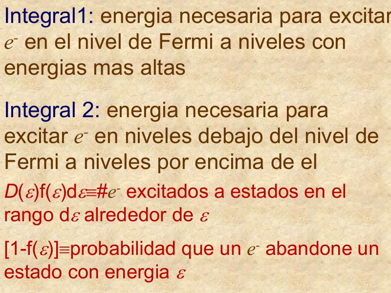 
<b>Pavlov, p. 202</b> (página del libro)  

<b>▶ Solución paso a paso — #7 Calor específico electrónico del oro: teoría vs. experimento</b>

**Dónde está la teoría.** $C_e\approx\frac{\pi^2}{2}R\,T/T_F$ (estimación $2R\,T/T_F$): diap. 57-59 (`cal.2`); $E_F$ y $n$: diap. 66-67. Pavlov: (6.64)-(6.65), §6.1, pp. 205-206, y $c_V=\gamma_eT+\gamma_DT^3$ (6.66), p. 206.

**Nota sobre la unidad.** El enunciado trae «0.73 J kg/mol K», que no tiene sentido físico. El valor medido del oro es $\gamma\approx0.73$ mJ/(mol·K²) y es el que se usa (el oro es monovalente: «por mol» de átomos = por mol de e⁻).

1. $n=\dfrac{\rho N_A}{M}=\dfrac{(18.9\times10^3)(6.022\times10^{23})}{0.197}=5.78\times10^{28}$ m⁻³ (1 e⁻ por átomo).
2. $E_F=\dfrac{\hbar^2}{2m}(3\pi^2n)^{2/3}=5.45$ eV ⇒ $T_F=E_F/k_B=6.32\times10^4$ K.
3. $C_e=\dfrac{\pi^2}{2}R\dfrac{T}{T_F}=AT$ ⇒ $A_{teo}=\dfrac{\pi^2R}{2T_F}=\dfrac{\pi^2(8.314)}{2(6.32\times10^4)}=6.49\times10^{-4}$ J/(mol·K²) $=0.65$ mJ/(mol·K²).
4. Comparación: $\dfrac{A_{exp}}{A_{teo}}=\dfrac{0.73}{0.65}=1.12$.

**Resultado.** $A_{teo}\approx0.65$ mJ/mol·K² frente a $A_{exp}=0.73$: acuerdo en ~12 %. La diferencia se atribuye a la masa efectiva térmica ($m^*/m\approx1.1$, por la interacción e⁻-red y e⁻-e⁻; diap. 19-23). Si se usara la estimación gruesa $2RT/T_F$ saldría 0.53 mJ/mol·K² (misma magnitud).

📷 Diapositivas y páginas de Pavlov citadas (4 diap., 2 Pavlov)

<b>Diap. 57</b> (Metales 2021)  
<b>Diap. 58</b> (Metales 2021)  
<b>Diap. 59</b> (Metales 2021)  
<b>Diap. 67</b> (Metales 2021)  
<b>Pavlov, p. 205</b> (página del libro)  
<b>Pavlov, p. 206</b> (página del libro) 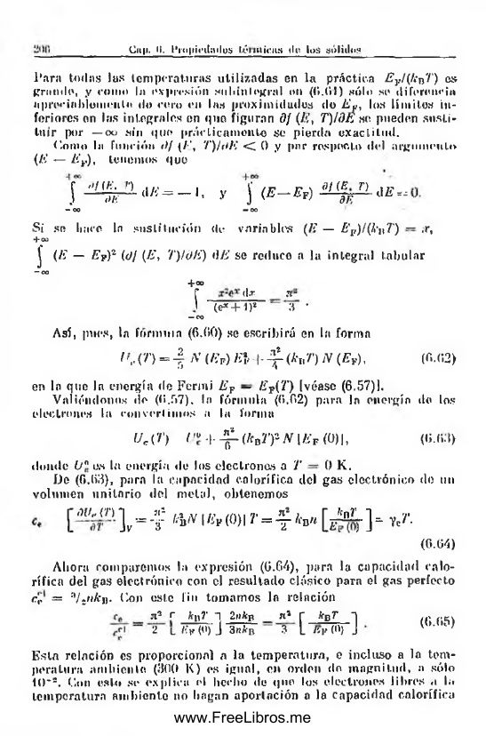 

<b>▶ Solución paso a paso — #8 C_e del aluminio a 300 K frente a 3R</b>

**Dónde está la teoría.** $n$ desde estructura y parámetro de red: diap. 10 y 67; $C_e=\frac{\pi^2}{2}R\,T/T_F$ (por mol de e⁻): diap. 58-59; $3R$ de la red (Dulong-Petit): diap. 53. Pavlov: (6.64)-(6.65), §6.1, pp. 205-206; Dulong-Petit y $\tfrac32 k_B$ clásico, p. 200.

Datos que no vienen en el enunciado: Al fcc, $a=4.05$ Å, 3 e⁻ de valencia por átomo.

1. $n=3\times\dfrac{4}{a^3}=3\times\dfrac{4}{(4.05\times10^{-10})^3}=1.81\times10^{29}$ m⁻³.
2. $E_F=\dfrac{\hbar^2}{2m}(3\pi^2n)^{2/3}=11.65$ eV ⇒ $T_F=1.35\times10^5$ K ⇒ $T/T_F=2.2\times10^{-3}$.
3. Por mol de **electrones**: $C_e=\dfrac{\pi^2}{2}R\dfrac{T}{T_F}=0.0110\,R=0.091$ J/mol·K.
4. Por mol de **átomos de Al** hay $3N_A$ electrones: $C_e=3\times0.0110\,R=0.0329\,R=0.27$ J/mol·K.
5. Comparación con $3R$ (red): $\dfrac{C_e}{3R}=\dfrac{0.0329R}{3R}=1.1\%$.

**Resultado.** $C_e\approx0.033R\approx0.27$ J/mol·K ≈ 1 % de $3R$; frente al valor clásico del gas de e⁻ ($\tfrac32\cdot3R=4.5R$) es ~0.7 %. Por eso a 300 K el $C$ de un metal es el de un aislante ($\approx3R$): el término electrónico domina solo por debajo de unos pocos K.

📷 Diapositivas y páginas de Pavlov citadas (4 diap., 3 Pavlov)

<b>Diap. 53</b> (Metales 2021) 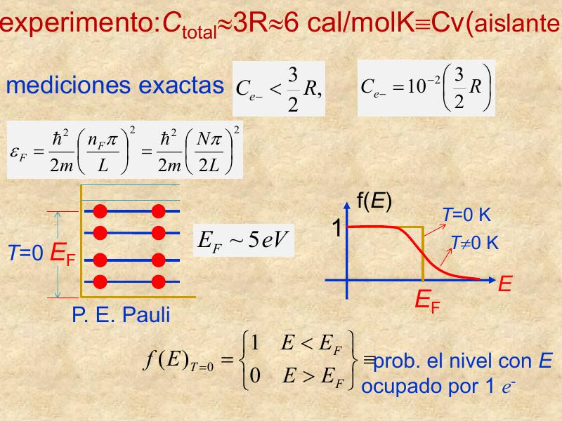 
<b>Diap. 58</b> (Metales 2021)  
<b>Diap. 59</b> (Metales 2021)  
<b>Diap. 67</b> (Metales 2021)  
<b>Pavlov, p. 200</b> (página del libro) 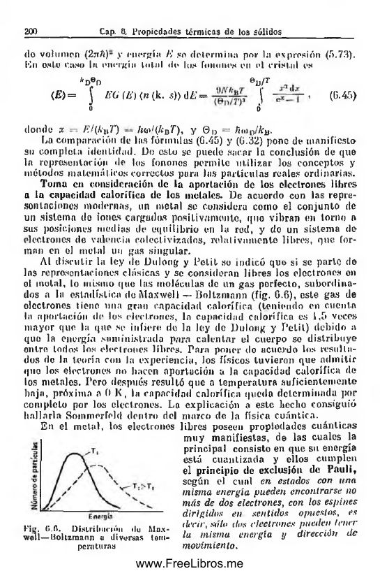 
<b>Pavlov, p. 205</b> (página del libro)  
<b>Pavlov, p. 206</b> (página del libro)  

<b>▶ Solución paso a paso — #9 C_e del sodio a 300 K</b>

**Dónde está la teoría.** Igual que #8: $C_e=\frac{\pi^2}{2}R\,T/T_F$, diap. 58-59; $E_F$ desde $n$, diap. 66-67. Pavlov: (6.64)-(6.65), §6.1, pp. 205-206.

**Aviso sobre el dato.** El enunciado dice $2.6\times10^{26}$ m⁻³, pero el Na (bcc, $a=4.23$ Å, 1 e⁻/átomo) tiene $n\approx2.6\times10^{28}$ m⁻³ (diap. 35: $2.5\times10^{28}$; diap. 67: $3\times10^{22}$ cm⁻³). Se resuelve con $2.6\times10^{28}$ m⁻³ (se interpreta como errata del exponente; $2.6\times10^{26}$ m⁻³ no corresponde a ningún metal).

1. $E_F=\dfrac{\hbar^2}{2m}(3\pi^2n)^{2/3}=3.20$ eV con $n=2.6\times10^{28}$ m⁻³.
2. $T_F=E_F/k_B=3.71\times10^{4}$ K ⇒ $T/T_F=8.1\times10^{-3}$.
3. $C_e=\dfrac{\pi^2}{2}R\dfrac{T}{T_F}=4.93\times8.314\times8.08\times10^{-3}=0.33$ J/mol·K $=0.040\,R$ (por mol de átomos = de e⁻).
4. Comparación: $C_e/\tfrac32R=2.7\%$ y $C_e/3R=1.3\%$.

**Resultado.** $C_e\approx0.33$ J/mol·K $\approx0.04R$: ~3 % del valor clásico $\tfrac32R$ (diap. 53) y ~1 % de $3R$. (Con el dato literal $2.6\times10^{26}$ m⁻³ saldría $E_F\approx0.15$ eV y $T_F\approx1.7\times10^3$ K, y $C_e\approx0.86\,R$: sin sentido para un metal.)

📷 Diapositivas y páginas de Pavlov citadas (4 diap., 2 Pavlov)

<b>Diap. 35</b> (Metales 2021) 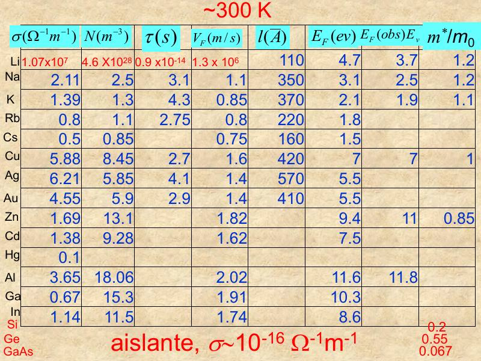 
<b>Diap. 58</b> (Metales 2021)  
<b>Diap. 59</b> (Metales 2021)  
<b>Diap. 67</b> (Metales 2021)  
<b>Pavlov, p. 205</b> (página del libro)  
<b>Pavlov, p. 206</b> (página del libro)  

<b>▶ Solución paso a paso — #10 Gas de Fermi del Sol colapsado: E_F, T_F y velocidad promedio</b>

**Dónde está la teoría.** $E_F$, $k_F$, $v_F$ desde $N/V$: diap. 66-67 (`fermi3d.1`); $T_F=E_F/k_B$: diap. 58-59. Pavlov: (6.56), §6.1, p. 204. ⚠ **Fuera de las diap. 1-70:** $\langle v\rangle=\tfrac34v_F$ (promedio sobre la esfera de Fermi) y el criterio relativista $E_F$ vs. $mc^2$ no están en las diapositivas (ver `notas/03` y `notas/06`, `extra.3`).

Supuestos: 1 e⁻ por protón ($N=M/m_p$, Sol neutro de hidrógeno); si fuera $N=M/2m_p$ (He) saldrían 20.7 eV.

1. $N=\dfrac{M}{m_p}=\dfrac{2\times10^{30}}{1.6726\times10^{-27}}=1.20\times10^{57}$.
2. $n=\dfrac NV=\dfrac{1.20\times10^{57}}{1.4\times10^{27}}=8.54\times10^{29}$ m⁻³ (el volumen dado coincide con $\tfrac43\pi R^3$ para $R=7\times10^8$ m).
3. $k_F=(3\pi^2n)^{1/3}=2.94\times10^{10}$ m⁻¹.
4. **a)** $E_F=\dfrac{\hbar^2k_F^2}{2m}=5.26\times10^{-18}$ J $=32.8$ eV.
5. **b)** $T_F=\dfrac{E_F}{k_B}=3.8\times10^{5}$ K.
6. **c)** $v_F=\dfrac{\hbar k_F}{m}=3.40\times10^{6}$ m/s ⇒ $\langle v\rangle=\tfrac34v_F=2.55\times10^{6}$ m/s ⇒ $\dfrac{\langle v\rangle}{c}=0.0085\approx0.85\%$.
7. Comprobación: $E_F/mc^2=6.4\times10^{-5}\ll1$ ⇒ no relativista, el tratamiento es válido.

**Resultado.** $E_F\approx33$ eV, $T_F\approx3.8\times10^5$ K, $\langle v\rangle\approx2.5\times10^6$ m/s $\approx0.01\,c$. Con los datos del enunciado (radio actual del Sol) el gas queda con $T_F\approx3.8\times10^5$ K; para una enana blanca real ($R\sim2\times10^7$ m) $n$ sube por $(7\times10^8/2\times10^7)^3$ y $E_F\approx4\times10^4$ eV (`T-2025-II` #3a).

📷 Diapositivas y páginas de Pavlov citadas (4 diap., 1 Pavlov)

<b>Diap. 66</b> (Metales 2021)  
<b>Diap. 67</b> (Metales 2021)  
<b>Diap. 58</b> (Metales 2021)  
<b>Diap. 59</b> (Metales 2021)  
<b>Pavlov, p. 204</b> (página del libro)  

<b>▶ Solución paso a paso — #11 Gas clásico: ρ ∝ T^{3/2}</b>

**Dónde está la teoría.** $\sigma=Ne^2\tau/m^*$ y $\rho=m^*/(Ne^2\tau)$: diap. 30; $\ell=v_r\tau$ y $\tfrac12mv_r^2=\tfrac32k_BT$: diap. 30 y 34; sección eficaz de los iones que vibran $\sigma_{ph}=\pi\langle x^2\rangle$, $\ell_{ph}=1/(N_{ion}\sigma_{ph})$, $\tfrac12M\omega^2\langle x^2\rangle=\langle E\rangle$ y límite de $T$ alta: diap. 46-49 (`drude.3`). Pavlov: distribución clásica (6.92), $\sigma=ne^2\langle\lambda_c\rangle/(m\langle v\rangle)$ (6.96), §6.3, pp. 218-219; $\rho(T)$ con $\mu\propto1/T$, §7.13, pp. 286-287.

1. De Drude: $\rho=\dfrac{m}{ne^2\tau}$ y $\tau=\dfrac{\ell}{v}$ ⇒ $\rho=\dfrac{m\,v}{ne^2\,\ell}$.
2. **Velocidad (gas clásico).** $\tfrac12mv^2=\tfrac32k_BT\Rightarrow v=\sqrt{3k_BT/m}\propto T^{1/2}$.
3. **Camino libre.** Los e⁻ chocan con los iones que vibran. Sección eficaz $\sigma_{ph}=\pi\langle x^2\rangle$ (área barrida por el ion) y $\ell=\dfrac{1}{N_{ion}\,\sigma_{ph}}$.
4. **Amplitud de vibración.** Para un oscilador clásico a $T$ alta, $\tfrac12M\omega^2\langle x^2\rangle=k_BT\ \Rightarrow\ \langle x^2\rangle\propto T$ ⇒ $\ell\propto T^{-1}$.
5. **Combinar:**
   $$\rho=\frac{m}{ne^2}\frac{v}{\ell}\ \propto\ T^{1/2}\cdot T=T^{3/2}.\qquad\blacksquare$$

**Resultado.** $\rho\propto T^{1/2}$ (de $v$) $\times\,T$ (de $\ell^{-1}$) $=T^{3/2}$. El experimento da $\rho\propto T$ (diap. 43, 49 y Pavlov p. 286-287): la diferencia es que los e⁻ degenerados se mueven a $v_F\approx$ const (no $\propto\sqrt T$), y entonces solo queda el factor $\langle x^2\rangle\propto T$. Es otra prueba de que el gas clásico no describe a los e⁻ de conducción.

📷 Diapositivas y páginas de Pavlov citadas (6 diap., 4 Pavlov)

<b>Diap. 30</b> (Metales 2021)  
<b>Diap. 34</b> (Metales 2021) 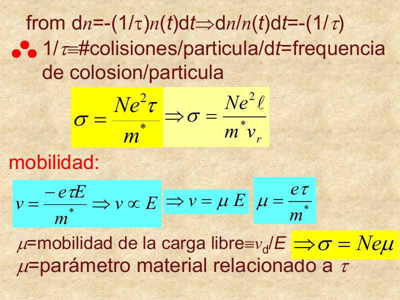 
<b>Diap. 46</b> (Metales 2021) 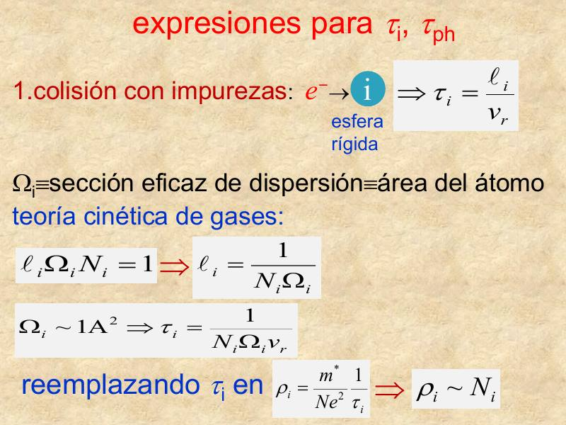 
<b>Diap. 47</b> (Metales 2021) 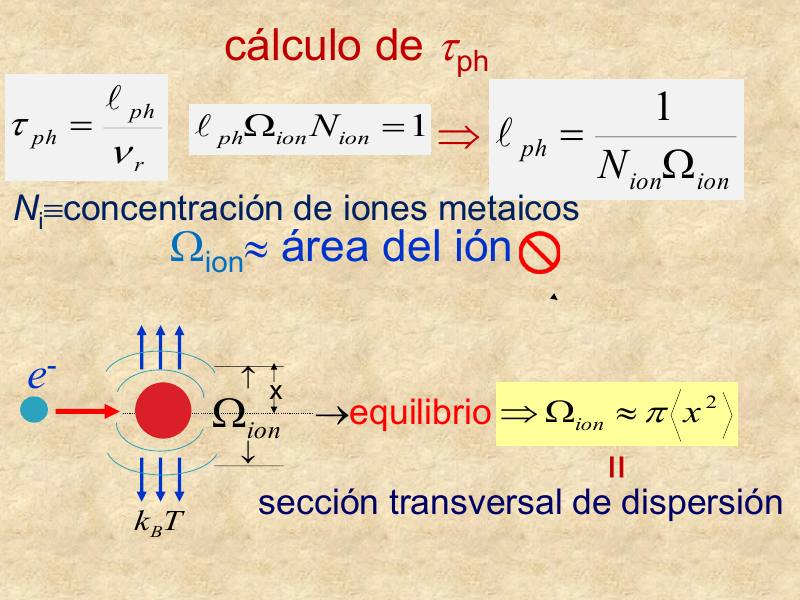 
<b>Diap. 48</b> (Metales 2021) 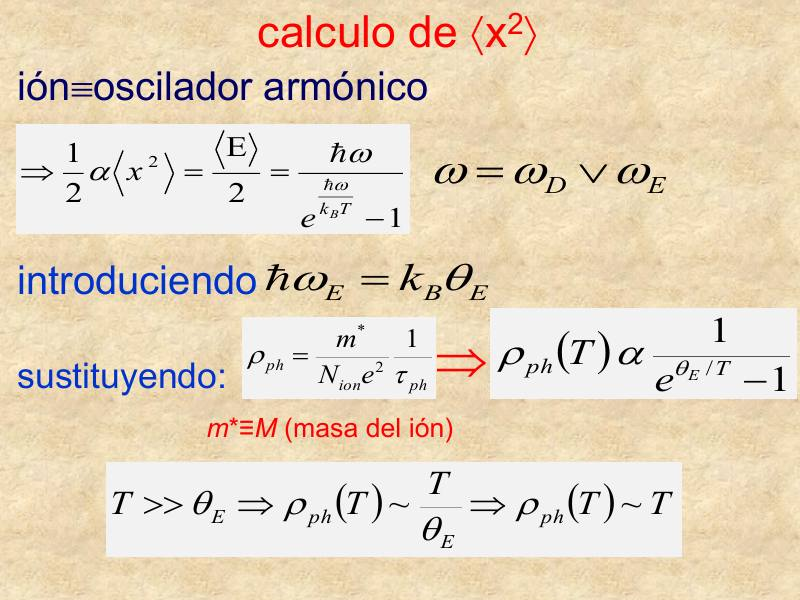 
<b>Diap. 49</b> (Metales 2021) 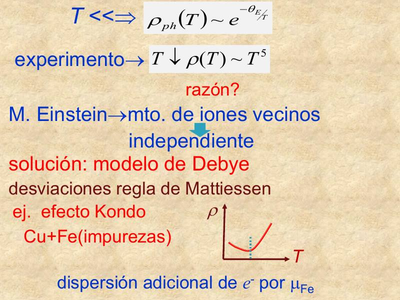 
<b>Pavlov, p. 218</b> (página del libro)  
<b>Pavlov, p. 219</b> (página del libro)  
<b>Pavlov, p. 286</b> (página del libro) 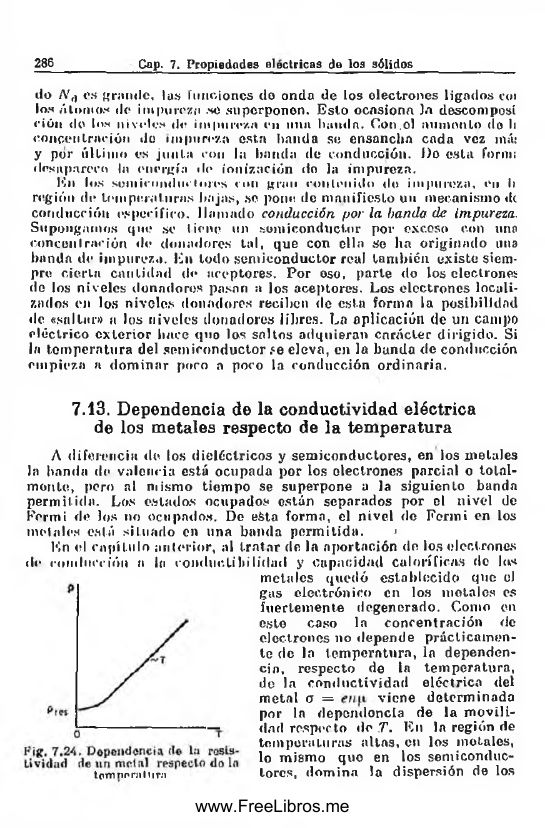 
<b>Pavlov, p. 287</b> (página del libro) 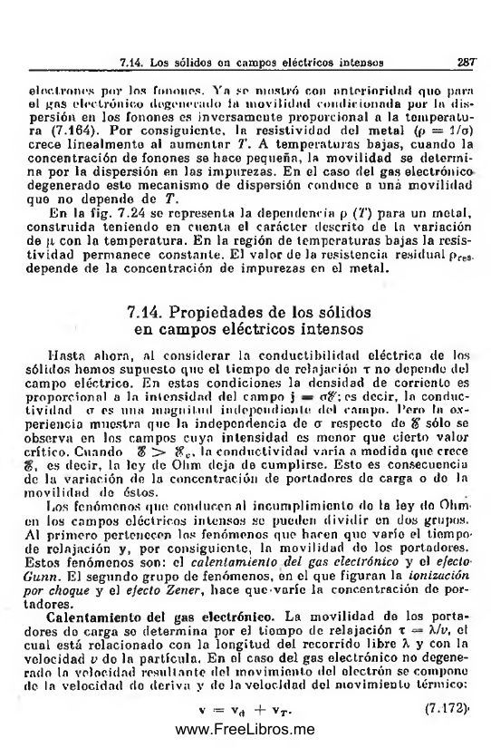 

<b>▶ Solución paso a paso — #12 Cambio de E_F del Na por dilatación térmica</b>

**Dónde está la teoría.** $E_F=\dfrac{\hbar^2}{2m}\left(3\pi^2\dfrac NV\right)^{2/3}$, con $N$ fijo: diap. 66-67 (`fermi3d.1`). Pavlov: (6.56), §6.1, p. 204; corrección térmica de $E_F$ (6.57), §6.1, pp. 204-205.

1. $N$ no cambia al calentar: $E_F\propto V^{-2/3}$. Con $V=\ell^3$: $E_F\propto\ell^{-2}$.
2. Diferenciando: $\dfrac{dE_F}{E_F}=-2\dfrac{d\ell}{\ell}=-2\alpha\,dT$.
3. Para $\alpha$ constante y $\Delta T=300$ K:
   $\dfrac{\Delta E_F}{E_F}=-2\alpha\Delta T=-2(1.5\times10^{-6})(300)=-9.0\times10^{-4}$.
   (Exacto: $(1+\alpha\Delta T)^{-2}-1=-8.99\times10^{-4}$.)
4. En porcentaje: $-0.090\,\%$. Con $E_F(0)\approx3.2$ eV (Na, $n=2.65\times10^{28}$ m⁻³): $\Delta E_F\approx-2.9$ meV.

**Resultado.** $E_F$ **disminuye** un $0.09\,\%$ ($\approx-3$ meV) entre 0 y 300 K al dilatarse la muestra. Es un efecto mayor que la corrección puramente térmica $\tfrac{\pi^2}{12}(k_BT/E_F)^2\approx5\times10^{-5}$ ($0.005\,\%$, Pavlov 6.57).

📷 Diapositivas y páginas de Pavlov citadas (2 diap., 2 Pavlov)

<b>Diap. 66</b> (Metales 2021)  
<b>Diap. 67</b> (Metales 2021)  
<b>Pavlov, p. 204</b> (página del libro)  
<b>Pavlov, p. 205</b> (página del libro)  

---

## Resumen de páginas usadas

| # | Tema | Diapositivas (Metales 2021) | Pavlov (página del libro) |
|---|---|---|---|
| 1 | $v_d/v_F$ | 30, 36-37, 66-67 | §6.3, 218-219 (6.93-6.94); §6.1, 204 (6.56) |
| 2 | He³ | 66-67, 58-59 | §6.1, 203-204 (6.55-6.56) |
| 3 | $T_F$, $T/T_F$ | 9-10, 27, 58-59, 66-67 | §6.1, 204-205 (6.56) |
| 4 | Fracción excitada | 55-58 | §6.1, 202-205 (6.46) |
| 5 | Gas 2D ⚠ | 13-18 (1D), 66 (3D) | §6.1, 203-204 (6.48-6.49) |
| 6 | Simetría $f(E)$ | 55-56, 60-61, 106-109 | §6.1, 202 (6.46) |
| 7 | $C_e$ del Au | 57-59, 66-67 | §6.1, 205-206 (6.64-6.66) |
| 8 | $C_e$ del Al vs. $3R$ | 10, 53, 58-59, 67 | §6.1, 200, 205-206 |
| 9 | $C_e$ del Na | 35, 58-59, 66-67 | §6.1, 205-206 |
| 10 | Sol colapsado ⚠ ($\langle v\rangle$, relativista) | 58-59, 66-67 | §6.1, 204 (6.56) |
| 11 | $\rho\propto T^{3/2}$ | 30, 34, 43, 46-49 | §6.3, 218-219 (6.92, 6.96); §7.13, 286-287 |
| 12 | $\Delta E_F$ por dilatación | 66-67 | §6.1, 204-205 (6.56-6.57) |

## Checklist de este taller

- [ ] V.T26II.1 #1 — $v_d/v_F$ en cable de Cu (20 A, 2 mm²)
- [ ] V.T26II.2 #2 — He³ líquido: $E_F$ y $T_F$
- [ ] V.T26II.3 #3 — $T_F$ de Cu, Na, Ag y $T/T_F$ a 300 K
- [ ] V.T26II.4 #4 — Fracción de e⁻ excitados (Cu, Na)
- [ ] V.T26II.5 #5 — Gas 2D: unidades atómicas y $E_F$
- [ ] V.T26II.6 #6 — Simetría partícula-hueco de $f(E)$
- [ ] V.T26II.7 #7 — $C_e$ del oro, teoría vs. experimento
- [ ] V.T26II.8 #8 — $C_e$ del Al a 300 K vs. $3R$
- [ ] V.T26II.9 #9 — $C_e$ del Na a 300 K
- [ ] V.T26II.10 #10 — Sol colapsado: $E_F$, $T_F$, $\langle v\rangle/c$
- [ ] V.T26II.11 #11 — Gas clásico: $\rho\propto T^{3/2}$
- [ ] V.T26II.12 #12 — $\Delta E_F$ del Na por dilatación
