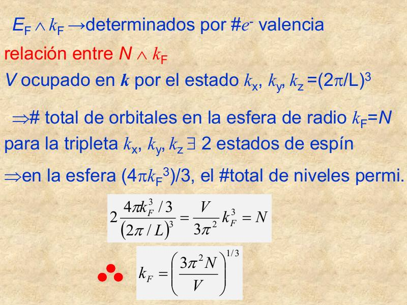
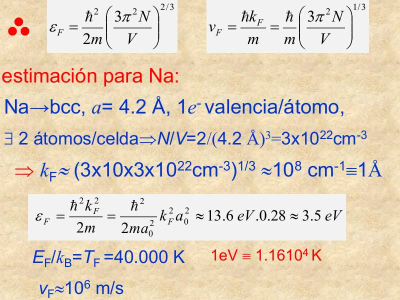
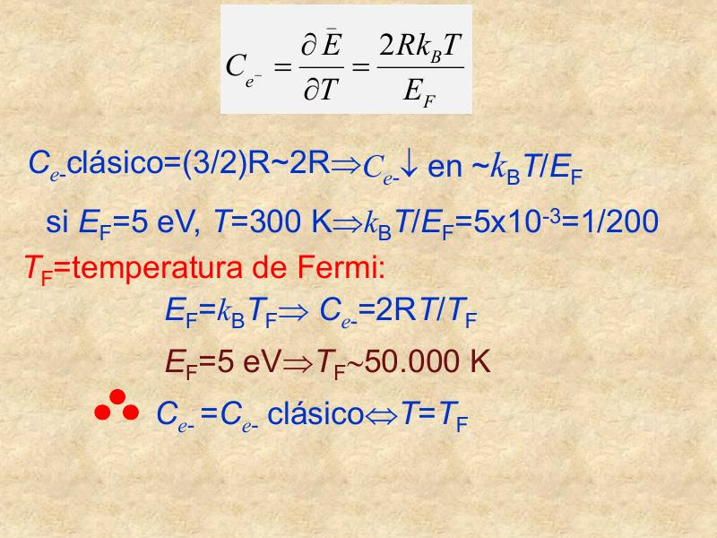
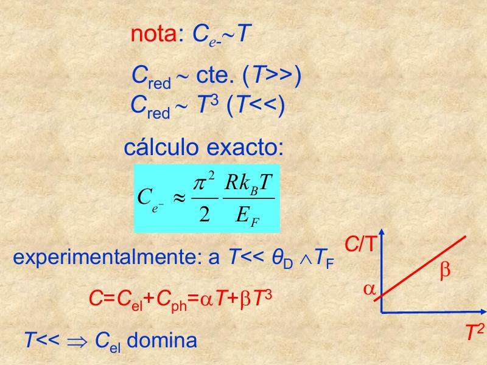
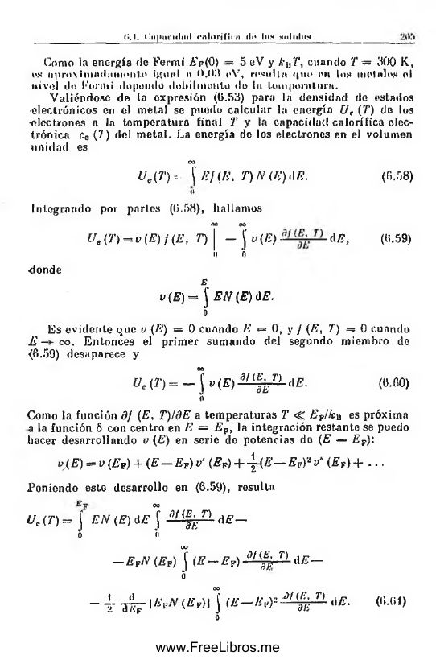

# T-SS2020 — Taller II (SS2020), resuelto paso a paso

> Solo lo **dentro de las diapositivas 1-70 y sin demostraciones**: #2, #3, #4, #6. **No resueltos:** #1 (Zener magnético, fuera de alcance) y #5 (demostración $P=I^2R$). Constantes: $\hbar=1.0546\times10^{-34}$, $m=9.109\times10^{-31}$ kg, $k_B=1.381\times10^{-23}$ J/K, 1 eV $=1.602\times10^{-19}$ J. Cifras verificadas con Python.
>
> **Formato:** primero los enunciados; después cada solución va plegada: abre «Solución paso a paso». Cada solución cita la diapositiva (`Metales 2021.pdf`) y, cuando aplica, Pavlov (mapa en `notas/08_mapa_pavlov.md`).

---

# Parte 1 · Ejercicios

**#2.** Cu con $n=8.45\times10^{28}$ m⁻³: calcula $E_F$ y la velocidad de un e⁻ con $E=E_F$.

**#3.** He³ líquido (átomo de espín ½, fermión), $\rho=0.081$ g/cm³: calcula $E_F$ y $T_F$ cerca de $T=0$.

**#4.** Calcula $T_F$ para Cu, Na y Ag y la razón $T/T_F$ a 300 K (masa efectiva de Cu y Na: 1 y 1.2 $m_0$).

**#6.** Sodio con coeficiente de dilatación lineal $\alpha=1.5\times10^{-6}$ K⁻¹ entre 0 y 300 K: calcula el cambio porcentual de $E_F$.

---

# Parte 2 · Soluciones paso a paso

<b>▶ Solución paso a paso — #2 Cu: $E_F$ y velocidad (numérico)</b>

**Solución.**

1. $n=8.45\times10^{28}$ m⁻³ ⇒ $k_F=(3\pi^2n)^{1/3}=1.358\times10^{10}$ m⁻¹.
2. $E_F=\dfrac{\hbar^2k_F^2}{2m}=1.125\times10^{-18}$ J $=7.02$ eV (la guía: 7.05; diferencia de redondeo en constantes).
3. Un e⁻ con $E=E_F$ tiene $v=\sqrt{2E_F/m}=\hbar k_F/m=1.57\times10^6$ m/s.

**Resultado.** $E_F\approx7.0$ eV y $v_F=1.57\times10^6$ m/s (diap. 66-67).

📷 Diapositivas y páginas de Pavlov citadas (2 diap., 1 Pavlov)

<b>Diap. 66</b> (Metales 2021)  
<b>Diap. 67</b> (Metales 2021)  
<b>Pavlov, p. 204</b> (página del libro)  

<b>▶ Solución paso a paso — #3 He³ líquido (numérico)</b>

**Solución.**

1. Masa del átomo: $M=3.016\ \text{u}=5.008\times10^{-27}$ kg (**no** $m_e$: la partícula es el átomo).
2. $n=\rho/M=81\ \text{kg/m}^3/5.008\times10^{-27}=1.617\times10^{28}$ m⁻³.
3. $E_F=\dfrac{\hbar^2}{2M}(3\pi^2n)^{2/3}=\dfrac{(1.0546\times10^{-34})^2}{2\times5.008\times10^{-27}}\times(4.787\times10^{29})^{2/3}=6.80\times10^{-23}$ J $=4.2\times10^{-4}$ eV.
4. $T_F=E_F/k_B=4.9$ K; $v_F=\hbar k_F/M=165$ m/s.

**Resultado.** $E_F=4.2\times10^{-4}$ eV, $T_F=4.9$ K: el He³ líquido se vuelve degenerado por debajo de unos pocos K (mismo modelo, masa ~$10^4$ veces mayor ⇒ $E_F$ ~$10^4$ veces menor).

📷 Diapositivas y páginas de Pavlov citadas (2 diap., 1 Pavlov)

<b>Diap. 66</b> (Metales 2021)  
<b>Diap. 67</b> (Metales 2021)  
<b>Pavlov, p. 204</b> (página del libro)  

<b>▶ Solución paso a paso — #4 $T_F$ y $T/T_F$ de Cu, Na y Ag (numérico)</b>

**Solución.** $T_F=E_F/k_B$, $T/T_F$ a 300 K.

| Metal | $n$ (m⁻³) | $m^*$ | $E_F$ (eV) | $T_F$ (K) | $T/T_F$ |
|---|---|---|---|---|---|
| Cu | $8.45\times10^{28}$ | $m_0$ | 7.02 | $8.15\times10^4$ | 0.0037 |
| Na | $2.65\times10^{28}$ | $1.2m_0$ | 2.70 | $3.13\times10^4$ | 0.0096 |
| Ag | $5.86\times10^{28}$ | $m_0$ | 5.50 | $6.38\times10^4$ | 0.0047 |

Con $m^*$: $E_F\propto1/m^*$ (para Na, $3.24/1.2=2.70$ eV).

**Resultado.** Los tres $\ll1$ (0.4 %-1 %): gas degenerado a 300 K; $T_F$ coincide con la guía (81 000, 31 000, 64 000 K).

📷 Diapositivas y páginas de Pavlov citadas (4 diap., 2 Pavlov)

<b>Diap. 58</b> (Metales 2021)  
<b>Diap. 59</b> (Metales 2021)  
<b>Diap. 66</b> (Metales 2021)  
<b>Diap. 67</b> (Metales 2021)  
<b>Pavlov, p. 204</b> (página del libro)  
<b>Pavlov, p. 205</b> (página del libro)  

<b>▶ Solución paso a paso — #6 $\Delta E_F$ por dilatación del Na (numérico)</b>

**Solución.**

1. $E_F\propto n^{2/3}\propto V^{-2/3}$ y $V\propto\ell^3\Rightarrow E_F\propto\ell^{-2}$.
2. $\dfrac{\Delta E_F}{E_F}=-2\dfrac{\Delta\ell}{\ell}=-2\alpha\Delta T$.
3. $=-2\times1.5\times10^{-6}\times300=-9\times10^{-4}$.

**Resultado.** $\Delta E_F/E_F=-0.09\,\%$ (despreciable): $E_F$ casi no depende de $T$, ni siquiera a través de la dilatación.

📷 Diapositivas y páginas de Pavlov citadas (2 diap., 2 Pavlov)

<b>Diap. 66</b> (Metales 2021)  
<b>Diap. 67</b> (Metales 2021)  
<b>Pavlov, p. 204</b> (página del libro)  
<b>Pavlov, p. 205</b> (página del libro)  

---

## Checklist de este examen

- [ ] V.TSS20.2 #2 — $E_F$ y $v_F$ del Cu
- [ ] V.TSS20.3 #3 — He³ líquido: $E_F$ y $T_F$
- [ ] V.TSS20.4 #4 — $T_F$ y $T/T_F$ de Cu, Na y Ag
- [ ] V.TSS20.6 #6 — $\Delta E_F/E_F=-2\alpha\Delta T$
