# T01 · Metales, gas de Fermi 1D e interacciones (`metal.1`, `gas1d.1`, `interac.1`)

> **Alcance:** diapositivas **1-23** de `Metales 2021.pdf` (O. Morán) + **Pavlov** (copia completa, `Diapositivas/pdfcoffee…pdf`). Teoría base: `notas/00_metales_y_gas_de_electrones.md`. Las imágenes están en `img/` y cada una lleva su fuente exacta; si una figura y el texto no coinciden, manda la figura y se avisa.

## Fuentes exactas

| Subtema | Diapositivas (`Metales 2021.pdf`) | Pavlov (libro, página impresa) | Imágenes |
|---|---|---|---|
| `metal.1` | 1-13 | **Cap. 2, §2.6 "Metales", pp. 92-94**; **Cap. 6, §6.1, p. 200** | `slide_p02…p13`, `pavlov_p092/093/094/200` |
| `gas1d.1` | 13-18 | *(no está en Pavlov: el libro pasa de la cuerda vibrante, cap. 5, directo a 3D)* | `slide_p13…p18` |
| `interac.1` | 19-23 | **Cap. 7, §7.1, pp. 235-236** (las dos aproximaciones del e⁻ libre) | `slide_p19…p23`, `pavlov_p236` |

---

## `metal.1` — Metal, cristal metálico y concentración de e⁻

**Idea central.** Un metal es una red de iones $+$ rodeada por un **gas de e⁻ de valencia deslocalizados**. Los iones son pozos de potencial $U$ y el gas queda confinado en el cristal (diap. 3-4).

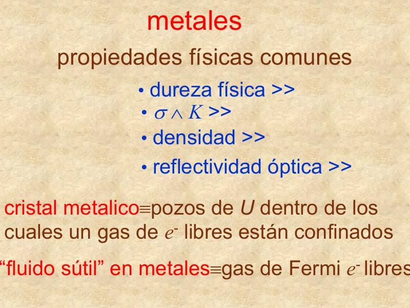
*Metales 2021, diap. 3: propiedades comunes de los metales y cristal metálico = pozos de $U$ con gas de e⁻ confinado.*

- **De átomo a metal (Na).** Átomo libre $1s^22s^22p^63s^1$: *core* de 10 e⁻ (capas llenas) + 1 e⁻ de valencia 3s, $r\sim1.9$ Å. En el sólido los orbitales 3s de vecinos se solapan → el e⁻ se **deslocaliza** (banda de conducción 3s) (diap. 6-8).
- **Volumen ocupado.** $r(\text{Na}^+)=0.98$ Å (≈3.9 ų por ion); el Na es bcc con $a=4.2$ Å, vecinos más próximos a 3.7 Å. La diap. 7 dice "$V_{iones}\approx15\,\%V_{crist}$"; con esos mismos datos el cálculo da $2\cdot3.9/4.2^3\approx10.5\,\%$. **Es una discrepancia de la diapositiva** (mismo orden de magnitud); se resuelve en `practica/P01`, ejercicio P01-2.
- **Nobles (Cu, Ag, Au):** iones más grandes, vecinos a 1.83 Å (casi en contacto). A 300 K: alcalinos bcc, nobles fcc (diap. 9).
- **Cuántos e⁻ de conducción:** monovalentes (Na, K, Cu, Ag, Au): 1 e⁻/átomo; divalentes (Be, Mg, Zn, Ca): 2. Concentración (diap. 10):

$$N=\frac{Z_vN_A\rho}{M}\quad[\text{e}^-/\text{cm}^3]$$

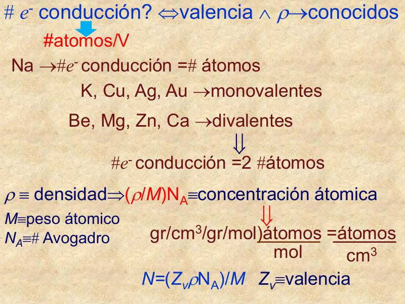
*Metales 2021, diap. 10: $N=(Z_v\rho N_A)/M$, monovalentes vs. divalentes.*

- **Éxitos y fracasos de la teoría clásica (diap. 11):** ✔ ley de Ohm y $\sigma_{el}/\sigma_{term}$ (Wiedemann-Franz); ✘ calor específico $C_{V,e}$ (falla la distribución de Maxwell) y ✘ camino libre largo (hasta $10^8$ distancias atómicas ≈ 1 cm a $T$ baja).
- **Transparencia del cristal (diap. 12):** (1) los e⁻ no son desviados por un $U$ *periódico* (ondas de materia); (2) solo los dispersan otros e⁻ ocasionalmente, por **Pauli**. **Gas de Fermi** = gas de e⁻ libres que obedecen Pauli.

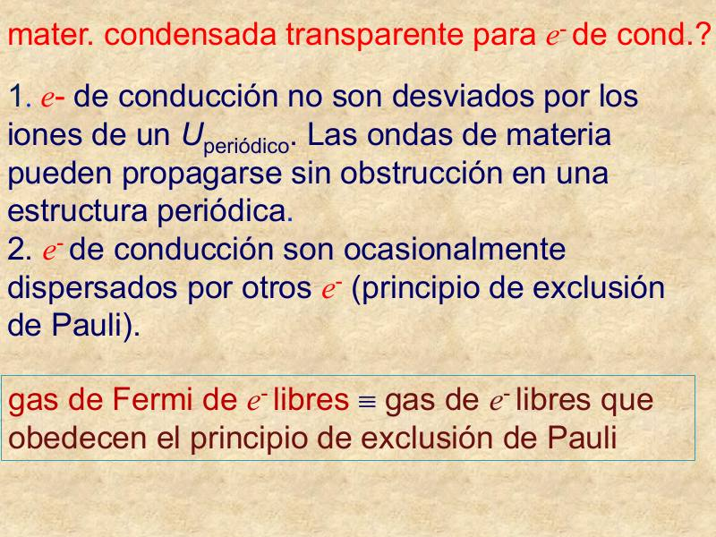
*Metales 2021, diap. 12: las dos razones de la "transparencia" de la materia condensada.*

### Lo que añade Pavlov (Cap. 2, §2.6, pp. 92-94)

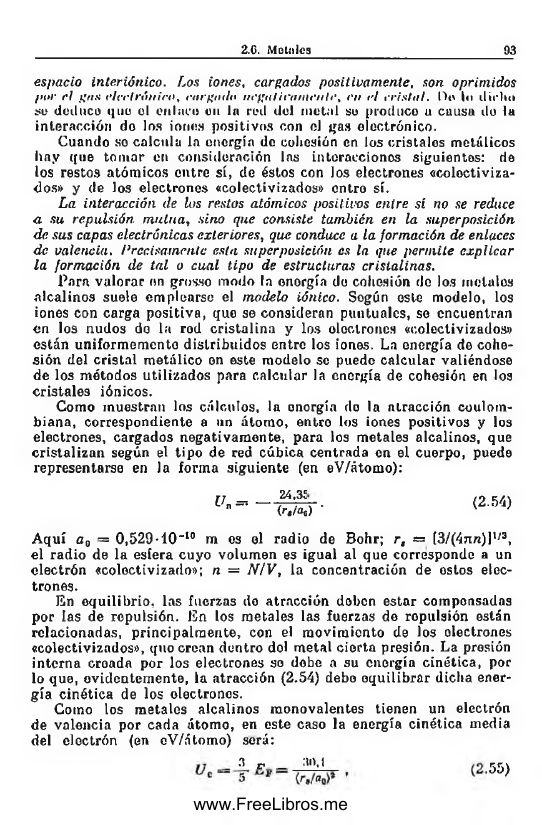
*Pavlov & Khokhlov, Cap. 2, §2.6, p. 93: modelo iónico de la energía de cohesión del metal alcalino (ecs. 2.54-2.55).*

- Propiedades específicas (σ alta, brillo, plasticidad) **por la existencia de e⁻ libres**; $\sigma$ **aumenta al bajar $T$** (p. 92).
- **Enlace metálico** (p. 92): átomos electropositivos con e⁻ de valencia débilmente ligados; cada Na tiene ~8 vecinos y 1 solo e⁻ de valencia, así que el e⁻ "colectivizado" recorre todos los iones (a diferencia del enlace covalente, donde el par se comparte entre 2 átomos). Los iones quedan "oprimidos" por el gas.
- **Energía de cohesión en el modelo iónico** (alcalinos, bcc), en eV/átomo, con $r_s=(3/4\pi n)^{1/3}$ y $a_0=0.529$ Å (pp. 93-94):

$$U_a=-\frac{24.35}{r_s/a_0},\qquad U_c=\tfrac35E_F=\frac{30.1}{(r_s/a_0)^2},\qquad U_e=-\frac{12.5}{(r_s/a_0)}$$

$$U=U_a+U_c+U_e=\frac{30.1}{(r_s/a_0)^2}-\frac{36.8}{r_s/a_0}\ \Rightarrow\ \left.\frac{dU}{dr_s}\right|_{eq}=0:\ \frac{r_s}{a_0}=1.6\ (2.57)$$

  El experimento da $r_s/a_0=2$-$6$; el propio libro dice que el modelo iónico es "demasiado burdo" pero que la imagen *iones en un gas de e⁻* es correcta (p. 94). 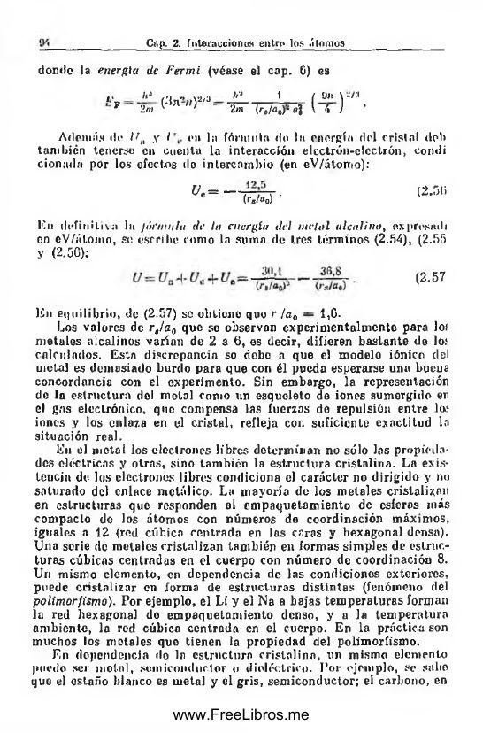
*Pavlov, Cap. 2, §2.6, p. 94: $E_F$, energía de intercambio (2.56) y energía total (2.57) con equilibrio en $r_s/a_0=1.6$.*

- **§6.1, p. 200:** metal = iones que vibran + gas de e⁻; con Maxwell-Boltzmann los e⁻ darían $C$ 1.5 veces mayor que Dulong-Petit (se retoma en T03).

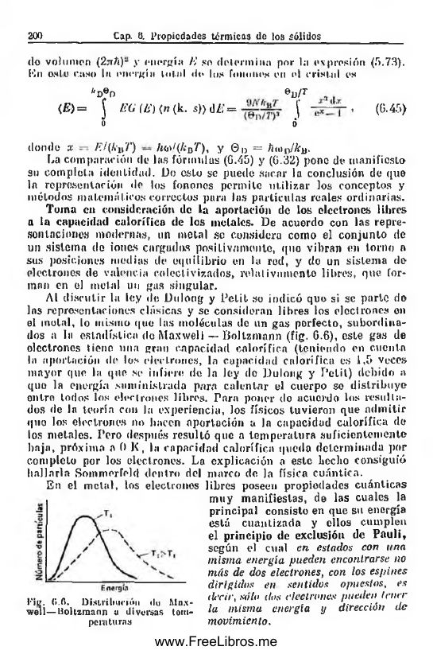
*Pavlov, Cap. 6, §6.1, p. 200: gas de e⁻ "singular", el fracaso de Maxwell-Boltzmann y enunciado de Pauli.*

---

## `gas1d.1` — Gas de Fermi en 1D

*(No está en Pavlov; usar diapositivas.)* e⁻ de masa $m$ en una caja de longitud $L$ con paredes infinitas ($U=0$ dentro), diap. 13-16:

$$-\frac{\hbar^2}{2m}\psi_n''=\varepsilon_n\psi_n,\quad\psi_n(0)=\psi_n(L)=0\ \Rightarrow\ \psi_n=A\sin\frac{n\pi x}{L},\ \lambda_n=\frac{2L}{n},\ \boxed{\varepsilon_n=\frac{\hbar^2\pi^2n^2}{2mL^2}}$$

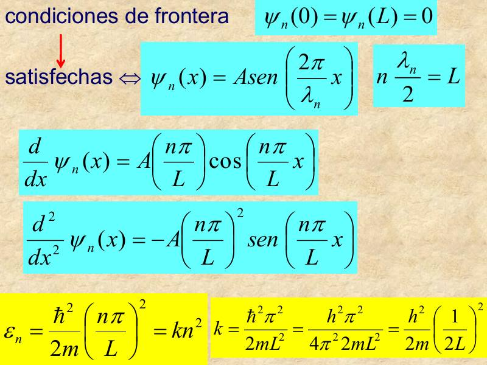
*Metales 2021, diap. 15: condiciones de frontera ⇒ $n\lambda_n/2=L$ ⇒ $\varepsilon_n=\hbar^2k^2/2m$.*

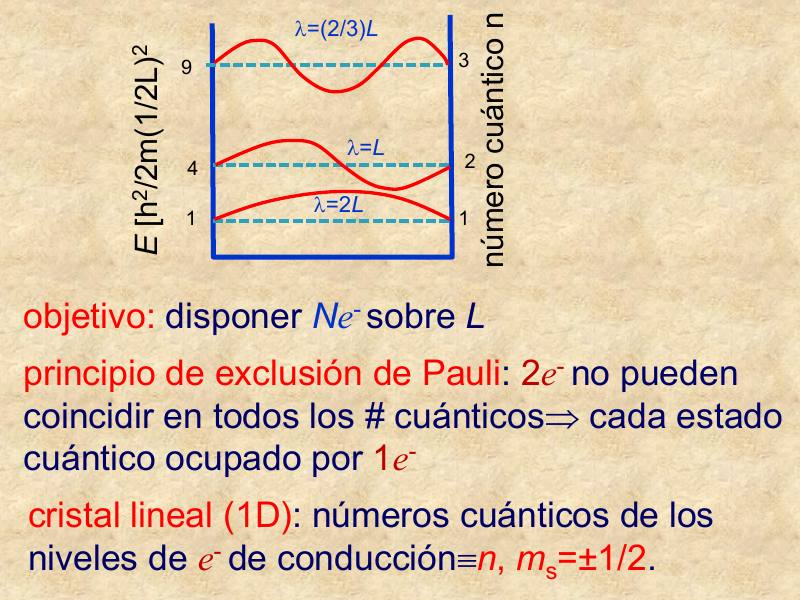
*Metales 2021, diap. 16: niveles $n=1,2,3$ con $\lambda=2L,\,L,\,2L/3$ y energías en relación 1 : 4 : 9.*

- **Exacto vs. aproximado (diap. 14):** cada nivel es solución para **un** e⁻; el estado de $N$ e⁻ se *aproxima* asignando $N$ niveles distintos. Es **exacto solo si no hay interacción**.
- **Pauli (diap. 16-17):** números cuánticos $(n,m_s=\pm\tfrac12)$ ⇒ **2 e⁻ por nivel**. Con $N=6$: ocupados $n=1,2,3$.
- **Nivel de Fermi (diap. 18):** $2n_F=N$ y
$$\varepsilon_F=\frac{\hbar^2}{2m}\left(\frac{n_F\pi}{L}\right)^2=\frac{\hbar^2}{2m}\left(\frac{N\pi}{2L}\right)^2$$

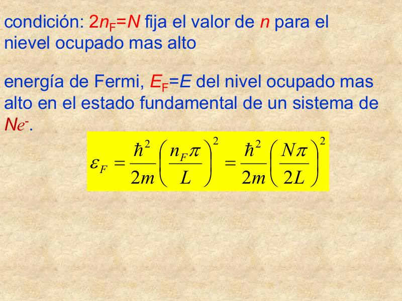
*Metales 2021, diap. 18: condición $2n_F=N$ y $\varepsilon_F$ en 1D.*

---

## `interac.1` — Por qué un gas de e⁻ libres es razonable

- **Modelo (diap. 19):** los e⁻ se mueven sin colisiones salvo reflexión en la superficie; $U$ solo los confina (analogía: gas ideal).
- **e⁻-ion débil (diap. 20):** la repulsión/atracción de Coulomb se **apantalla** ⇒ $U_{neto}$ = **seudopotencial** débil; por incertidumbre ($x p_x\sim\hbar$) un e⁻ rápido pasa poco tiempo cerca de un ion.
- **e⁻-e⁻ débil (diap. 21-22):** (1) **Pauli** (mismo espín no se acercan: "hueco de Fermi", $r\sim1$ Å); (2) **energía mínima** (separarse baja la energía de Coulomb) ⇒ cada e⁻ lleva su hueco positivo ⇒ apantallamiento.

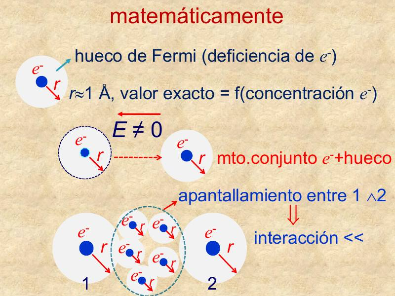
*Metales 2021, diap. 22: hueco de Fermi y apantallamiento entre dos e⁻ (interacción efectiva ≪).*

- **Gas de e⁻ ≠ gas ordinario (diap. 23):** $N\sim10^{29}$ m⁻³ (vs. $10^{25}$), carga $q=-e$ ⇒ **plasma denso** (vs. neutro), estadística **Fermi-Dirac** (vs. Maxwell-Boltzmann).

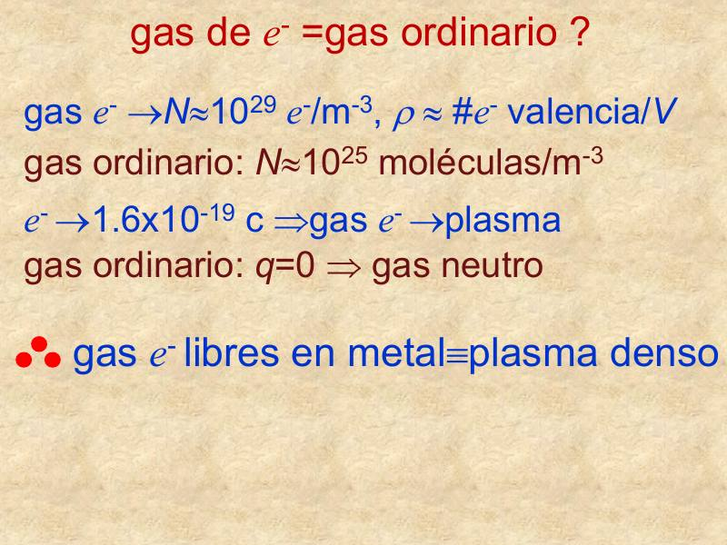
*Metales 2021, diap. 23: comparación gas de e⁻ vs. gas ordinario.*

### Lo que añade Pavlov (Cap. 7, §7.1, p. 236)

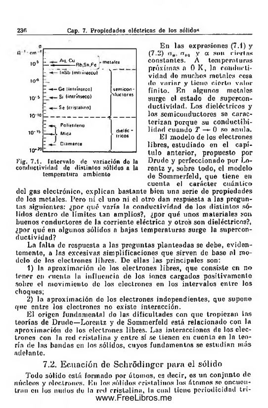
*Pavlov, Cap. 7, §7.1, p. 236: las dos aproximaciones del modelo de Drude-Lorentz-Sommerfeld y las preguntas que no contestan.*

Las dificultades del e⁻ libre vienen de **dos simplificaciones**: (1) **e⁻ libres** (se ignora la acción de los iones entre choques); (2) **e⁻ independientes** (se ignora la interacción e⁻-e⁻). No explican por qué σ varía tanto entre sólidos (Fig. 7.1: de $10^{-20}$ a $10^{5}$ Ω⁻¹cm⁻¹), ni los aislantes, ni la superconductividad; eso lo resuelve la teoría de bandas (fuera de alcance).

---

## Checklist de teoría (T01)

- [ ] T.metal.1.1 Describir el cristal metálico (pozos $U$ + gas de e⁻ libres) y cómo el e⁻ 3s del Na pasa a e⁻ de conducción
- [ ] T.metal.1.2 Calcular $N=Z_vN_A\rho/M$ y distinguir monovalentes de divalentes
- [ ] T.metal.1.3 Éxitos (Ohm, W-F) y fracasos (calor específico, camino libre largo) de la teoría clásica
- [ ] T.metal.1.4 Las dos razones de la "transparencia" del cristal (periodicidad y Pauli)
- [ ] T.metal.1.5 Pavlov §2.6: enlace metálico y modelo iónico de la energía de cohesión ($r_s/a_0=1.6$)
- [ ] T.gas1d.1.1 Deducir $\varepsilon_n=\hbar^2\pi^2n^2/2mL^2$ desde $\psi(0)=\psi(L)=0$
- [ ] T.gas1d.1.2 Estado exacto vs. aproximado de $N$ e⁻ (exacto solo sin interacción)
- [ ] T.gas1d.1.3 Pauli en 1D: 2 e⁻ por nivel, condición $2n_F=N$
- [ ] T.gas1d.1.4 Calcular $\varepsilon_F$ en 1D y construir el estado fundamental
- [ ] T.interac.1.1 Por qué e⁻-ion (seudopotencial, apantallamiento) y e⁻-e⁻ (Pauli + energía mínima) son débiles
- [ ] T.interac.1.2 Gas de e⁻ vs. gas ordinario (densidad, plasma, FD vs. MB, $E(T{=}0)\neq0$) y las dos aproximaciones de Pavlov §7.1

## Galería completa de diapositivas 1-23

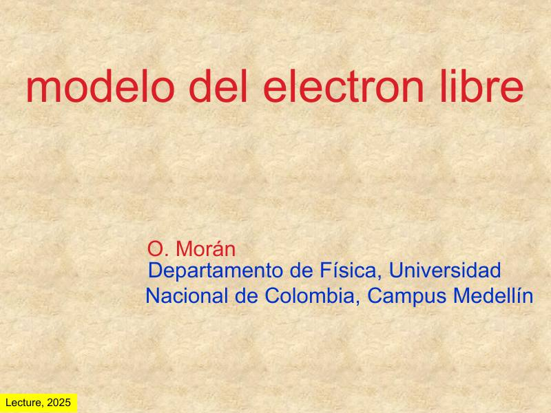
*Metales 2021, diap. 1*

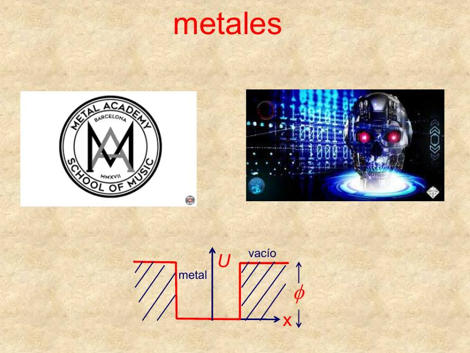
*Metales 2021, diap. 2*

*Metales 2021, diap. 3*

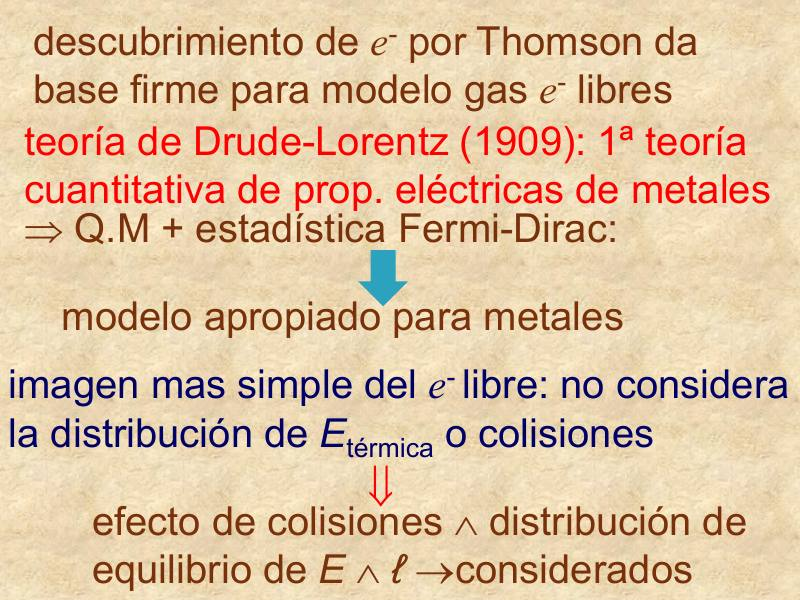
*Metales 2021, diap. 4*

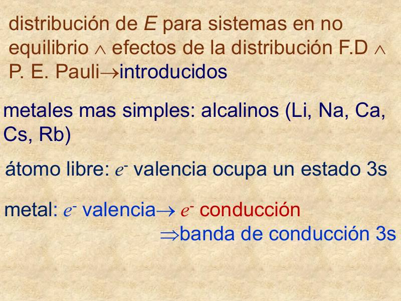
*Metales 2021, diap. 5*

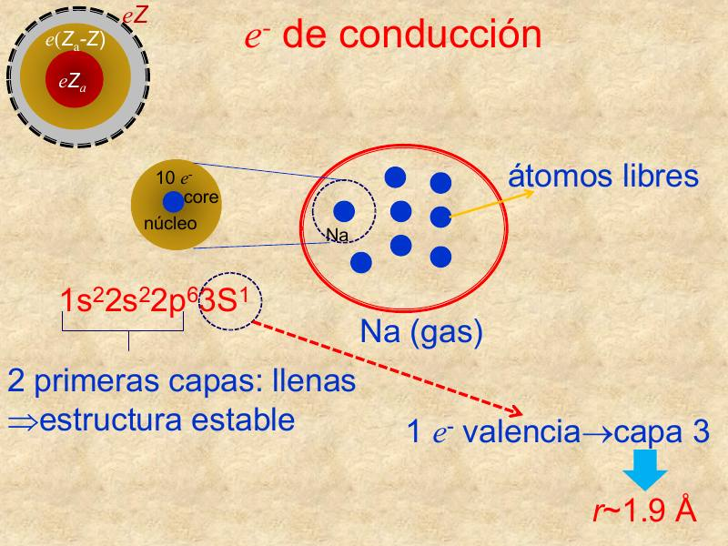
*Metales 2021, diap. 6*

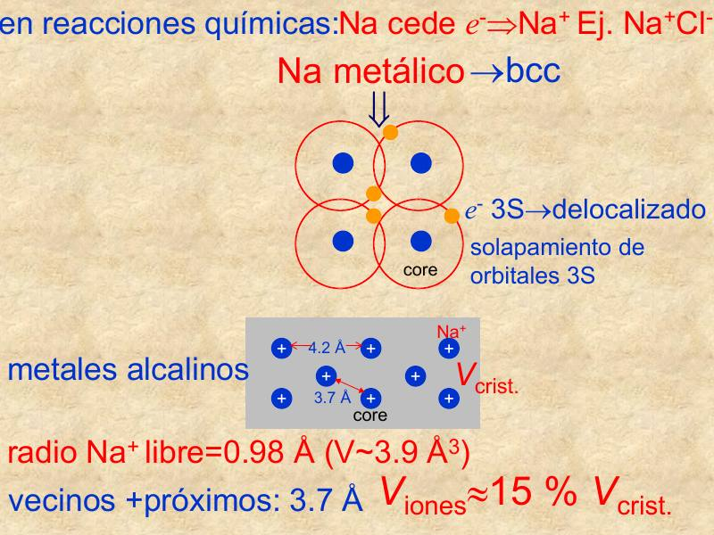
*Metales 2021, diap. 7*

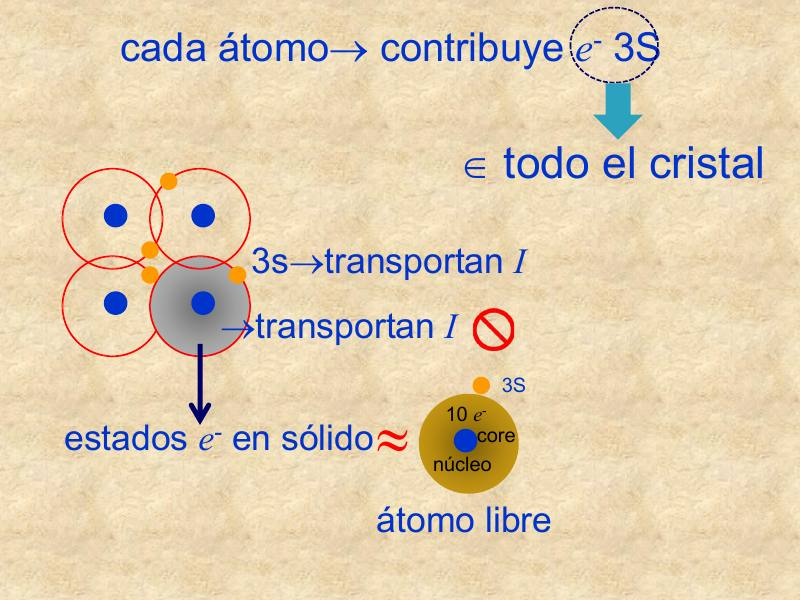
*Metales 2021, diap. 8*

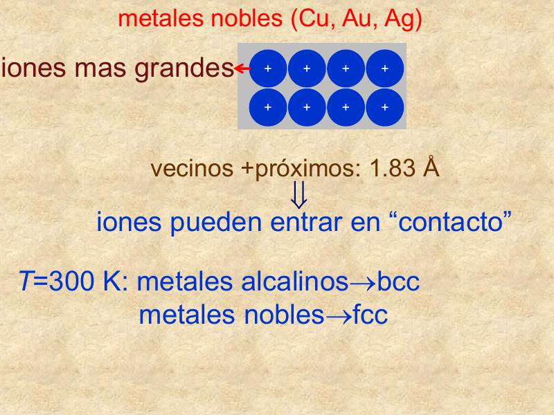
*Metales 2021, diap. 9*

*Metales 2021, diap. 10*

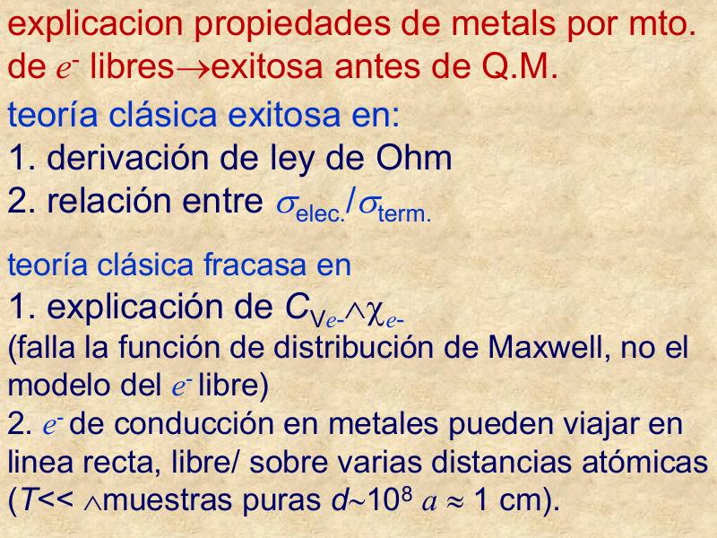
*Metales 2021, diap. 11*

*Metales 2021, diap. 12*

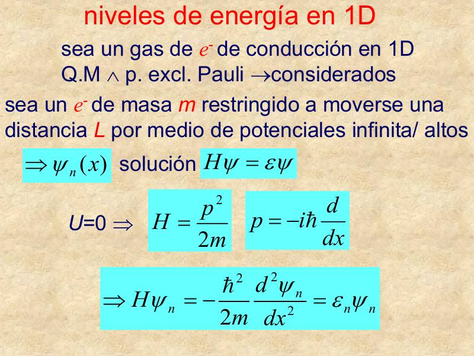
*Metales 2021, diap. 13*

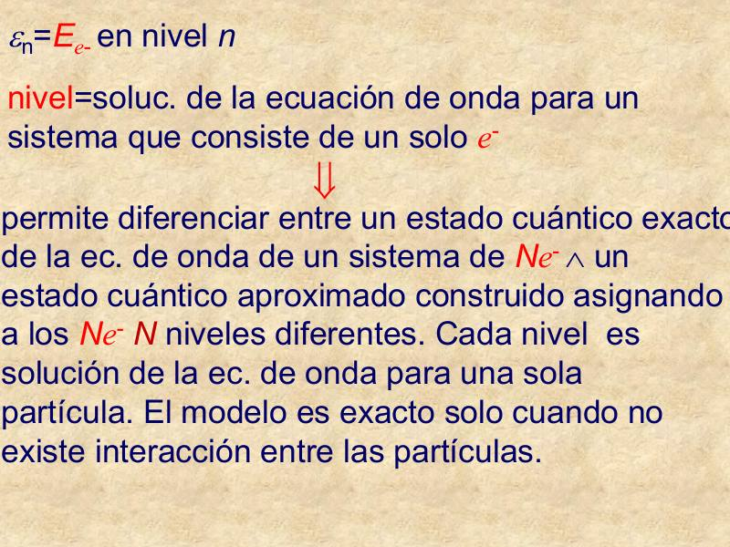
*Metales 2021, diap. 14*

*Metales 2021, diap. 15*

*Metales 2021, diap. 16*

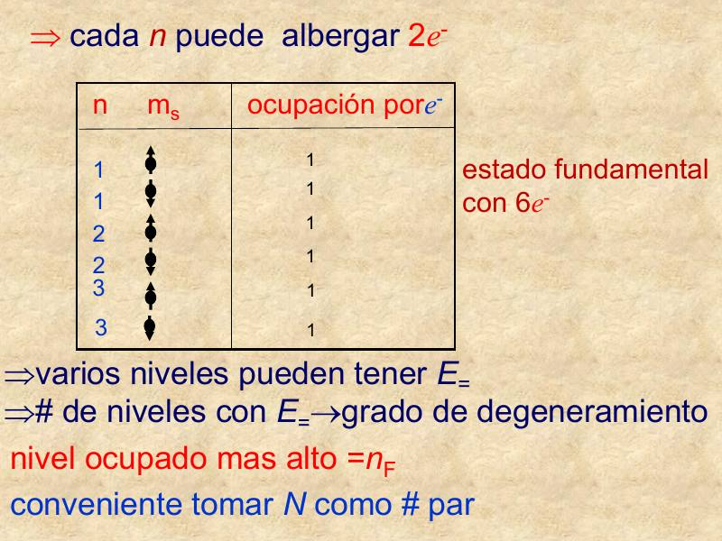
*Metales 2021, diap. 17*

*Metales 2021, diap. 18*

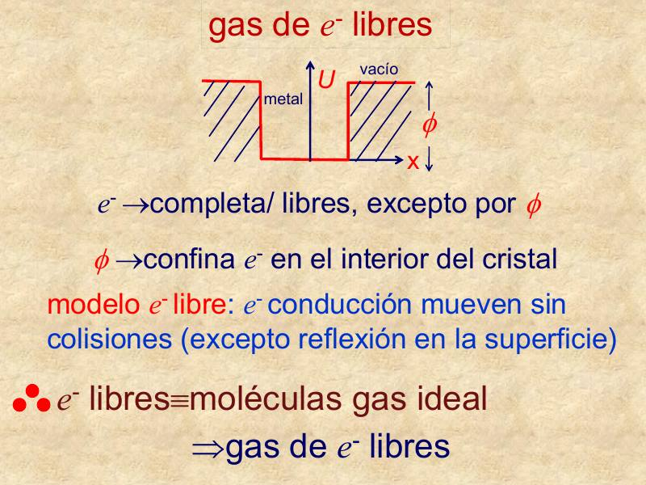
*Metales 2021, diap. 19*

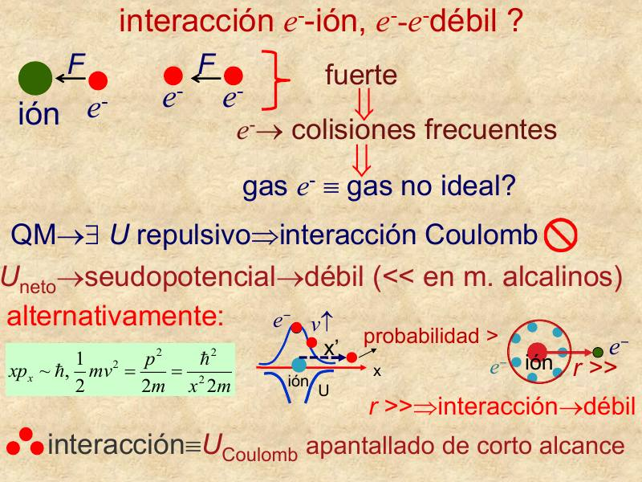
*Metales 2021, diap. 20*

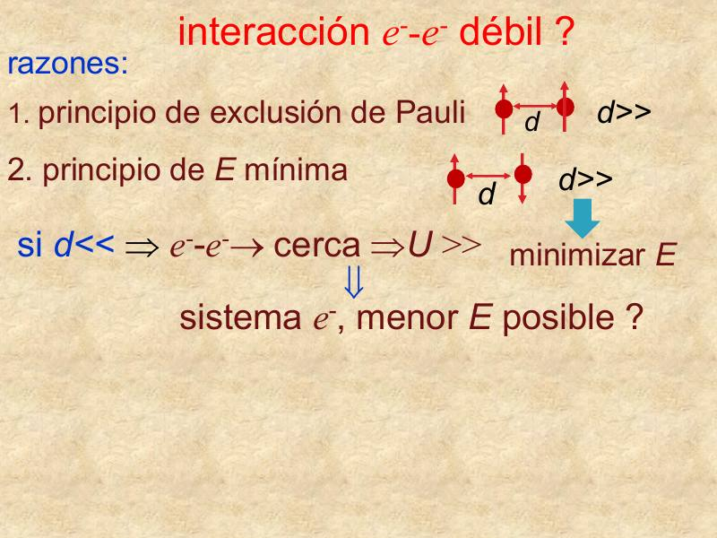
*Metales 2021, diap. 21*

*Metales 2021, diap. 22*

*Metales 2021, diap. 23*

