# T02 · Modelo de Drude (`drude.1`, `drude.2`, `drude.3`)

> **Alcance:** diapositivas **24-50** de `Metales 2021.pdf` + **Pavlov** (copia completa). Teoría base: `notas/01_modelo_de_drude.md`. $m^*$ = masa efectiva (interacción e⁻-red); $\tau$ = tiempo de relajación.

## Fuentes exactas

| Subtema | Diapositivas | Pavlov (libro, página impresa) | Imágenes |
|---|---|---|---|
| `drude.1` | 24-30 | **Cap. 6, §6.3, pp. 218-219** (ecs. 6.92-6.96: deducción de Drude-Lorentz de $\sigma$); **Cap. 7, §7.1, pp. 235-236** | `slide_p24…p30`, `pavlov_p218/219/235/236` |
| `drude.2` | 31-37 | **Cap. 6, §6.3, pp. 218-219** ($\tau$, $\langle\lambda_c\rangle=v\tau$, movilidad) | `slide_p31…p37`, `pavlov_p218` |
| `drude.3` | 38-50 | **Cap. 7, §7.13, pp. 286-287** (ρ(T) de metales, Fig. 7.24) | `slide_p38…p50`, `pavlov_p286/287` |

---

## `drude.1` — Ley de Ohm y ecuación de Drude

- **Macroscópico (diap. 24-25):** $I=V/R$, $J=I/A$, $EL=V$, $R=\rho L/A$, $\sigma=1/\rho$ ⇒ $\mathbf J=\sigma\mathbf E$ (ley de Ohm). Es **empírica** (no un principio fundamental): falla a campos muy altos.

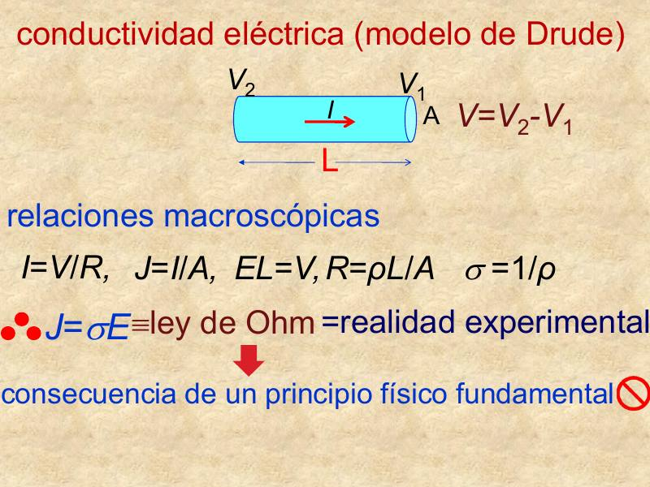
*Metales 2021, diap. 24: alambre ($L$, $A$, $V=V_2-V_1$) y relaciones macroscópicas de Ohm.*

- **Dinámica (diap. 27):** fuerza $-e\mathbf E$ + fricción $-m^*\mathbf v/\tau$:
$$m^*\frac{d\mathbf v}{dt}=-e\mathbf E-\frac{m^*\mathbf v}{\tau}$$

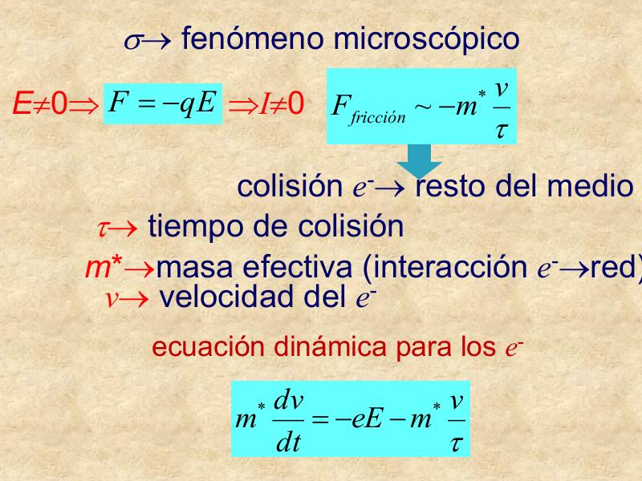
*Metales 2021, diap. 27: ecuación dinámica del e⁻ (fuerza del campo + fricción de las colisiones).*

- **Estacionario (diap. 28):** $\dot{\mathbf v}=0$ ⇒ $\mathbf v_d=-e\tau\mathbf E/m^*$ (velocidad de deriva). La colisión es un evento *instantáneo* (teoría cinética).
- **$v_r\gg v_d$ (diap. 29):** la velocidad aleatoria (térmica, $\tfrac12mv_r^2=\tfrac32k_BT$) domina; con $E=0$ la distribución en $v_x$ es simétrica ($I=0$); con $E\neq0$ se desplaza $v_d$.

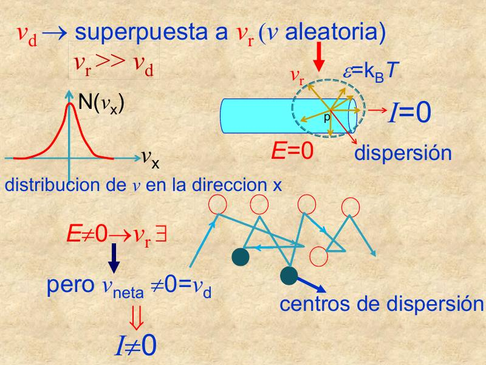
*Metales 2021, diap. 29: $v_d$ superpuesta a la velocidad aleatoria $v_r$; centros de dispersión.*

- **$\mathbf J$ (diap. 30):** en $dt$ cruzan $A$ los e⁻ del volumen $Av_ddt$ ⇒ $\mathbf J=-Ne\mathbf v_d$ ⇒ $\boxed{\sigma=\dfrac{Ne^2\tau}{m^*}}$.

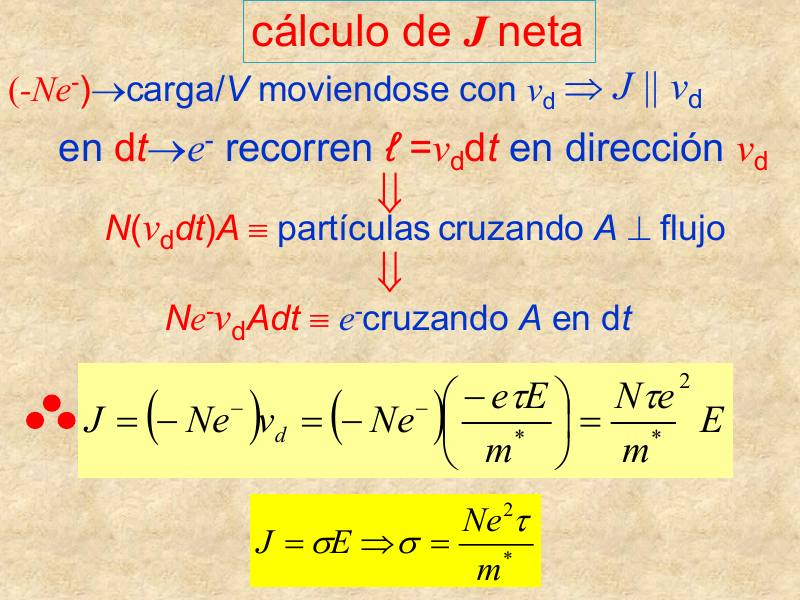
*Metales 2021, diap. 30: cálculo de $J$ neta y $\sigma=Ne^2\tau/m^*$.*

### Pavlov (Cap. 6, §6.3, pp. 218-219) — la misma deducción

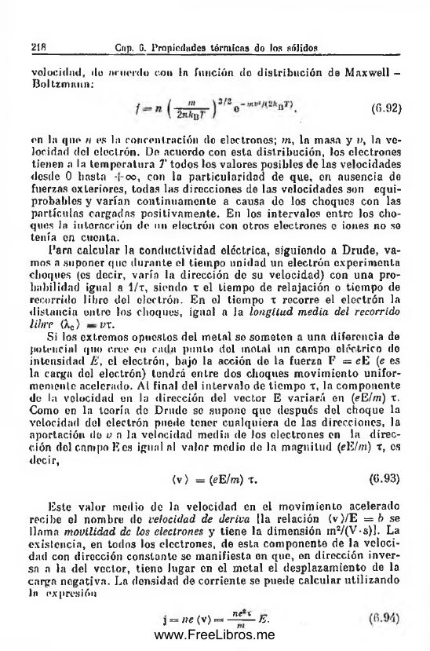
*Pavlov, Cap. 6, §6.3, p. 218: Drude-Lorentz con distribución de Maxwell (6.92); probabilidad de choque $1/\tau$; $\langle v\rangle=(eE/m)\tau$ (6.93); $j=ne^2\tau E/m$ (6.94).*

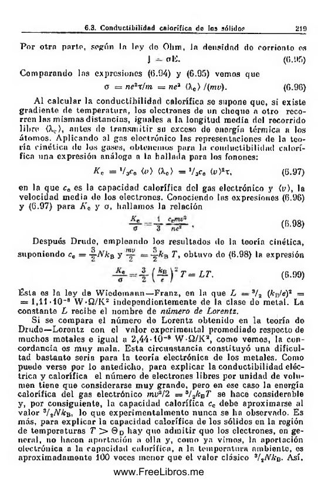
*Pavlov, Cap. 6, §6.3, p. 219: $\sigma=ne^2\tau/m=ne^2\langle\lambda_c\rangle/(m\langle v\rangle)$ (6.96). Debajo, la ley de Wiedemann-Franz (6.97-6.99, **fuera de alcance**).*

Pavlov usa $b=\langle v\rangle/E$ como **movilidad** (m²/V·s) y llama $\langle\lambda_c\rangle=v\tau$ a la longitud media del recorrido libre. (Su $m$ es $m^*$ en la notación de las diapositivas.)

---

## `drude.2` — $\tau$, camino libre, movilidad, órdenes de magnitud, Joule

- **Significado de $\tau$ (diap. 31):** se apaga $E$ en $t=0$ ⇒ $m^*\dot v_d=-m^*v_d/\tau$ ⇒ $v_d(t)=v_{d,0}e^{-t/\tau}$; $\tau\sim10^{-14}$ s.
- **Sobrevivientes (diap. 32-33):** prob. de colisión en $dt$ = $dt/\tau$ ⇒ $dn=-(1/\tau)n\,dt$ ⇒ $n(t)=n_0e^{-t/\tau}$; tiempo medio de supervivencia $t_{av}=\int t\,e^{-t/\tau}dt\big/\int e^{-t/\tau}dt=\tau$.

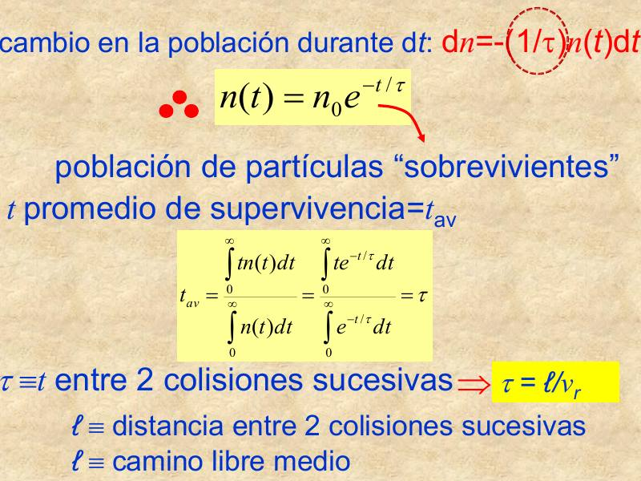
*Metales 2021, diap. 33: $n(t)=n_0e^{-t/\tau}$ y $t_{av}=\tau$.*

- **Camino libre y movilidad (diap. 34):** $\ell=v_r\tau$; $\sigma=Ne^2\ell/(m^*v_r)$; $v=\mu E$ con $\mu=e\tau/m^*$ ⇒ $\sigma=Ne\mu$.

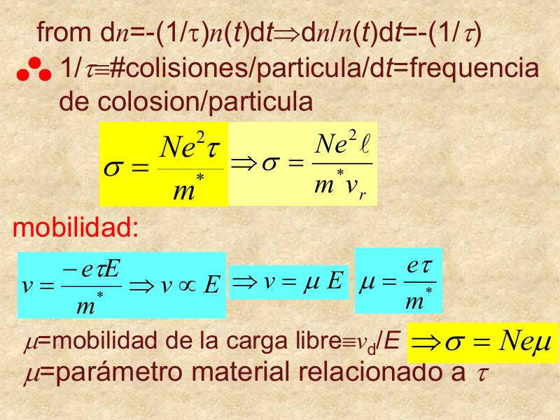
*Metales 2021, diap. 34: $\sigma=Ne^2\ell/m^*v_r$, movilidad $\mu=e\tau/m^*$ y $\sigma=Ne\mu$.*

- **Tabla (diap. 35):** por ejemplo Na: $\sigma=2.11\times10^7$ Ω⁻¹m⁻¹, $N=2.5\times10^{28}$ m⁻³, $\tau=3.1\times10^{-14}$ s, $v_F=1.1\times10^6$ m/s, $\ell=350$ Å, $m^*/m_0=1.2$; Cu: $\sigma=5.88\times10^7$, $N=8.45\times10^{28}$, $\tau=2.7\times10^{-14}$ s.

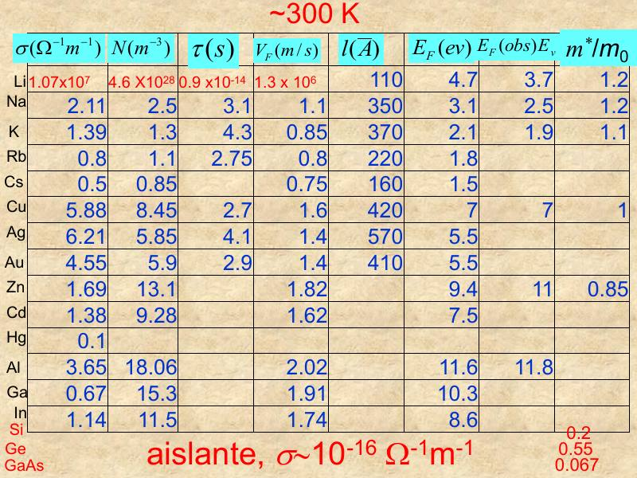
*Metales 2021, diap. 35: tabla de $\sigma$, $N$, $\tau$, $v_r$, $\ell$, $E_F$, $m^*/m_0$ (300 K).*

- **Metal vs. aislante (diap. 36):** $\sigma_m/\sigma_i\sim10^{23}$ ($N\sim10^{29}$ vs. $10^{20}$ m⁻³; $v_r\sim10^6$ vs. $10^4$ m/s); $v_d\sim10^{-2}$ m/s ⇒ $v_d/v_r\sim10^{-8}$.
- **Joule (diap. 37):** $W_{abs}=NFv_d=\sigma E^2$ ⇒ $dQ/dt=\mathbf J\cdot\mathbf E=\rho J^2$ ⇒ $P=I^2R$.

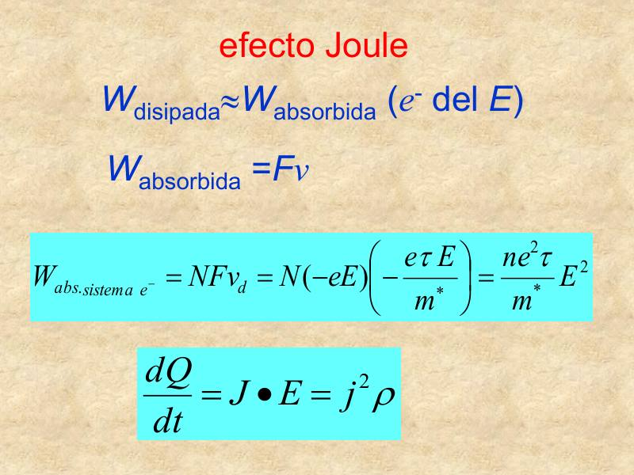
*Metales 2021, diap. 37: efecto Joule, $W=\sigma E^2$.*

> **Nota de coherencia:** con $\sigma$, $N$ y $m^*$ de la tabla de la diap. 35 el $\tau=\sigma m^*/Ne^2$ sale ≈10-15 % distinto del $\tau$ de la tabla (p. ej. Cu: 2.5 vs. 2.7 × 10⁻¹⁴ s). Son valores redondeados de la diapositiva; se resuelve en `practica/P02`.

---

## `drude.3` — Origen de $\tau$: red, ondas de materia y Matthiessen

- **Qué colisiones destruyen $J$ (diap. 38):** e⁻-e⁻ **conservan** $\mathbf p_{total}$ ⇒ no cambian $\sum\mathbf v_d$ ni $J$. Solo cuentan colisiones que no conservan el momento del gas de e⁻ (red, impurezas).
- **Paradoja (diap. 39):** $\ell=\tau v_r\approx10^{-14}\cdot10^6=10^{-8}$ m $\approx10^2$ Å ⇒ **$\ell>20a$**: los iones no son bolas rígidas.

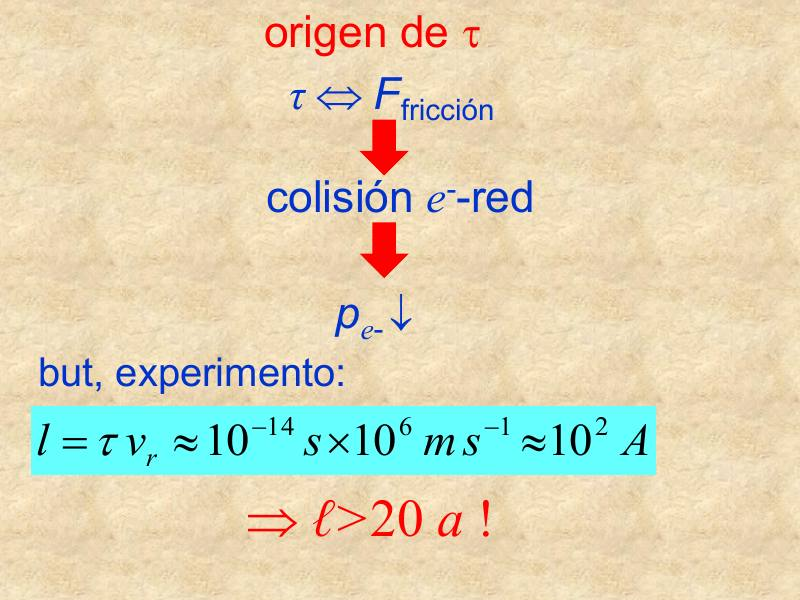
*Metales 2021, diap. 39: $\ell=\tau v_r\approx10^2$ Å ⇒ $\ell>20a$.*

- **Cuántica (diap. 40-42):** $\lambda_e=h/m^*v_r$; una **red periódica perfecta no dispersa** (cada ion re-emite pero la interferencia no cambia dirección/intensidad, salvo Bragg) ⇒ $\ell=\infty$, $\tau=\infty$, $\sigma=\infty$. Experimentalmente $\ell\sim10^2$ Å por **vibración térmica, imperfecciones, impurezas**. Un fonón no transporta carga ni conserva $\mathbf p$ ⇒ $J$ puede revertirse.

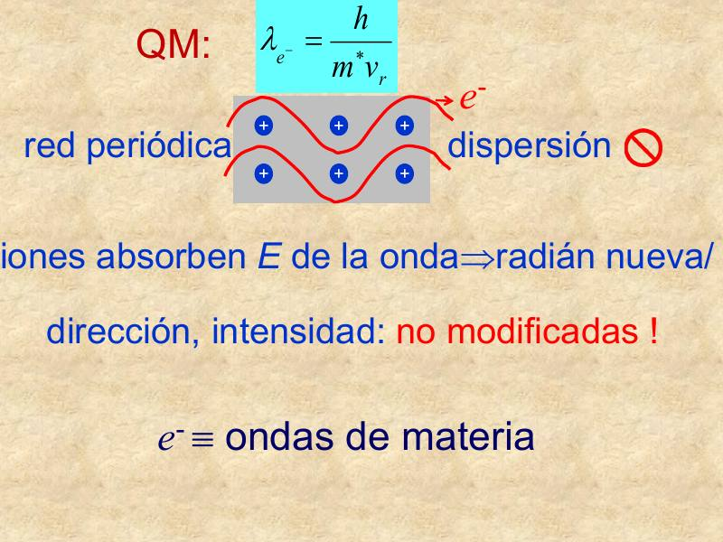
*Metales 2021, diap. 40: el e⁻ como onda de materia en la red periódica (no hay dispersión).*

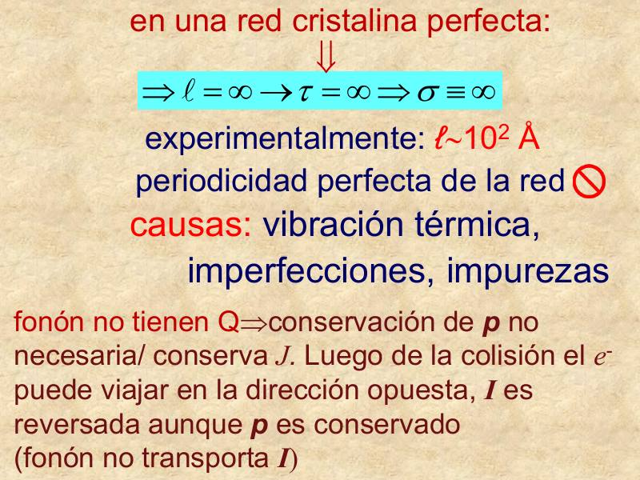
*Metales 2021, diap. 42: red perfecta ⇒ $\ell=\infty$; causas reales de dispersión.*

- **$\rho(T)$ (diap. 43):** $\rho=m^*/(Ne^2\tau)$; $1/\tau$ = probabilidad de dispersión por unidad de tiempo ($10^{14}$ colisiones/s). Na: comportamiento lineal a $T$ alta.

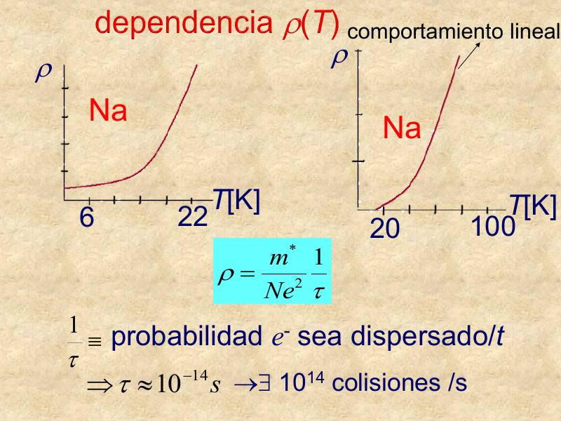
*Metales 2021, diap. 43: $\rho(T)$ del Na (6-22 K y 20-100 K) y comportamiento lineal.*

- **Matthiessen (diap. 44-45):** mecanismos independientes:
$$\frac1\tau=\frac1{\tau_{ph}(T)}+\frac1{\tau_{imp}}\Rightarrow\rho=\rho_{imp}+\rho_{ph}(T)$$
$T\to0$: $\rho\to\rho_{imp}$ (**residual**, cte.); $T\gg$: $\rho\approx\rho_{ph}\propto T$.

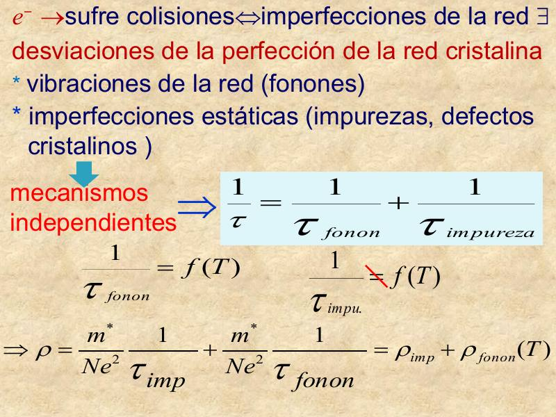
*Metales 2021, diap. 44: fonones e imperfecciones estáticas; $1/\tau=1/\tau_{ph}+1/\tau_{imp}$; regla de Matthiessen.*

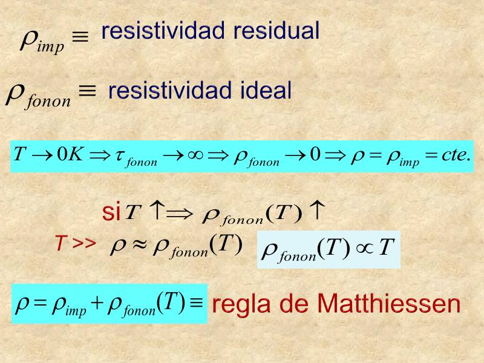
*Metales 2021, diap. 45: $\rho_{imp}$ residual, $\rho_{fonón}$ ideal y $\rho=\rho_{imp}+\rho_{ph}(T)$.*

- **Cálculos (diap. 46-49):** impurezas: $\ell_i=1/(N_i\Omega_i)$, $\rho_i\sim N_i$. Fonones: $\Omega_{ion}\approx\pi\langle x^2\rangle$, $\tfrac12M\omega^2\langle x^2\rangle=\langle E\rangle=\hbar\omega/(e^{\hbar\omega/k_BT}-1)$ (Einstein) ⇒ $T\gg\theta_E$: $\rho_{ph}\sim T/\theta_E\Rightarrow\rho_{ph}\propto T$; $T\ll\theta_E$: $\rho_{ph}\sim e^{-\theta_E/T}$ (Einstein) pero el **experimento** da $\rho\sim T^5$ ⇒ modelo de **Debye** (iones acoplados).

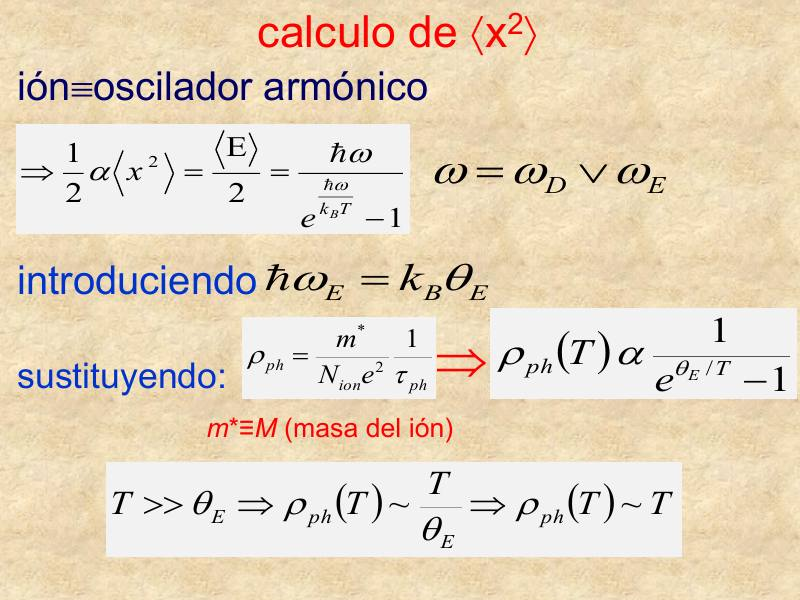
*Metales 2021, diap. 48: cálculo de $\langle x^2\rangle$ y $\rho_{ph}\propto1/(e^{\theta_E/T}-1)$; $T\gg\theta_E$ ⇒ $\rho_{ph}\sim T$.*

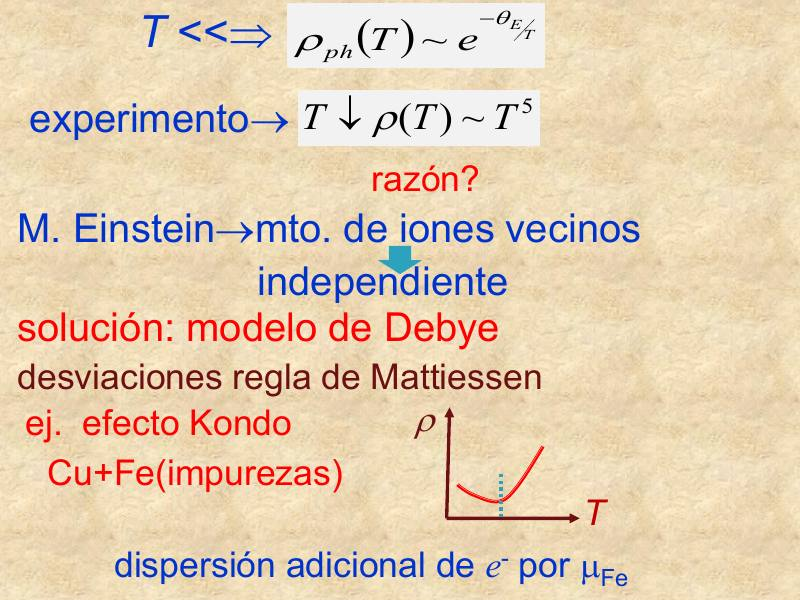
*Metales 2021, diap. 49: $T\ll\theta$: Einstein da $e^{-\theta_E/T}$, el experimento $T^5$ ⇒ Debye. Desviaciones de Matthiessen: efecto Kondo (Cu+Fe).*

- **Desviaciones (diap. 49-50):** efecto **Kondo** (Cu con Fe: dispersión extra por el espín magnético; $\rho$ sube al bajar $T$).

### Pavlov (Cap. 7, §7.13, pp. 286-287)

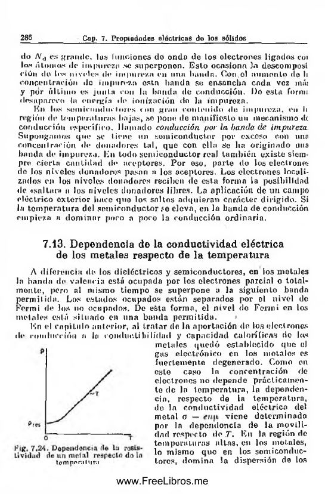
*Pavlov, Cap. 7, §7.13, p. 286: dependencia de σ de los metales con $T$; Fig. 7.24 $\rho(T)$ con $\rho_{res}$ a $T\to0$ y $\rho\propto T$ a $T$ alta.*

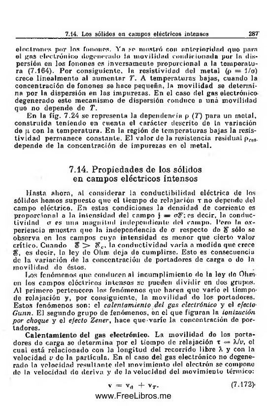
*Pavlov, Cap. 7, §7.13, p. 287: dispersión por fonones ($\mu\propto1/T$ ⇒ $\rho\propto T$) e impurezas ($\rho_{res}$ constante).*

En el metal $n$ es casi constante (gas degenerado) ⇒ $\sigma(T)=en\mu(T)$ la fija la movilidad: a $T$ alta dominan los **fonones** ($\mu\propto1/T$, $\rho\propto T$); a $T$ baja las **impurezas** ($\rho\to\rho_{res}$). **El libro no da la ley $T^5$** de las diapositivas.

### Pavlov (Cap. 7, §7.1, pp. 235-236)

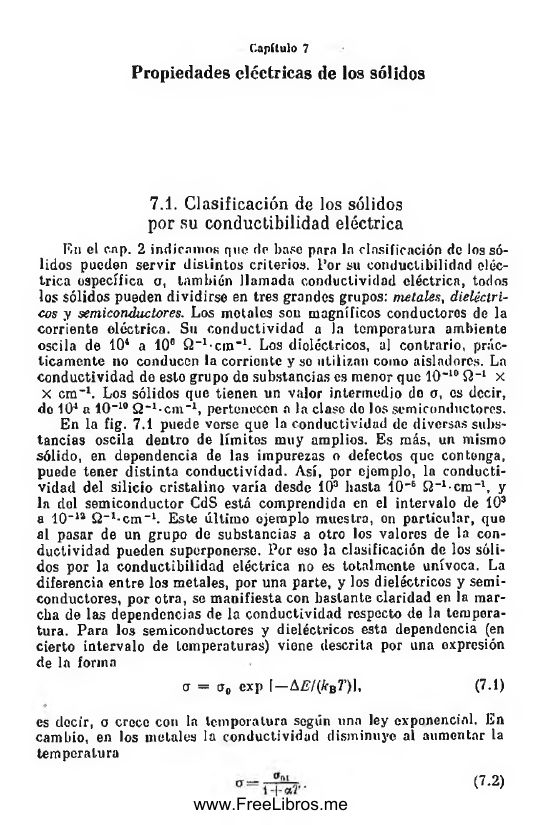
*Pavlov, Cap. 7, §7.1, p. 235: rangos de σ de metales, semiconductores y dieléctricos; σ de los metales baja al subir $T$ (7.2).*

---

## Checklist de teoría (T02)

- [ ] T.drude.1.1 Escribir $m^*\dot{\mathbf v}=-e\mathbf E-m^*\mathbf v/\tau$ y resolver el estacionario $v_d=-e\tau E/m^*$
- [ ] T.drude.1.2 Deducir $\mathbf J=-Nev_d$ y $\sigma=Ne^2\tau/m^*$ (y compararlo con Pavlov 6.92-6.96)
- [ ] T.drude.1.3 Explicar $v_r\gg v_d$ y que la ley de Ohm es empírica con rango de validez
- [ ] T.drude.1.4 Usar $v_d=I/(neA)$ en un alambre
- [ ] T.drude.2.1 Interpretar $\tau$: $e^{-t/\tau}$, vida media de supervivencia, $1/\tau$ = frecuencia de colisión
- [ ] T.drude.2.2 Relacionar $\ell=v\tau$, $\sigma=Ne^2\ell/m^*v$ y la movilidad $\mu=e\tau/m^*$, $\sigma=Ne\mu$
- [ ] T.drude.2.3 Órdenes de magnitud: $v_d\sim10^{-2}$ m/s, $v_r\sim10^6$ m/s, $\tau\sim10^{-14}$ s, $\ell\sim10^2$ Å
- [ ] T.drude.2.4 Explicar $\sigma_m/\sigma_i\sim10^{23}$ y demostrar $P=\sigma E^2\Rightarrow I^2R$
- [ ] T.drude.3.1 Por qué e⁻-e⁻ no cambian $v_d$ ni $J$ y qué colisiones sí
- [ ] T.drude.3.2 Resolver la paradoja $\ell\sim100$ Å $\gg a$: red perfecta no dispersa (ondas de materia)
- [ ] T.drude.3.3 Enunciar y usar la regla de Matthiessen y la resistividad residual
- [ ] T.drude.3.4 Límites de $\rho_{ph}$: $\propto T$ ($T\gg\theta$), $\sim T^5$ (experimental, Debye) y por qué Einstein no basta
- [ ] T.drude.3.5 Efecto Kondo como violación de Matthiessen
- [ ] T.drude.3.6 Mostrar que con dispersión clásica $\rho\propto T^{3/2}$ y comparar con Pavlov §7.13 ($\rho\propto T$)

## Galería completa de diapositivas 24-50

*Metales 2021, diap. 24*

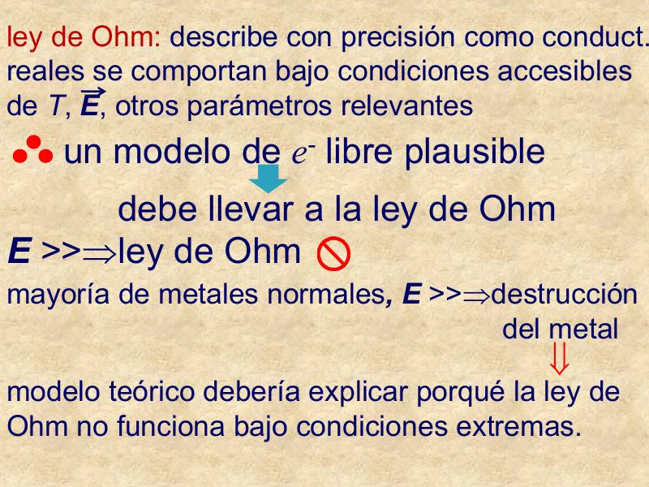
*Metales 2021, diap. 25*

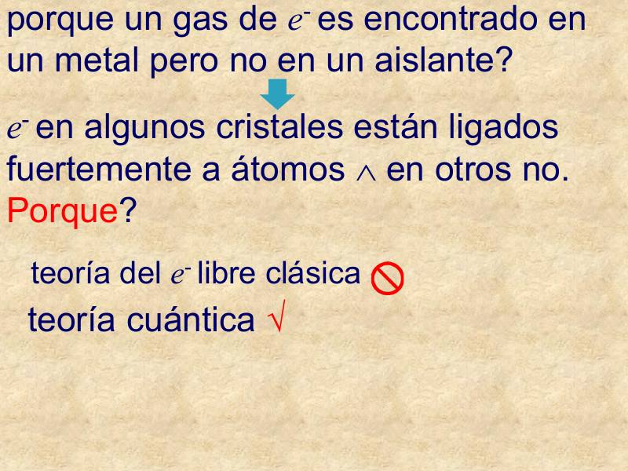
*Metales 2021, diap. 26*

*Metales 2021, diap. 27*

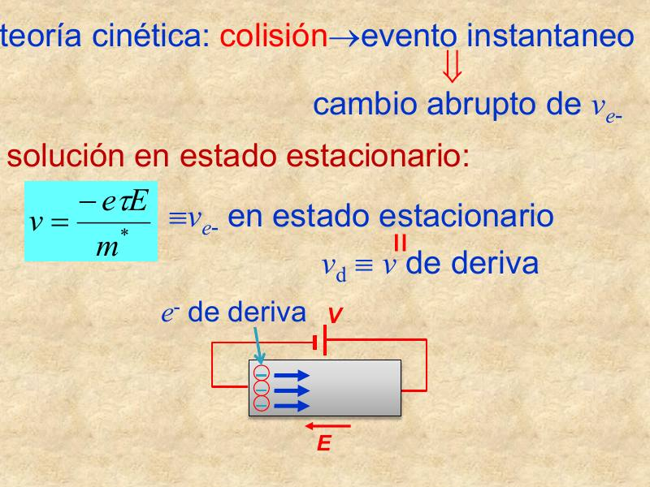
*Metales 2021, diap. 28*

*Metales 2021, diap. 29*

*Metales 2021, diap. 30*

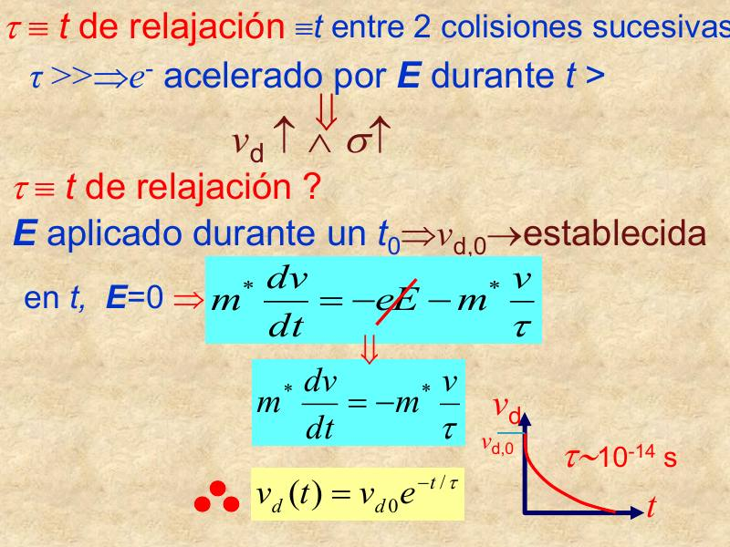
*Metales 2021, diap. 31*

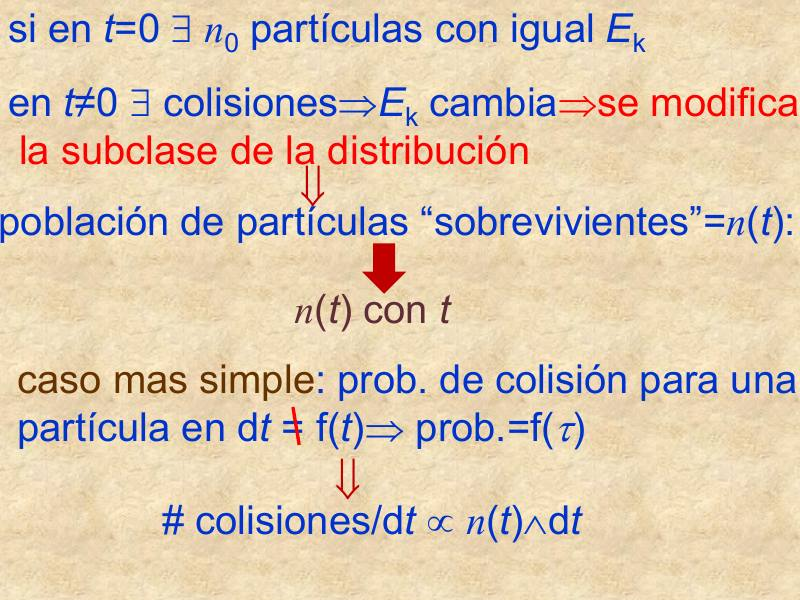
*Metales 2021, diap. 32*

*Metales 2021, diap. 33*

*Metales 2021, diap. 34*

*Metales 2021, diap. 35*

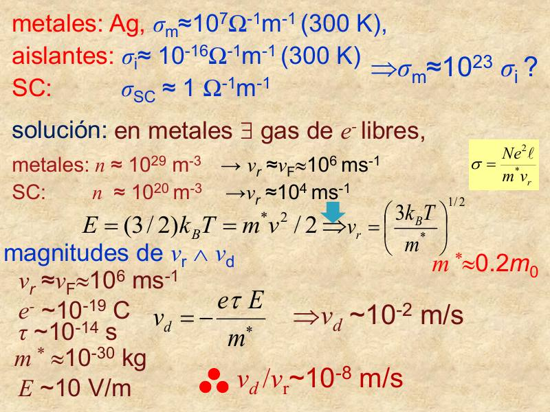
*Metales 2021, diap. 36*

*Metales 2021, diap. 37*

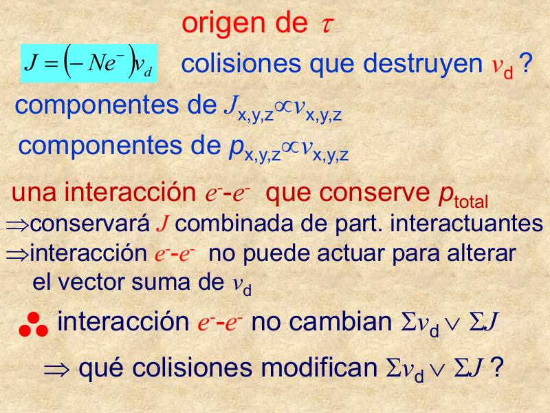
*Metales 2021, diap. 38*

*Metales 2021, diap. 39*

*Metales 2021, diap. 40*

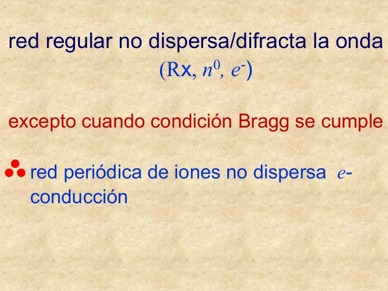
*Metales 2021, diap. 41*

*Metales 2021, diap. 42*

*Metales 2021, diap. 43*

*Metales 2021, diap. 44*

*Metales 2021, diap. 45*

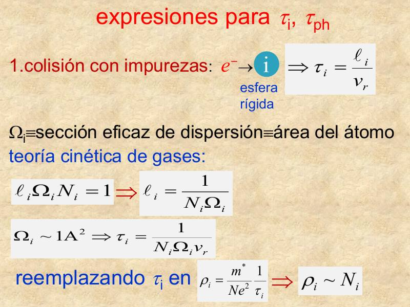
*Metales 2021, diap. 46*

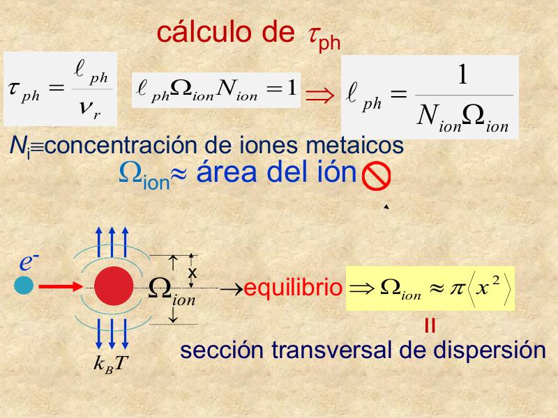
*Metales 2021, diap. 47*

*Metales 2021, diap. 48*

*Metales 2021, diap. 49*

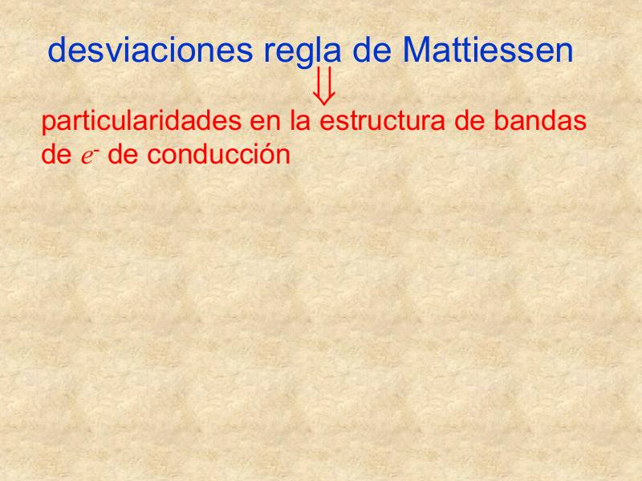
*Metales 2021, diap. 50*

