# T03 · Calor específico electrónico y Fermi-Dirac (`cal.1`, `cal.2`)

> **Alcance:** diapositivas **51-61** de `Metales 2021.pdf` + **Pavlov Cap. 6, §6.1, pp. 200-207**. Teoría base: `notas/02_estadistica_fermi_calor_especifico.md`. (`cal.3`, $U(T)$ de las diap. 70-71 y 106-109, está **fuera del parcial**.)

## Fuentes exactas

| Subtema | Diapositivas | Pavlov (libro, página impresa) | Imágenes |
|---|---|---|---|
| `cal.1` | 51-53 | **Cap. 6, §6.1, p. 200** (Maxwell-Boltzmann da $C$ 1.5× Dulong-Petit; Fig. 6.6) | `slide_p51…p53`, `pavlov_p200` |
| `cal.2` | 53-61 | **Cap. 6, §6.1, pp. 201-207**: Pauli y Fig. 6.7 (p. 201); $f(E)$ de Fermi-Dirac (6.46), límite MB (6.47), $T_F\approx5\cdot10^4$ K, Figs. 6.8-6.9 (p. 202); (6.57) $E_F(T)$ (p. 204); $U_e(T)$ (6.58-6.61, p. 205); $c_e=\gamma_eT$ (6.62-6.65, p. 206); $c_V=\gamma_eT+\gamma_DT^3$ (6.66) y $T_c\approx\Theta_D/10$ (6.67), Fig. 6.11 (p. 207) | `slide_p53…p61`, `pavlov_p201…p207` |

---

## `cal.1` — El fracaso clásico

- **Drude-Lorentz (diap. 51-52):** los e⁻ serían partículas libres que cumplen mecánica, magnetismo y estadística clásicos ⇒ equipartición $\langle E\rangle=\tfrac32k_BT$ por e⁻, $\langle E\rangle_{mol}=\tfrac32RT$ ⇒ $C_e=\tfrac32R\approx3$ cal/mol·K.
- **Total clásico a $T$ alta (diap. 52):** $C=C_{red}+C_e=3R+\tfrac32R=4.5R\approx9$ cal/mol·K.

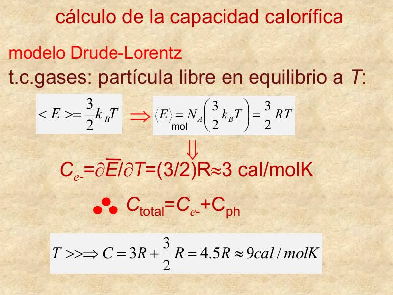
*Metales 2021, diap. 52: cálculo clásico, $C_{e}=\tfrac32R$ y $C_{total}=4.5R$.*

- **Experimento (diap. 53):** $C_{total}\approx3R\approx6$ cal/mol·K (como un aislante); $C_e\approx10^{-2}\cdot\tfrac32R$. Lo que falla es **Maxwell-Boltzmann** (estadística), no la idea de e⁻ libres.

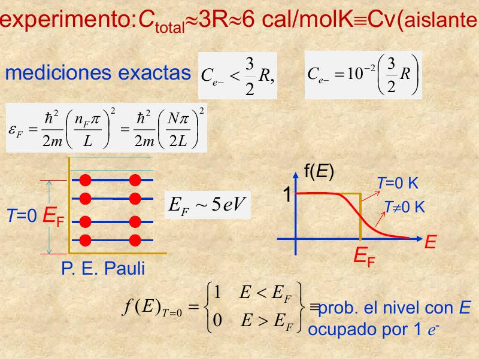
*Metales 2021, diap. 53: experimento ($C_{total}\approx3R$), $C_{e}\sim10^{-2}\cdot\tfrac32R$; niveles con $E_F\sim5$ eV y $f(E)$ a $T=0$ y $T>0$.*

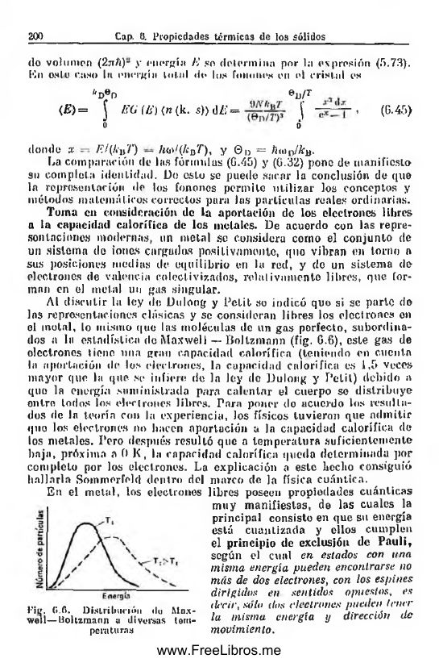
*Pavlov, Cap. 6, §6.1, p. 200: con Maxwell-Boltzmann (Fig. 6.6) $C_e$ sería ~1.5 veces mayor que la de Dulong-Petit; Pauli resuelve la discrepancia.*

## `cal.2` — Fermi-Dirac, $T_F$ y $C_e\propto T$

- **$T=0$ (diap. 53, 56):** los $N$ e⁻ llenan los niveles hasta $E_F\sim5$ eV (Pauli): $f=1$ si $E<E_F$, $f=0$ si $E>E_F$. Pavlov: Fig. 6.7 (niveles con "espines") y Fig. 6.8 (escalón).

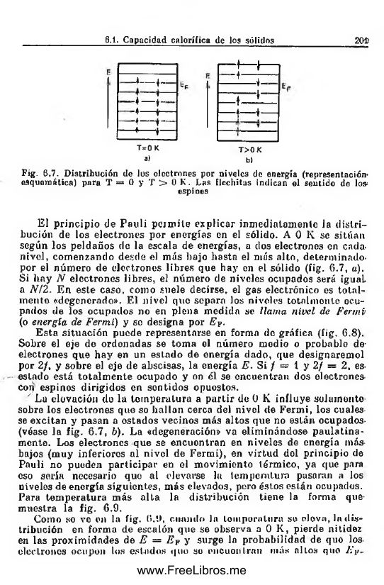
*Pavlov, Cap. 6, §6.1, p. 201, Fig. 6.7: distribución de e⁻ por niveles a $T=0$ y $T>0$ (solo los cercanos a $E_F$ se excitan).*

- **$T>0$ (diap. 54):** la energía no se reparte igual entre todos; los e⁻ con $E\ll E_F$ **no pueden** absorber (niveles vecinos llenos). $k_BT\approx25$ meV a 300 K $\ll E_F$.

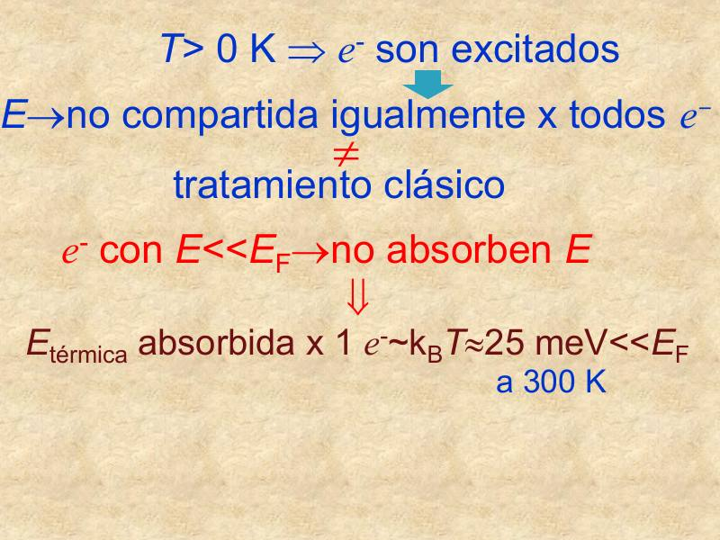
*Metales 2021, diap. 54: a $T>0$ solo e⁻ cercanos a $E_F$ se excitan; $E_{térmica}\sim k_BT\approx25$ meV $\ll E_F$.*

- **Fermi-Dirac (diap. 55, 60):**
$$f(E)=\frac1{e^{(E-\mu)/k_BT}+1}$$
Pavlov lo escribe con $E_F$ en (6.46) (p. 202) y muestra su forma en la Fig. 6.9.

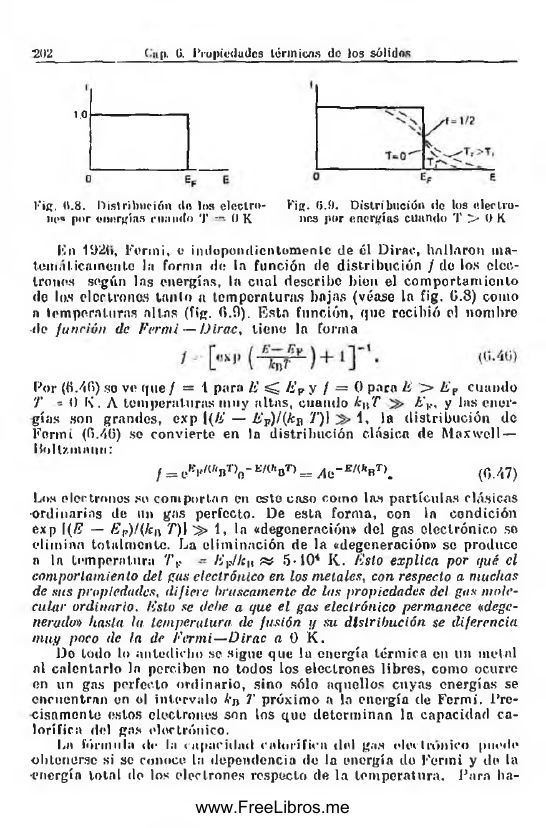
*Pavlov, Cap. 6, §6.1, p. 202: Figs. 6.8-6.9; $f$ de Fermi-Dirac (6.46), límite clásico (6.47) y $T_F=E_F/k_B\approx5\cdot10^4$ K.*

- **Estimación de $C_e$ (diap. 57-58):** fracción de e⁻ afectados $\sim k_BT/E_F$ ⇒ $N_Ak_BT/E_F$ por mol, cada uno absorbe $\sim k_BT$ ⇒ $\bar E=N_A(k_BT)^2/E_F$ ⇒ $C_e=\partial\bar E/\partial T\approx2Rk_BT/E_F=2R\,T/T_F$. Con $E_F=5$ eV, $T_F\approx50\,000$ K y a 300 K: $k_BT/E_F\approx1/200$.

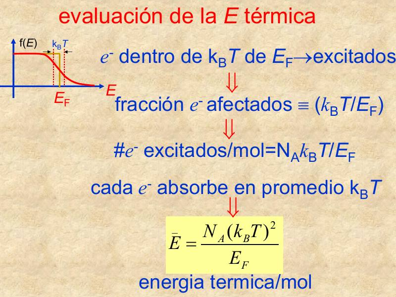
*Metales 2021, diap. 57: solo los e⁻ dentro de $k_BT$ de $E_F$ se excitan; $\bar E=N_A(k_BT)^2/E_F$.*

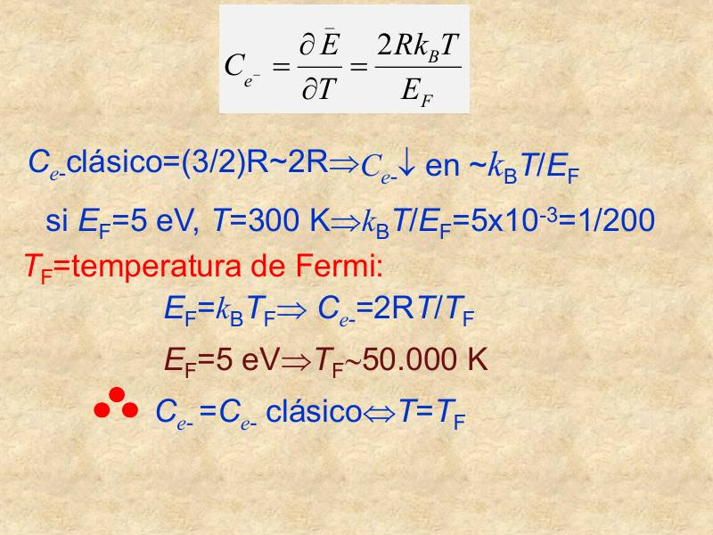
*Metales 2021, diap. 58: $C_e\approx2Rk_BT/E_F$; $T_F=E_F/k_B$ (5 eV ⇒ 50 000 K); $C_e=C_{clás}$ solo si $T=T_F$.*

- **Cálculo exacto (diap. 59; Pavlov 6.64):** $C_e\approx\dfrac{\pi^2}{2}R\dfrac{k_BT}{E_F}=\dfrac{\pi^2}{2}R\dfrac T{T_F}$. *(La estimación de la diap. 58 da prefactor 2; el exacto es $\pi^2/2\approx4.93$: mismo orden.)* Pavlov: $c_e=\tfrac{\pi^2}{3}k_B^2N[E_F(0)]T=\gamma_eT$ (6.64) y $c_e/c_e^{cl}=\tfrac{\pi^2}{3}k_BT/E_F\sim10^{-2}$ (6.65).
- **Red + electrones (diap. 59; Pavlov 6.66):** $C=C_{el}+C_{ph}=\gamma T+\beta T^3$, $C/T=\gamma+\beta T^2$; a $T\ll\theta_D$ domina $\gamma T$. Pavlov: $T_c\approx\Theta_D/10$ por debajo del cual el término electrónico supera al de la red (6.67, Fig. 6.11).

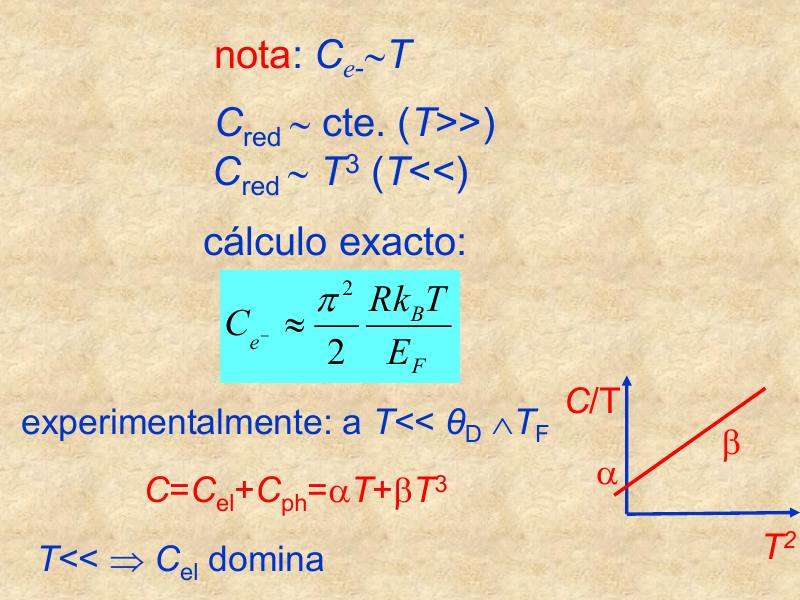
*Metales 2021, diap. 59: $C_e\propto T$; $C_{red}\sim T^3$; cálculo exacto $C_e\approx\tfrac{\pi^2}{2}R\,k_BT/E_F$; gráfica $C/T$ vs. $T^2$.*

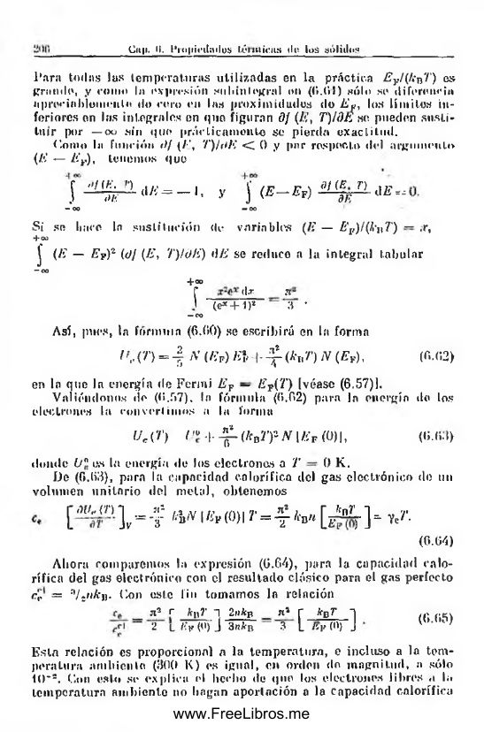
*Pavlov, Cap. 6, §6.1, p. 206: $U_e(T)$ (6.62-6.63), $c_e=\gamma_eT$ (6.64) y $c_e/c_e^{cl}$ (6.65).*

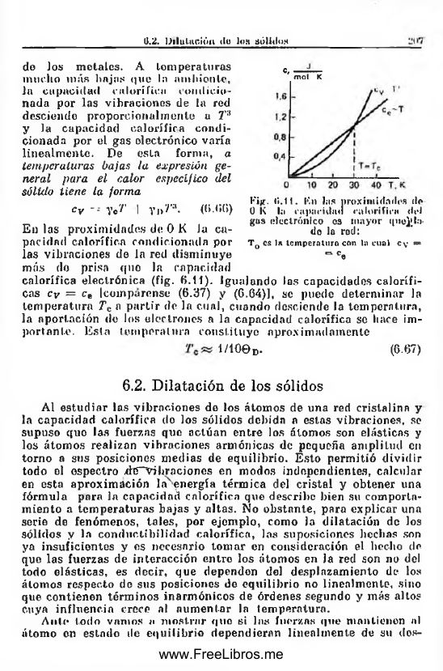
*Pavlov, Cap. 6, §6.1, p. 207: $c_V=\gamma_eT+\gamma_DT^3$ (6.66), $T_c\approx\Theta_D/10$ (6.67), Fig. 6.11.*

- **Potencial químico (diap. 60-61):** $\mu=\mu(T)$ se fija pidiendo $\int Df=N$; $\mu(0)=E_F$; $f(\mu)=\tfrac12$. Pavlov (6.57, p. 204): $E_F(T)=E_F(0)\{1-\tfrac{\pi^2}{12}[k_BT/E_F(0)]^2\}$. En la cola, $E-\mu\gg k_BT$: $f\approx e^{\mu/k_BT}e^{-E/k_BT}=Ce^{-E/k_BT}$ ⇒ **Maxwell-Boltzmann** (Pavlov 6.47).

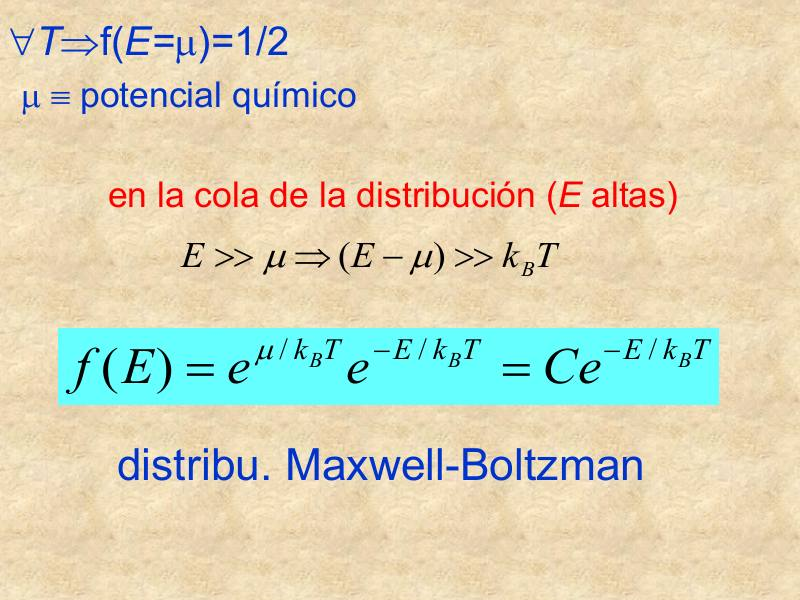
*Metales 2021, diap. 61: $f(E=\mu)=\tfrac12$ y la cola de Maxwell-Boltzmann.*

*Pavlov, Cap. 6, §6.1, p. 204: $N=\int2VN(E)f\,dE$ (6.55), $E_F(0)$ (6.56) y $E_F(T)$ (6.57).*

> **Cuidado con el libro** (`notas/08_mapa_pavlov.md`): en la p. 204 el ejemplo $n=10^{29}$ m⁻³ ⇒ 5 eV no es coherente ($10^{29}$ da 7.9 eV); usa los números de las notas. Además Pavlov usa $N(E)$ por espín en (6.53) y a veces sin el factor 2.

---

## Checklist de teoría (T03)

- [ ] T.cal.1.1 Calcular el valor clásico $C_e=\tfrac32R$ y $C_{total}=4.5R$ y compararlo con el experimental ($\approx3R$)
- [ ] T.cal.1.2 Explicar que falla la estadística (MB), no la idea de e⁻ libres (Pavlov p. 200)
- [ ] T.cal.2.1 Explicar por qué solo los e⁻ cercanos a $E_F$ (dentro de $k_BT$) absorben energía (Pauli)
- [ ] T.cal.2.2 Escribir $f(E)$; mostrar $f(\mu)=\tfrac12$, $\mu(0)=E_F$ y el límite MB en la cola
- [ ] T.cal.2.3 Reconstruir $C_e\approx2R\,T/T_F$ (exacto $\tfrac{\pi^2}{2}R\,T/T_F$) y calcular $T_F=E_F/k_B$
- [ ] T.cal.2.4 Dar $C=\gamma T+\beta T^3$ y decir cuál domina a $T\ll\theta_D$ (Pavlov 6.66-6.67)
- [ ] T.cal.2.5 Comparar $C_{el}$ y $C_{red}$ y hallar la $T$ en que son del mismo orden
- [ ] T.cal.2.6 Anchura de $f(E)$: de 90 % a 10 % ⇒ $\Delta E=2\ln9\,k_BT\approx4.4k_BT$

## Galería completa de diapositivas 51-61

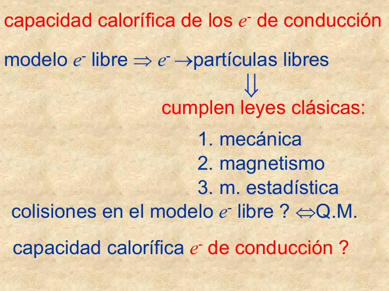
*Metales 2021, diap. 51*

*Metales 2021, diap. 52*

*Metales 2021, diap. 53*

*Metales 2021, diap. 54*

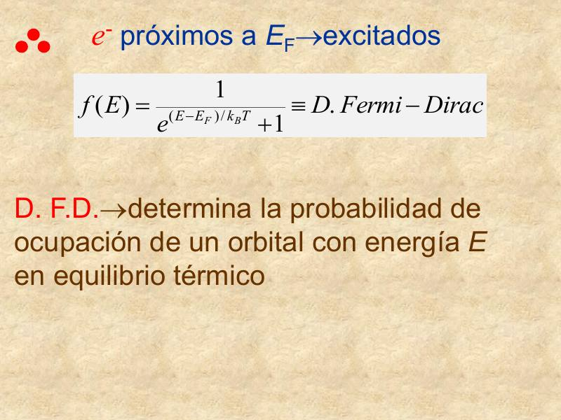
*Metales 2021, diap. 55*

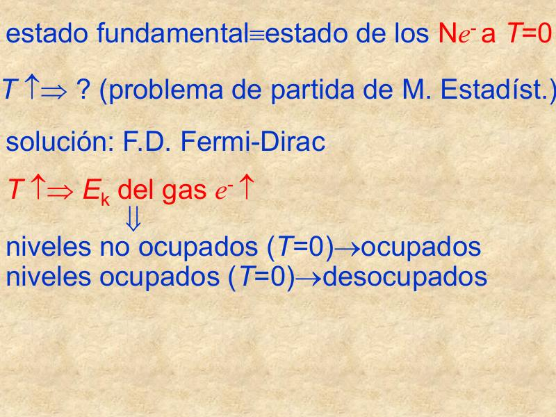
*Metales 2021, diap. 56*

*Metales 2021, diap. 57*

*Metales 2021, diap. 58*

*Metales 2021, diap. 59*

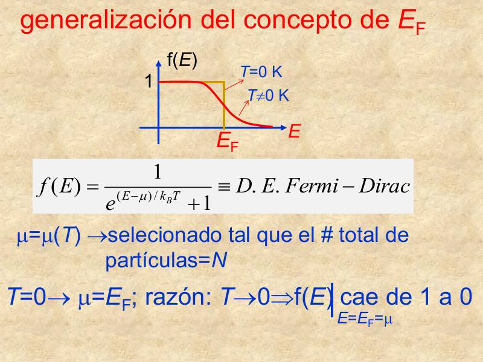
*Metales 2021, diap. 60*

*Metales 2021, diap. 61*

