# T04 · Gas de Fermi en 3D (`fermi3d.1`, `fermi3d.2`)

> **Alcance:** diapositivas **62-70** de `Metales 2021.pdf` + **Pavlov Cap. 6, §6.1, pp. 202-206**. Teoría base: `notas/03_gas_de_fermi_3D.md`. (La superficie de Fermi, diap. 72-73, `fermi3d.3`, está **fuera del parcial**; la diap. 70 es el borde de alcance: se usa solo para $N=\int Df$.)

## Fuentes exactas

| Subtema | Diapositivas | Pavlov (libro, página impresa) | Imágenes |
|---|---|---|---|
| `fermi3d.1` | 62-67 | **Cap. 6, §6.1, pp. 202-204**: espacio de impulsos, celdas $(2\pi\hbar)^3/V$ (6.48-6.49, p. 203); $N=\int2VN(E)f\,dE$ (6.55) y $E_F(0)$ (6.56, p. 204) | `slide_p62…p67`, `pavlov_p203/204` |
| `fermi3d.2` | 68-70 | **Cap. 6, §6.1, pp. 203-206**: $N(E)\propto E^{1/2}$ (6.53), Fig. 6.10 (p. 203); $U_e(T)$ (6.58-6.63, pp. 205-206) | `slide_p68…p70`, `pavlov_p203/205/206` |

---

## `fermi3d.1` — Ondas planas, $k_F$, $E_F$, $v_F$

- **Partícula libre en cubo $L$ (diap. 62):** $-\tfrac{\hbar^2}{2m}\nabla^2\psi=\varepsilon\psi$; con paredes rígidas, $\psi=A\sin\sin\sin$ con $n_i\in\mathbb Z^+$.

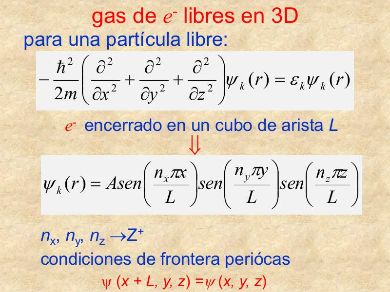
*Metales 2021, diap. 62: ecuación de Schrödinger libre en 3D y soluciones con paredes rígidas.*

- **Condiciones periódicas (diap. 63-64):** $\psi(x+L,y,z)=\psi(x,y,z)$. Ventajas: cristal infinito; sin efecto de fronteras. Soluciones: **ondas planas** $\psi_{\mathbf k}=e^{i\mathbf k\cdot\mathbf r}$ con $k_i=2\pi n_i/L$ ($n_i\in\mathbb Z$, **positivos y negativos**), pues $e^{ik_x(x+L)}=e^{ik_xx}e^{i2\pi n}$.

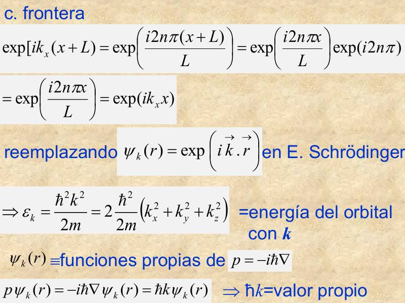
*Metales 2021, diap. 64: $e^{ik_x(x+L)}=e^{ik_xx}$ ⇒ $k_x=2\pi n_x/L$; $\varepsilon_k=\hbar^2k^2/2m$.*

- **Momento y velocidad (diap. 65):** $\mathbf p\psi_k=-i\hbar\nabla\psi_k=\hbar\mathbf k\psi_k$, $\mathbf v=\hbar\mathbf k/m$; estado fundamental de $N$ e⁻ = esfera de Fermi de radio $k_F$ en el espacio $\mathbf k$.
- **Conteo (diap. 66):** cada estado ocupa $(2\pi/L)^3$ en $\mathbf k$; con espín (×2):

$$2\cdot\frac{\tfrac43\pi k_F^3}{(2\pi/L)^3}=\frac{V}{3\pi^2}k_F^3=N\ \Rightarrow\ \boxed{k_F=\left(3\pi^2\frac NV\right)^{1/3}},\ \ \boxed{E_F=\frac{\hbar^2}{2m}\left(3\pi^2\frac NV\right)^{2/3}},\ \ v_F=\frac{\hbar k_F}{m}$$

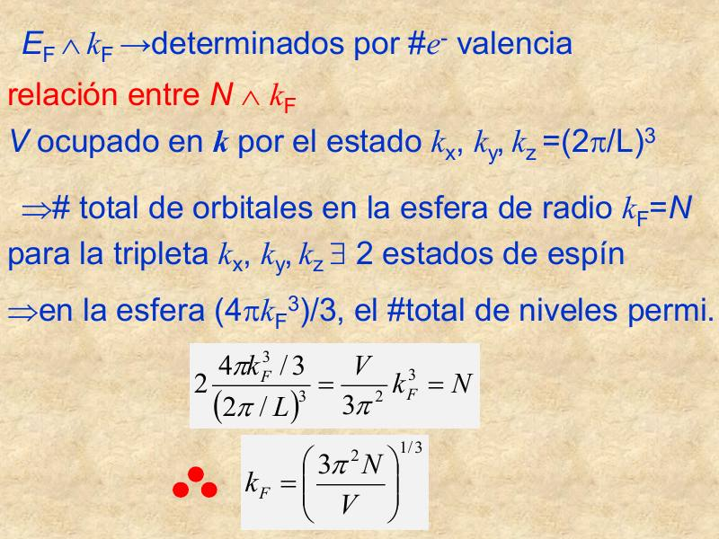
*Metales 2021, diap. 66: $2\cdot\frac{4\pi k_F^3/3}{(2\pi/L)^3}=N$ ⇒ $k_F=(3\pi^2N/V)^{1/3}$.*

- **Estimación para Na (diap. 67):** bcc, $a=4.2$ Å, 2 átomos/celda ⇒ $N/V=3\times10^{22}$ cm⁻³; $k_F\approx10^8$ cm⁻¹; $E_F\approx3.5$ eV; $T_F\approx40\,000$ K; $v_F\sim10^6$ m/s. *(Con $a=4.225$ Å y $\hbar$, $m$ exactos sale $E_F=3.24$ eV; la diapositiva usa números redondeados — ver `practica/P04`.)*

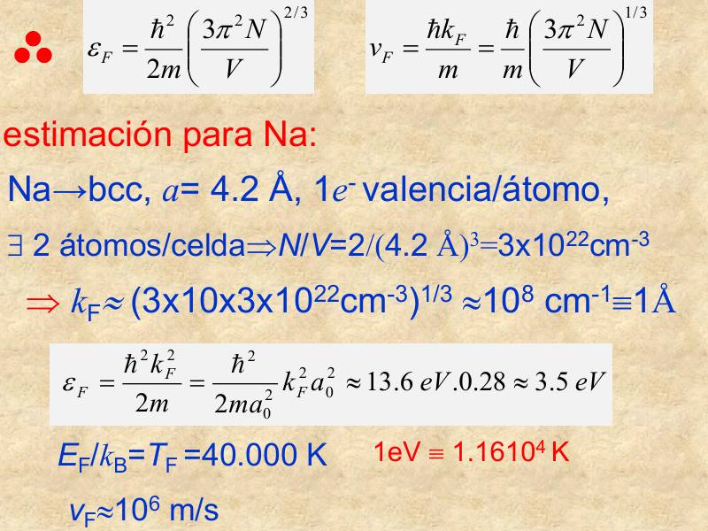
*Metales 2021, diap. 67: $\varepsilon_F$, $v_F$ y estimación para el Na (3.5 eV, 40 000 K, $10^6$ m/s).*

- **Pavlov (pp. 203-204):** el mismo resultado contando celdas de fase $(2\pi\hbar)^3/V$ en el espacio de impulsos (6.48-6.49) y $N=\int_0^\infty2VN(E)f\,dE$ (6.55) ⇒ $E_F(0)=\tfrac{\hbar^2}{2m}(3\pi^2n)^{2/3}$ (6.56).

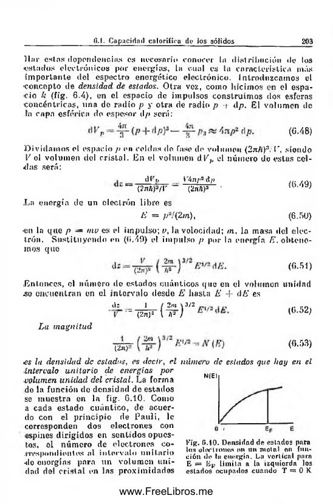
*Pavlov, Cap. 6, §6.1, p. 203: esfera de impulsos y celdas de fase (6.48-6.49); densidad de estados $N(E)$ (6.52-6.53), Fig. 6.10.*

*Pavlov, Cap. 6, §6.1, p. 204: $N=\int2VN(E)f\,dE$ (6.55) y $E_F(0)$ (6.56).*

- **Velocidad media (examen):** $\langle v\rangle=\tfrac34v_F$ a $T=0$ y $\langle E\rangle=\tfrac35E_F$ (no están en las diapositivas; se deducen en `practica/P04`).

---

## `fermi3d.2` — Densidad de estados $D(\varepsilon)$, energía, presión

- **Definición (diap. 68):** $N(\varepsilon)=\dfrac V{3\pi^2}\left(\dfrac{2m\varepsilon}{\hbar^2}\right)^{3/2}$ y

$$D(\varepsilon)=\frac{dN}{d\varepsilon}=\frac V{2\pi^2}\left(\frac{2m}{\hbar^2}\right)^{3/2}\varepsilon^{1/2}$$

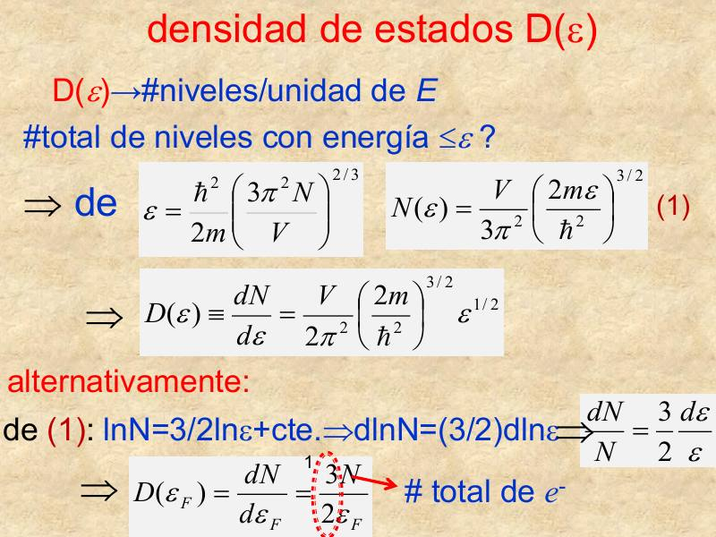
*Metales 2021, diap. 68: $N(\varepsilon)$ y $D(\varepsilon)\propto\varepsilon^{1/2}$.*

- **Atajo (diap. 68-69):** $\ln N=\tfrac32\ln\varepsilon+$cte ⇒ $dN/N=\tfrac32\,d\varepsilon/\varepsilon$ ⇒ $\boxed{D(E_F)=\dfrac{3N}{2E_F}}$.
- **Ocupación (diap. 69-70):** $N=\int_0^{E_F}D\,d\varepsilon$ a $T=0$ y $N=\int_0^\infty Df\,d\varepsilon$ a $T>0$; $D\cdot f$ = densidad de orbitales llenos (cola difusa de ancho $\sim k_BT$ en $E_F$).

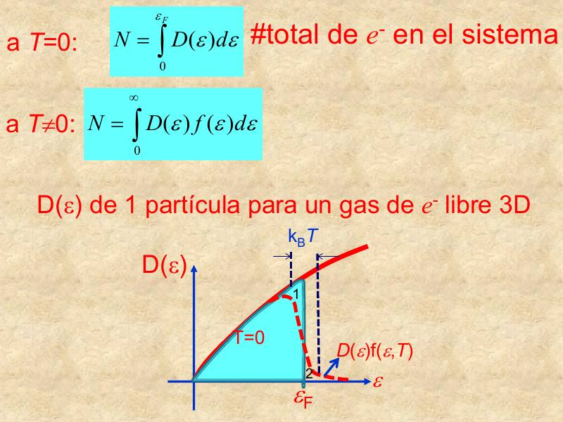
*Metales 2021, diap. 69: $N=\int Df\,d\varepsilon$ y $D(\varepsilon)$ para un gas 3D (curva $\propto\varepsilon^{1/2}$ cortada en $E_F$).*

*Pavlov, Cap. 6, §6.1, p. 203 (Fig. 6.10): densidad de estados $N(E)=\frac1{(2\pi)^2}(2m/\hbar^2)^{3/2}E^{1/2}$ (6.53), por espín y por volumen.*

- **Energía y presión a $T=0$ (de talleres, no de las diapositivas):** $E_0=\int_0^{E_F}\varepsilon D\,d\varepsilon=\tfrac35NE_F$; $P=-\partial E_0/\partial V=\tfrac25nE_F$; $B=-V\partial P/\partial V=\tfrac23nE_F$ (usa $E_F\propto V^{-2/3}$). Pavlov da $U_e(T)=U_e^0+\tfrac{\pi^2}{6}(k_BT)^2N[E_F(0)]$ (6.63, p. 206).

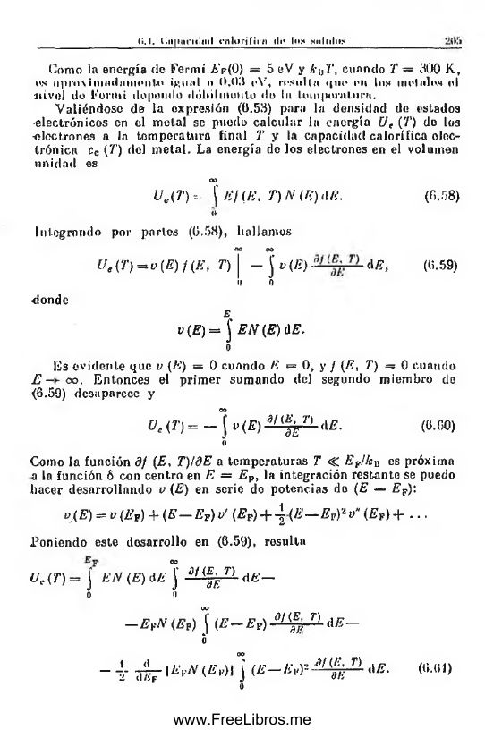
*Pavlov, Cap. 6, §6.1, p. 205: energía de los e⁻ $U_e(T)=\int Ef\,N\,dE$ (6.58), integración por partes (6.59-6.61).*

---

## Checklist de teoría (T04)

- [ ] T.fermi3d.1.1 Ventaja de las condiciones periódicas y ondas planas $e^{i\mathbf k\cdot\mathbf r}$ con $k_i=2\pi n_i/L$ ($n_i$ enteros ±)
- [ ] T.fermi3d.1.2 Derivar $k_F$ y $E_F$ contando estados en la esfera (factor 2 de espín; volumen por estado $(2\pi/L)^3$)
- [ ] T.fermi3d.1.3 Calcular $E_F$, $T_F$, $v_F$ desde $N/V$ (Na, Cu) y comparar con la diap. 67
- [ ] T.fermi3d.1.4 $\langle v\rangle=\tfrac34v_F$ y $\langle E\rangle=\tfrac35E_F$ a $T=0$
- [ ] T.fermi3d.2.1 Derivar $N(\varepsilon)\propto\varepsilon^{3/2}$, $D(\varepsilon)\propto\varepsilon^{1/2}$ y $D(E_F)=3N/2E_F$
- [ ] T.fermi3d.2.2 Usar $N=\int Df$ y entender qué muestra $D\cdot f$
- [ ] T.fermi3d.2.3 Obtener $E_0=\tfrac35NE_F$, $P=\tfrac25nE_F$ y $B=\tfrac23nE_F$ usando $E_F\propto V^{-2/3}$

## Galería completa de diapositivas 62-70

*Metales 2021, diap. 62*

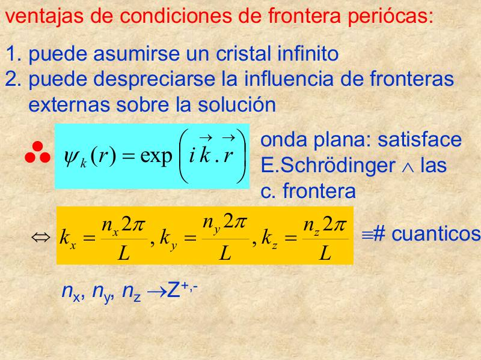
*Metales 2021, diap. 63*

*Metales 2021, diap. 64*

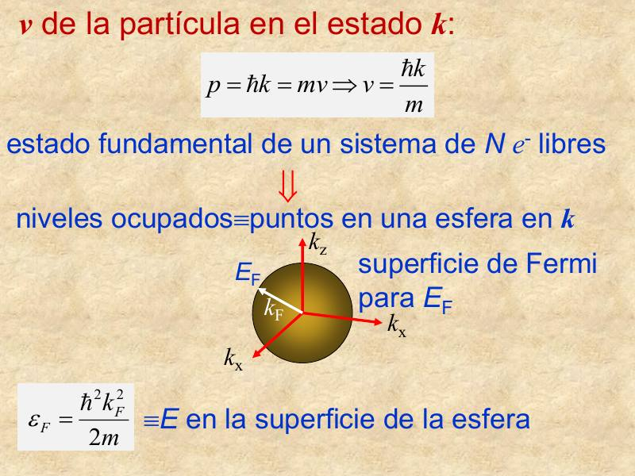
*Metales 2021, diap. 65*

*Metales 2021, diap. 66*

*Metales 2021, diap. 67*

*Metales 2021, diap. 68*

*Metales 2021, diap. 69*

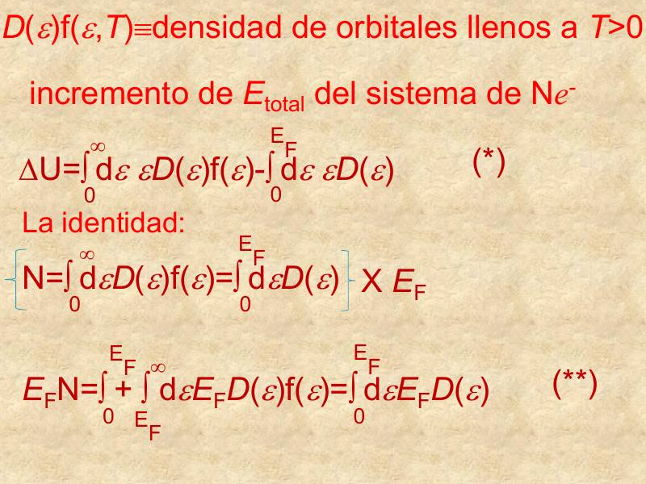
*Metales 2021, diap. 70*

