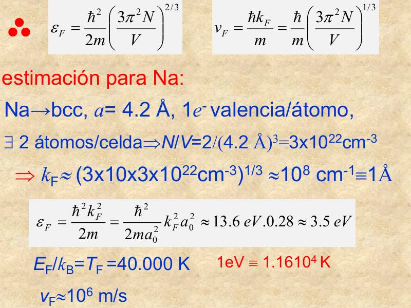
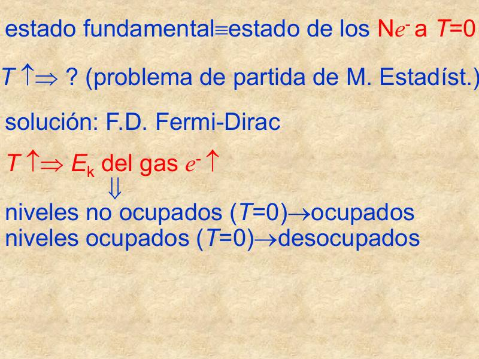
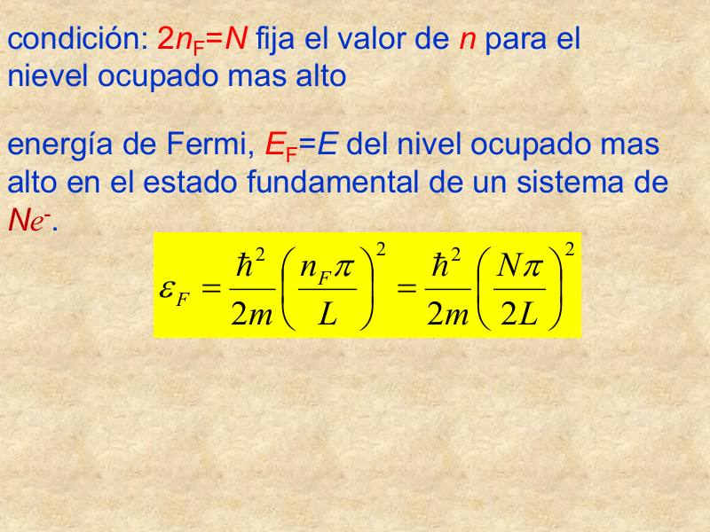
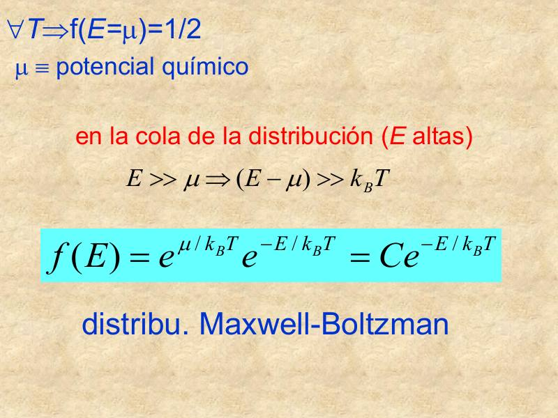
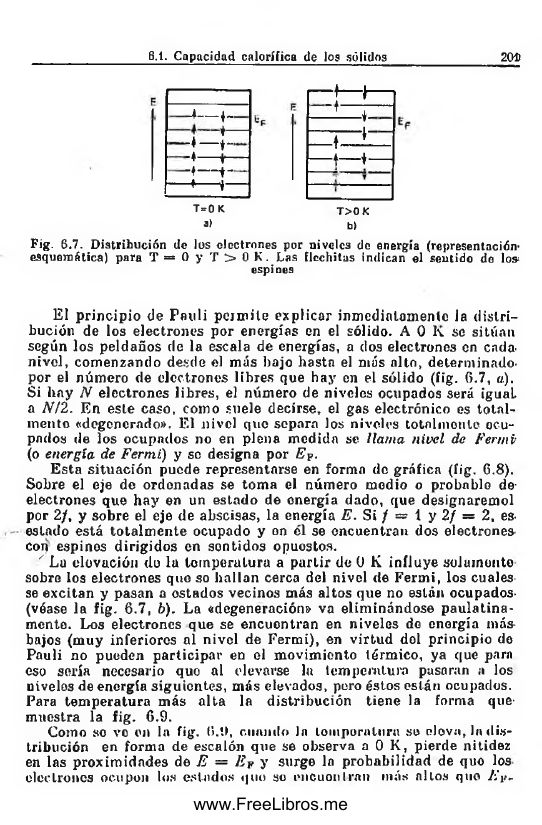
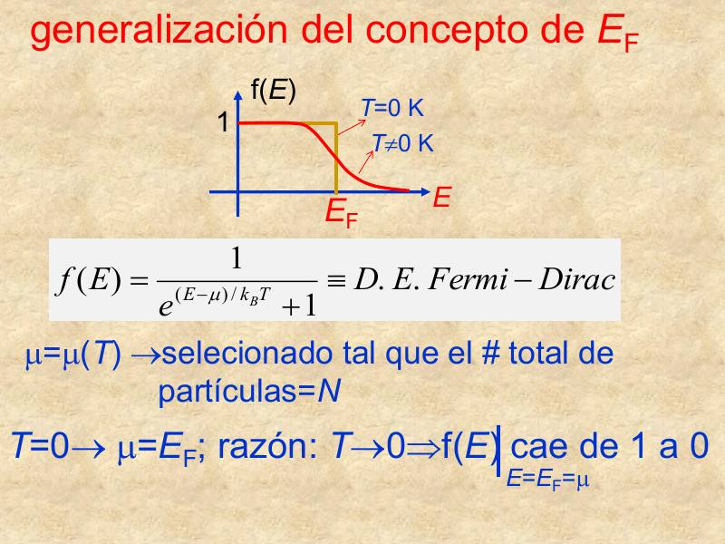
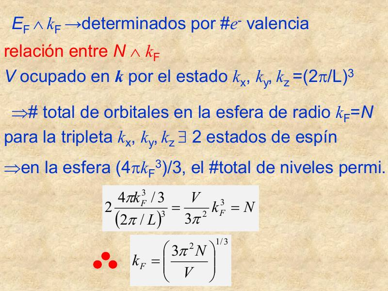

# T05 · Escalas astrofísicas/relativistas y definición de $E_F$ (`extra.3`, `vib.6`)

> **Alcance:** `extra.3` y `vib.6` **no vienen de las diapositivas**: salen de preguntas de examen (`T-2025-II #3`, `P-2025-2S #2`, `P-2026-1S #11`). No llevan `[p. N]` propio; se apoyan en las diapositivas 18, 56, 60-61 y 66 y en Pavlov §6.1. Teoría base: `notas/06_temas_de_examen_fuera_del_pdf.md` (§21) y `notas/07_vibraciones_para_parcial_2026_1S.md` (§27).

## Fuentes exactas

| Subtema | Diapositivas | Pavlov (libro, página impresa) | Examen | Imágenes |
|---|---|---|---|---|
| `extra.3` | 66-67 (fórmula de $k_F$, $E_F$) | **Cap. 6, §6.1, pp. 203-204** (6.56). *El límite relativista no está en el libro.* | `T-2025-II #3`, `P-2025-2S #2` | `slide_p66/p67`, `pavlov_p204` |
| `vib.6` | 18, 56, 60-61 (def. de $E_F$, $\mu(T)$) | **Cap. 6, §6.1, pp. 201-202** (nivel de Fermi, Fig. 6.7-6.8) | `P-2026-1S #11` | `slide_p56/p60/p61`, `pavlov_p201/p202` |

---

## `extra.3` — Estrellas y límite relativista

- **Número de e⁻:** $N\approx M/m_p$ (un e⁻ por protón; con neutrones, $N\approx M/2m_p$). Sol, $M=2\times10^{30}$ kg ⇒ $N\approx1.2\times10^{57}$.
- **No relativista:** $E_F=\dfrac{\hbar^2}{2m}(3\pi^2n)^{2/3}$ con $n=N/V$ (misma fórmula de la diap. 66-67).

*Metales 2021, diap. 67: $\varepsilon_F$ y $v_F$ a partir de $N/V$ — la fórmula que se aplica a la estrella.*

- **Cuándo deja de valer:** si $E_F\gtrsim mc^2=0.511$ MeV (equivale a $v_F\to c$).
- **Límite ultrarrelativista:** $E=pc=\hbar kc$ con el **mismo** conteo de estados (mismo $k_F$) ⇒
$$\boxed{E_F\approx\hbar c\,(3\pi^2n)^{1/3}\sim\hbar c\,(N/V)^{1/3}}$$
- **Resultados de examen:** enana blanca $R=2\times10^9$ cm: $n=3.6\times10^{34}$ m⁻³, $E_F\approx4\times10^4$ eV $\approx0.08\,mc^2$ (casi no relativista); pulsar $R=10$ km: $n\approx2.9\times10^{44}$ m⁻³, $E_F\approx4\times10^8$ eV; Sol colapsado ($R=7\times10^8$ m): $E_F\approx32$ eV, $T_F\approx3.7\times10^5$ K, $\langle v\rangle=\tfrac34v_F\approx2.5\times10^6$ m/s.
- **Honestidad sobre las fuentes:** el libro de Pavlov **no** trata el límite relativista; esto es conocimiento estándar (no del PDF), así que se cita siempre la pregunta de examen.

*Pavlov, Cap. 6, §6.1, p. 204: $E_F(0)=\frac{\hbar^2}{2m}(3\pi^2n)^{2/3}$ (6.56), de donde parte el cálculo no relativista.*

## `vib.6` — Definición de $E_F$ a $T=0$ (`P-2026-1S #11`)

**$E_F$ es la energía del estado cuántico ocupado más alto en el estado fundamental del gas de e⁻ ($T=0$).** Lo que **no** es:

| Opción del examen | ¿Qué describe en realidad? |
|---|---|
| a. energía promedio de los e⁻ | $\langle E\rangle=\tfrac35E_F$ |
| c. estado ocupado más bajo | $E=0$ (ε en $k=0$) |
| d. nivel con probabilidad 0.5 | $\mu(T>0)$, $f(\mu)=\tfrac12$ (diap. 61) |
| e. energía para sacar el e⁻ del metal | función trabajo $\phi=E_{vac}-E_F$ |

*Metales 2021, diap. 56: estado fundamental = estado de los $N$ e⁻ a $T=0$.*

*Metales 2021, diap. 18: $E_F$ = energía del nivel ocupado más alto en el estado fundamental de $N$ e⁻ (1D).*

*Metales 2021, diap. 61: $\mu=\mu(T)$, $f(\mu)=\tfrac12$ y a $T=0$, $\mu=E_F$ (la opción d describe $\mu$, no $E_F$).*

*Pavlov, Cap. 6, §6.1, p. 201: "el nivel que separa los ocupados de los no ocupados se llama nivel de Fermi ($E_F$)".*

---

## Checklist de teoría (T05)

- [ ] T.extra.3.1 Estimar $N$ de una estrella ($N\approx M/m_p$) y calcular $E_F$ no relativista
- [ ] T.extra.3.2 Reconocer cuándo $E_F\gtrsim mc^2$ y usar $E_F\approx\hbar c(3\pi^2n)^{1/3}$; dar $T_F$, $v_F$ y $\langle v\rangle=\tfrac34v_F$
- [ ] T.vib.6.1 Definir $E_F$ a $T=0$ como el nivel ocupado más alto y distinguirlo de $\mu(T)$, de $\tfrac35E_F$ y de la función trabajo

## Imágenes de apoyo

*Metales 2021, diap. 60: generalización del concepto de $E_F$ a $\mu(T)$.*

*Metales 2021, diap. 66: relación entre $N$ y $k_F$.*
